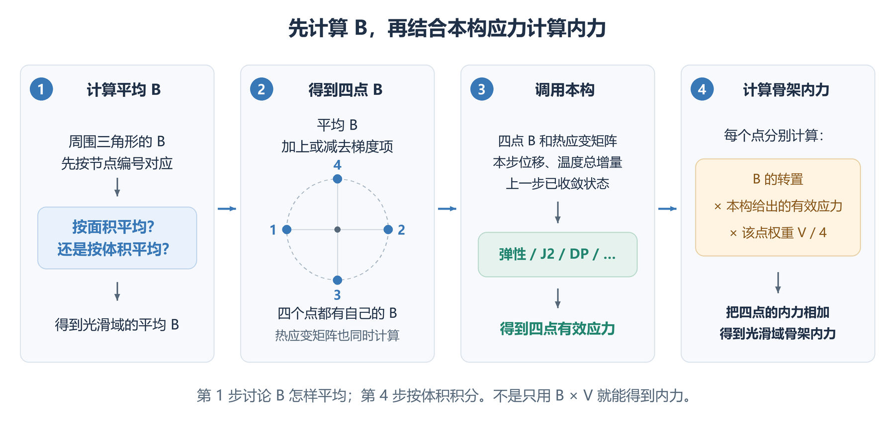

# Axisymmetric SNS-FEM formulation

本文讨论小变形轴对称 THM 的 SNS-FEM 离散，包括光滑域几何、四个虚拟积分点、耦合残差与切线，以及机械体积力和 Darcy 重力项。公式按本文的符号与章节独立说明；已有检查结果和新增检查要求在第 14 节分别列出。

## 0. 物理范围与符号约定

采用与新的正在撰写的手稿一致的假设：小应变、准静态、固定参考几何、单一均匀且各向同性的材料、不可压缩固体颗粒 $K_s\to\infty$，以及标量 Biot 系数 $b=1$。孔隙率及水力、热学系数取给定参考值，不随位置或当前未知量更新。机械体力允许是已知的空间和时间函数，但不依赖当前 Newton 未知量；Darcy 定律中的重力加速度采用给定常向量。含一般体力不意味着材料非均匀，也不意味着可把机械体力自动解释成作用于流体的加速度。

体力、重力加速度和混合物参考密度分别写为

$$
\boldsymbol f(\boldsymbol x,t)=[f_r,f_z]^T,
\qquad
\boldsymbol g=[g_r,g_z]^T,
\qquad
\rho=(1-n)\rho_s+n\rho_f.
$$

其中 $\boldsymbol f$ 是**单位总体积的机械体力**，量纲为力/体积；$\boldsymbol g$ 是重力加速度，量纲为长度/时间平方。纯重力时 $\boldsymbol f=\rho\boldsymbol g$；$z$ 轴向上时 $\boldsymbol g=[0,-g]^T$。若还含有其他机械体力，应将它加到 $\boldsymbol f$ 中，但不得因此把 Darcy 定律中的 $\boldsymbol g$ 替换为 $\boldsymbol f/\rho$。后者会改变模型中流体受到的作用，不能仅由力学平衡方程推出。

本文使用以下物理符号：

| 记号 | 含义 |
| --- | --- |
| $n$ | 均匀参考孔隙率；边界单位外法向另写 $\boldsymbol n_{\mathrm{out}}$。 |
| $c_s,c_f$ | 固、液两相的单位质量比热容；不是本构切线 $C_{kg}^{\mathrm{ep}}$。 |
| $S$ | 储水系数；PPP 稳定化矩阵写作 $S_{\mathrm{PPP}}$。 |
| $\beta_T$ | 温度—流体含量耦合系数。 |
| $C_T$ | 混合物单位总体积的热容量，使用大写 $C$。 |
| $\boldsymbol q_f$ | 相对固体、按总截面积计的 Darcy 体积通量，不是孔隙内真实流速。 |
| $n_{\mathrm{node},k}$ | 光滑域 $k$ 涉及的节点数，不是孔隙率。 |

在 $b=1$ 的设定下，孔压耦合直接使用几何列向量 $\boldsymbol m$，不再引入独立的张量型 Biot 参数：

$$
\boldsymbol m=[1,1,1,0]^T,
\qquad S=\frac{n}{K_f},
\qquad \beta_T=3[(1-n)\alpha_s+n\alpha_f],
\qquad C_T=(1-n)\rho_sc_s+n\rho_fc_f.
$$

**材料参数不带光滑域下标 $k$。** 例如 $n,K_f,\alpha_s,\alpha_f,\rho_s,\rho_f,c_s,c_f,k_f,\gamma_f,k_T,S,\beta_T,C_T$ 在整个计算域内相同。几何量 $V_k$、局部矩阵 $K_{ab}^k$、节点向量 $\boldsymbol U_k$ 及积分点状态 $\boldsymbol\sigma'_{kg},C_{kg}^{\mathrm{ep}}$ 仍保留位置索引。均匀材料的各积分点可以经历不同加载路径，因此应力、塑性变量和算法切线未必相同。

本构的四分量应力顺序为 $[rr,zz,\theta\theta,rz]$，应变的第 4 项使用工程剪应变 $\gamma_{rz}=2\varepsilon_{rz}$。矩阵分量排列与张量所选基的排列必须明确对应，不能混用剪切应变因子。

水力传导系数 $k_f$ 与导热系数 $k_T$ 均为常标量。若程序接口需要二维矩阵，则分别传入 $k_f I_2$ 与 $k_T I_2$；$I_2$ 是二维单位矩阵，正文公式直接使用标量。以下 Darcy 重力采用给定竖向常量 $\boldsymbol g=[0,-g]^T$，机械一般体力则允许是已知的 $\boldsymbol f(\boldsymbol x,t)$。

## 1. 已确定的前提与光滑方案

采用小变形轴对称模型，不考虑绕轴扭转。材料采用第 0 节的均匀、各向同性及 $b=1$ 设定。$r,z$ 分别为径向、轴向坐标，$r\geq0$，$\theta$ 表示环向角度。$u,p,T$ 分别表示位移、孔隙水压力和温度；$B$ 是将节点位移换算为应变的矩阵。保留把 $u,p,T$ 放在同一个方程组中求解的做法：变形与孔压相互影响，温度变化影响变形和孔压。**热对流可通过 `Keyword.HeatAdvection` 开关选择；第 8 节统一给出含重力的通量、残差和切线。** 关闭时，温度方程不依赖位移和孔压；开启时，孔压通过 Darcy 速度影响温度，但仍不加入由变形率、孔压变化率直接产生的热量项，具体见第 8.5 节。不更新网格，采用位移、孔压、温度的整体耦合求解。实现时逐场检查绝对和相对残差，避免零载荷 patch 的零除；必要时将 Newton 更新减半重试，每次本构试算仍使用上一步已收敛状态。已有结果与新增检查要求分别见第 14 节。

**已确定：所有光滑操作均按四边形子域的实际旋转体积加权。平均 B 的环向应变行改用原始 $N_I/r$ 的精确体积积分，其余行沿用体积平均；计算 B 的梯度时，仍用第 4.1 节的单元中心矩阵 $B_e$ 作为 $\widehat B$，并保留径向修正。四个虚拟点仍采用$\ell_k=\sqrt{A_k/\pi}$的点距及每点 $V_k/4$ 的权重。** 平均环向行的计算见第 4.3 节；平均矩阵与梯度的不同处理见第 5.3 节。

下面标明已确定的内容。后文的面积平均、其他环向近似和重新布点方案，仅用于比较和解释。

| 事项 | 已确定内容 |
| --- | --- |
| 光滑子域体积 | **已确定。** 使用四边形子域的实际旋转体积，不用母三角形旋转体积的 $1/3$，也不用四个顶点的平均半径代替子域面积形心半径。 |
| 光滑平均 | **已确定。** B、N、E 均按体积平均；平均 B 的环向行使用 $\int (N_I/r)\,\mathrm{d}V=2\pi\int N_I\,\mathrm{d}A$，不再平均中心值 $1/(3r_{ec})$。 |
| B 的梯度 | **已确定。** 用第 4.1 节的单元中心近似的 $B_e$ 作为 $\widehat B$，按第 5.3 节计算，包含径向修正；E 的体积加权梯度同样包含第 7.3 节的径向修正。 |
| 四个虚拟点 | **已确定。** 保留点距 $\ell_k=\sqrt{A_k/\pi}$，每点权重为 $V_k/4$，不再乘该点半径，暂不重新布点或改成不等权。改成轴对称后的精度和稳定性仍需验证。 |
| 热应变与耦合 | **已确定。** 热应变继续使用光滑温度及其梯度；$K_{12}$ 使用更新后的常数 NS 矩阵与原始 T3 型函数的子域积分，不要求定义四个虚拟点上的原始 T3 型函数。 |
| 热对流 | **可开关；含重力形式见第 8 节。** $\rho_f c_f$ 按常数处理，Darcy 速度与温度梯度均用四点 $\widetilde E_{kg}$，温度试函数用 $\widetilde N_{kg}$ 插值，每点权重仍为 $V_k/4$。温度残差及其对孔压、温度的导数一起加入，见第 8.5 节。 |
| 子域积分、PPP | **已确定。** 四边形子域采用 $3\times3$ Gauss 积分；PPP 使用母三角形的体积平均压力，积分也按实际旋转体积计算，系数沿用固定弹性参考参数。 |
| 轴线、圆弧 | **已确定。** 轴线只因轴对称条件约束 $u_r=0$；圆弧先用直线段逼近，各段使用自己的外法向，荷载积分保留 $2\pi r$。 |

下文区分公式推导、已有检查记录与实现时仍需完成的验证。

## 2. 先看清光滑域，再区分面积、体积和组装

### 2.1 一个完整光滑域由哪些部分组成

先选一个网格节点 $k$。在每个与它相连的三角形中，依次连接“节点 $k$—一侧边的中点—三角形的面积形心—另一侧边的中点”，得到一个四边形。

**$D_{ke}$ 是三角形 $e$ 内的这一个四边形；$D_k$ 是围绕节点 $k$ 的所有这些四边形合在一起的区域。** 下文把三角形 $e$ 称为“母三角形”，只是说明 $D_{ke}$ 属于哪个单元。

**图 1。** 左图中，所有蓝色四边形合起来才是 $D_k$。右图只放大其中一个三角形：蓝色四边形是 $D_{ke}$，其余部分属于该三角形另外两个顶点的光滑域。橙色轮廓表示同一个母三角形。一个完整光滑域通常跨越多个三角形，一个子域则只占其中一个三角形的一部分。计算光滑域的矩阵时，要用到这些母三角形的全部节点，包括图中位于蓝色区域外的三角形顶点。

### 2.2 面积、旋转体积与虚拟点距离

$A_{ke}$ 是四边形 $D_{ke}$ 在 r–z 平面内的面积；$V_{ke}$ 是它绕 z 轴旋转一周后的体积。$A_k,V_k$ 则分别表示完整光滑域的面积、旋转体积。因此，

$$
\boxed{A_k=\sum_{e\ni k}A_{ke},\qquad V_k=\sum_{e\ni k}V_{ke}}
$$

这里 $e\ni k$ 表示“遍历所有包含节点 $k$ 的三角形”。面积和体积都是标量，直接相加即可。

$$
\mathrm{d}A=\mathrm{d}r\mathrm{d}z,\qquad \mathrm{d}V=2\pi r\,\mathrm{d}A,\qquad \mathrm{d}S=2\pi r\,\mathrm{d}s.
$$

$$
A_k=\int_{D_k}\,\mathrm{d}A,\qquad V_k=\int_{D_k}2\pi r\,\mathrm{d}A,\qquad \ell_k=\sqrt{A_k/\pi}.
$$

$r$ 是到旋转轴的距离，$A_k$ 是二维面积，$V_k$ 是旋转一周后的体积，$\ell_k$ 是构造四个虚拟点矩阵时使用的偏移距离。式中的 $\mathrm{d}s$ 是平面内的一小段边长，$\mathrm{d}S$ 是这段边旋转后对应的表面积。当前轴对称代码用 `virtualPointDistance = sqrt(domain.area/pi)` 计算 $\ell_k$，与径向坐标 $r$ 区分。

**轴对称内力、刚度等要按体积积分，但不能把代码中每一个面积都换成体积。** 例如，$\ell_k=\sqrt{A_k/\pi}$ 表示与光滑域面积相等的圆的半径；如果改为 $\sqrt{V_k/\pi}$，结果的单位就不再是长度。

如果所有体积分和表面积分都含有 $2\pi$，可以把这个公共因子一起约去。这样算出的位移、孔压和温度不变，但统计完整一圈的总力、总流量时，仍需把 $2\pi$ 乘回来。建议直接保留 $2\pi$：长度用 m、应力用 kPa 时，等效节点力就是 kN。基本应变公式和半径在积分中的位置可参见 [FEniCSx 轴对称弹性示例](https://bleyerj.github.io/comet-fenicsx/tours/linear_problems/axisymmetric_elasticity/axisymmetric_elasticity.html)；下面有关 SNS 离散的讨论按本笔记中的几何与组装定义展开。

### 2.3 组装：按节点编号对齐，再相加

本文统一用 $\operatorname{Assemble}$ 表示组装。它的意思就是：**把对应节点自由度的行或列，按节点编号和自由度类型对齐，再相加。** 刚度矩阵需要对齐行和列；B、N、E 只需对齐节点列，它们的应变、标量或梯度分量行保持原顺序。位移的径向与轴向分量、孔压、温度分别对应各自的位置。面积仍写成 $A$。

例如，只看每个节点的一个标量贡献（数值仅用于示意）。三角形 1 的节点依次为 4、8、12，三角形 2 的节点依次为 4、12、19。按节点编号对应后，组装结果是：

| 节点编号 | 4 | 8 | 12 | 19 |
| --- | ---: | ---: | ---: | ---: |
| 三角形 1 的贡献 | 2 | 5 | 7 | 0 |
| 三角形 2 的贡献 | 3 | 0 | 11 | 13 |
| 组装后的贡献 | 5 | 5 | 18 | 13 |

这些数字只用于说明组装。三角形 1 的第 3 个节点和三角形 2 的第 2 个节点都是节点 12，所以对应的 7 和 11 要相加。刚度矩阵组装时，行和列都按这个规则对应。

| 写法 | 相加的范围 |
| --- | --- |
| $\operatorname*{Assemble}_{e\ni k}[\cdots]$ | 只取与节点 $k$ 相连的三角形，将它们的贡献按光滑域 $k$ 的节点顺序对齐后相加。 |
| $\operatorname*{Assemble}_{k}[\cdots]$ | 遍历所有光滑域，将它们的贡献按全局节点顺序对齐后相加。 |
| $\operatorname*{Assemble}_{e}[\cdots]$ | 遍历所有母三角形，将它们的贡献按全局节点顺序对齐后相加。 |

图 1 说明的是“哪些四边形组成一个光滑域”；组装说明的是“这些单元或光滑域的矩阵怎样对应相加”。

### 2.4 后文共用的记号

下面几种记号会反复出现：

| 记号 | 本文含义 |
| --- | --- |
| $k,e,I$ | 分别是光滑域中心节点编号、母三角形编号、参与插值的节点编号；$i,j,l$ 也用于标记三角形的三个顶点。$D_{ie}$ 就是以顶点 $i$ 为中心、位于三角形 $e$ 内的子域，与 $D_{ke}$ 是同一种记法。 |
| $g=1,2,3,4$ | 同一光滑域内的四个虚拟点编号；后文的 $\sum_g$ 均对这四点求和。 |
| $\widetilde B_{kg},\widetilde N_{kg},\widetilde E_{kg}$ | 波浪号标记 SNS 虚拟点矩阵；下标 $kg$ 依次表示光滑域 $k$、虚拟点 $g$，不是两者相乘。它们与单元矩阵 $B_e,N_e,E_e$、横线标记的平均矩阵区分。 |
| 上标 $A,V$ 与横线 | $A,V$ 标明按二维面积、旋转体积加权，不是乘方；横线表示相应平均值。省略 $A,V$ 时，表示采用正在讨论的那种平均方案。 |
| $\boldsymbol x=[r,z]^T$、$\boldsymbol x_I=[r_I,z_I]^T$ | 分别为积分位置、节点 $I$ 的坐标。右上角 $T$ 表示转置，与温度 $T$ 区分。 |
| $N_I$、$N_e$ | $N_I$ 是节点 $I$ 的原始 T3 型函数；$N_e$ 是母三角形三个型函数组成的行向量。省略下标的 $N$ 按上下文表示型函数或该行向量。 |
| $\boldsymbol U,\boldsymbol P,\boldsymbol T$ | 分别为节点位移、孔压、温度组成的列向量。加下标 $k$ 时，只取光滑域 $k$ 涉及的节点；局部矩阵也按这组节点排列。 |
| $\Delta$ | 相对于上一个已收敛时间步的增量，例如 $\Delta\boldsymbol T$ 是当前时间步的试算温度总增量；$\Delta t$ 是时间步长。 |
| $\delta\boldsymbol P,\delta\boldsymbol T$ | 第 8.5 节计算切线时，对当前试算孔压、温度施加的独立小扰动；不是从上一步收敛状态算起的 $\Delta\boldsymbol P,\Delta\boldsymbol T$。 |

矩阵块 $K_{ab}^{k}$ 的上标 $k$ 表示光滑域 $k$ 的局部贡献；不带这个上标的 $K_{ab}$ 表示组装后的全局矩阵。下标 $a,b$ 标记方程和未知量，具体对应见第 8 节。正文中的向量用粗体表示；B、N、E 等矩阵则保留与代码接近的字母写法。

**本文的试函数（test function）统一使用字母 v，用下标区分方程、粗体区分向量与标量。** 力学方程的试函数为虚位移向量 $\boldsymbol v_u=[v_r,v_z]^T$，其中 $v_r,v_z$ 分别是径向、轴向分量；孔压方程的试函数为标量 $v_p$；温度方程的试函数为标量 $v_T$。下标 $u,p,T$ 标明所属方程，各方程中的试函数独立选取。每个弱式前都会说明其含义。

**偏导数与标签分开写。** 为避免歧义，本文将空间偏导直接展开，例如 $\frac{\partial N_I}{\partial r}$、$\frac{\partial p}{\partial r}$，不用下标逗号表示求导。下列已命名离散量中保留的逗号只分隔标签或索引，**不表示再求一次导数**：

| 标签型逗号的例子 | 逗号分隔的内容 |
| --- | --- |
| $G_{B,r,k},G_{E,z,k}$ | 矩阵种类 B/E、方向 r/z、光滑域 k；整个 G 是第 5、7 节定义的梯度近似矩阵。 |
| $\overline E_{r,k}^{V},\overline E_{z,k}^{V}$；$n_{\mathrm{out},r},n_{\mathrm{out},z}$ | E 的径向/轴向行及所属域；外法向的径向/轴向分量。这里的 r、z 是分量标签。 |
| $B_{e,I},N_{u,e},I_{N,k}^{V}$；$n_{\mathrm{node},k}$ | 单元与节点列块、位移插值与单元、N 的积分与光滑域；节点计数与光滑域。 |
| $\boldsymbol f_{u,k},\boldsymbol f_{T,k},\boldsymbol F_{u,I},\boldsymbol F_{u,k}$；$f_{r,k},f_{z,k}$ | 力学/热量贡献及所属节点或光滑域；局部体力的径向/轴向分量及所属域，均不是导数。 |
| $\boldsymbol G_{p,k},\boldsymbol q_{f,kg}$ | 流体方程的重力载荷、流体通量，以及所属域/虚拟点。$\boldsymbol G_{p,k}$ 不是对 p 或 k 求导。 |

上标中的 $V,\mathrm c$、$V,\mathrm{incomplete}$、$\mathrm{adv,grav}$，以及 $K_{33\mathrm{Adv,grav}}$ 中的逗号，也只分隔方案或贡献标签。例如 $n_{\mathrm{out},r}$ 表示外法向的径向分量，其含义与偏导运算不同。函数自变量、向量分量和并列公式之间的普通逗号仍按通常标点理解。

## 3. 四边形光滑子域的体积如何计算

### 3.1 三角形的体积可以用三角形中心计算

母三角形顶点为 $i,j,l$，面积为 $A_e$；$r_i,r_j,r_l$ 是三个顶点的半径，$r_{ec}$ 是三角形面积形心的半径，$V_e$ 是该三角形旋转一周的体积。因为 $r$ 在直边三角形上是线性函数，所以

$$
r_{ec}=\frac{r_i+r_j+r_l}{3},\qquad V_e=2\pi A_e r_{ec}
$$

是精确几何公式。

### 3.2 子域体积一般不是三角形体积的三分之一

节点 $i$ 对应的四边形依次连接“节点 $i$—边 $ij$ 中点—三角形中心—边 $il$ 中点”。它的面积确实是 $A_e/3$。计算旋转体积时，需要用它的**面积形心**，也就是把四边形看成均匀薄片时的重心：

$$
\boldsymbol x_{ie}^{A}=\frac{22\boldsymbol x_i+7\boldsymbol x_j+7\boldsymbol x_l}{36}.
$$

这里 $\boldsymbol x_{ie}^{A}$ 是子域 $D_{ie}$ 的面积形心坐标，$A_{ie}=A_e/3$ 是子域面积，$V_{ie}$ 是其真实旋转体积。因此

$$
\boxed{V_{ie}=2\pi\frac{A_e}{3}\frac{22r_i+7r_j+7r_l}{36}.}
$$

将四边形沿“节点—三角形中心”分成两个等面积小三角形后分别积分，即可得到这个结果。它满足

$$
V_{ie}+V_{je}+V_{le}=V_e,
$$

但一般不满足 $V_{ie}=V_e/3$。对子域 $i$，等式 $V_{ie}=V_e/3$ 成立的条件是 $2r_i=r_j+r_l$。

例如，取三角形的三个顶点为 $(r,z)=(0,0),(1,0),(0,1)$，按此顺序将顶点局部编号为 $1,2,3$。三个子域面积相等，但旋转体积分配为

$$
\frac{V_{1e}}{V_e}=\frac{7}{36},\qquad \frac{V_{2e}}{V_e}=\frac{22}{36},\qquad \frac{V_{3e}}{V_e}=\frac{7}{36}.
$$

**图 2。** 左图按实际坐标画出三个子域，右图用相同颜色比较面积占比和体积占比。这里的分数只对应这个三角形，不是所有网格的固定分配比例。

远离旋转轴的子域，转一圈后扫过的体积更大。另外，轴线节点虽然 $r_i=0$，但它的光滑域仍向轴线外侧延伸，旋转后的体积不为零。

**旧手稿中的子域体积计算错误：** 旧手稿用母三角形的中心半径 $r_{ec}$ 计算四边形子域体积，即采用 $2\pi r_{ec}A_{ke}$，这一处理不正确：它将母三角形的旋转体积平均分成三份，一般不等于各四边形子域的实际旋转体积。这里必须使用四边形子域的实际旋转体积，按该子域面积形心的半径计算，具体公式见本节上文。本文采用这一正确的体积计算方式。

### 3.3 四个顶点的平均坐标不等于面积形心（注意）

上述四边形的顶点平均坐标记为 $\boldsymbol x_{ie}^{\mathrm{vertices}}$，其中上标 $\mathrm{vertices}$ 只标明“顶点平均”：

$$
\boldsymbol x_{ie}^{\mathrm{vertices}}=\frac{14\boldsymbol x_i+5\boldsymbol x_j+5\boldsymbol x_l}{24},
$$

它一般不等于 $\boldsymbol x_{ie}^{A}$。原 markdown 文件（本讨论整理前的技术笔记）记录的参考函数 `Smooth_T3_axisym.m` 使用 `xc_sub=(x1+xm1+xc+xm3)/4`，该表达式计算的是顶点平均，而非面积形心。以下按该表达式分析其后果，不把记录等同于对源码的重新验证。

若按上述记录，用 `N_ino/center_SD_ino` 计算 B 的环向应变行，分子取精确的面积平均，分母取四个顶点的平均半径，则两者不对应。对上面的单三角形、节点 1 和 $u_r=r$，由此得到 $\varepsilon_{\theta\theta}=14/15$，正确值应为 $1$。这是对上述表达式的条件推导，不能据此认定旧手稿中的“子域形心”也指四顶点平均坐标。

该记录还指出，单元中心近似写法在参考函数中被注释掉了。本文的平均环向行采用第 4.3 节的精确体积平均，因此不使用四顶点平均半径；第 4.1 节的单元中心近似只用于计算 B 的梯度。

## 4. B 矩阵应该按面积平均，还是按体积平均

先区分两个问题：**怎样平均 B**，以及**怎样用 B 和应力计算内力**。前一个问题决定光滑矩阵；后一个问题要对 B 的转置与有效应力的乘积作体积积分，不能只把 B 乘体积就当作内力。

记 $\boldsymbol\sigma$ 为总应力向量，$\boldsymbol\sigma'$ 为有效应力向量，撇号在应力符号上表示“有效”，不表示求导。$\boldsymbol f_{u,k}^{\mathrm{skel}}$ 是光滑域 $k$ 对相关节点的骨架内力贡献，$\mathrm{skel}$ 表示固体骨架；它包含这组节点的径向、轴向分量，不只是中心节点的力。$\widetilde B_{kg}$、$\boldsymbol\sigma'_{kg}$ 分别是该域第 $g$ 个虚拟点的 B 矩阵和有效应力。骨架内力的体积积分，以及本文讨论的四点近似写法为

$$
\boldsymbol f_{u,k}^{\mathrm{skel}}=\int_{D_k}B^T\boldsymbol\sigma'\,2\pi r\,\mathrm{d}A\ \approx\ \frac{V_k}{4}\sum_{g=1}^{4}\widetilde B_{kg}^{T}\boldsymbol\sigma'_{kg}.
$$

**图 3。** 有效应力来自本构更新，输入的位移、温度增量**均从上一步已收敛状态算起**，表示当前时间步的试算总增量，不是单次 Newton 修正量。四个虚拟点分别计算应力和内力，再把内力组装相加。图中只表示骨架内力，孔压产生的内力仍单独组装。图中第 1 步的选择现已确定：采用体积平均，其中环向行按第 4.3 节精确积分；第 4 步则使用每点 $V_k/4$ 的体积积分权重。

### 4.1 两种平均方式

应变向量按下面的顺序排列：$\varepsilon_{rr},\varepsilon_{zz},\varepsilon_{\theta\theta}$ 是径向、轴向、环向正应变，$\gamma_{rz}=2\varepsilon_{rz}$ 是 r–z 面的工程剪应变，$\varepsilon_{rz}$ 是应变张量的剪切分量。$u_{rI},u_{zI}$ 是节点 $I$ 的两个位移分量：

$$
\boldsymbol\varepsilon=[\varepsilon_{rr},\varepsilon_{zz},\varepsilon_{\theta\theta},\gamma_{rz}]^T,\qquad \boldsymbol u_I=[u_{rI},u_{zI}]^T.
$$

型函数的径向、轴向偏导分别写为 $\frac{\partial N_I}{\partial r}$、$\frac{\partial N_I}{\partial z}$。采用母单元中心环向值的近似，记母三角形 $e$ 的顶点 $I$ 两个位移自由度对应的两列为 $B_{e,I}$；单元矩阵 $B_e$ 由该三角形三个节点的这类列块组成：

$$
B_{e,I}=\begin{bmatrix}
\dfrac{\partial N_I}{\partial r}&0\\[10pt]
0&\dfrac{\partial N_I}{\partial z}\\[10pt]
\dfrac{1}{3r_{ec}}&0\\[10pt]
\dfrac{\partial N_I}{\partial z}&\dfrac{\partial N_I}{\partial r}
\end{bmatrix}.
$$

这里把 $N_I/r$ 在母三角形中心取值，得到 $1/(3r_{ec})$，并在该单元内按常数使用。它不等于这个函数在每个四边形子域上的精确平均。为保留原来的比较，先列出对这套中心矩阵按面积、体积平均的两种写法。体积平均的上标 $\mathrm c$ 标记“仍使用中心环向值的旧方案”；第 4.3 节给出新方案的 $\overline B_k^V$。

$$
\begin{aligned}
\overline B_k^A&=\frac{1}{A_k}\operatorname*{Assemble}_{e\ni k}\left[A_{ke}B_e\right],\\
\overline B_k^{V,\mathrm c}&=\frac{1}{V_k}\operatorname*{Assemble}_{e\ni k}\left[V_{ke}B_e\right].
\end{aligned}
$$

给定 $u_r=\varepsilon_{r0}r,\ u_z=\varepsilon_{z0}z+u_{z0}$，其中 $\varepsilon_{r0},\varepsilon_{z0}$ 是这项检查选定的常数应变，$u_{z0}$ 是轴向平移量。两种平均方式都能算出正确的应变 $[\varepsilon_{r0},\varepsilon_{z0},\varepsilon_{r0},0]^T$。**但“应变算对了”还不够，还要检查：用它算出的节点内力是否平衡。**

### 4.2 为什么采用体积平均

为看清原因，先比较 B 的体积积分，此处还没有乘应力。按体积平均有一个好处：每个光滑域的平均 B 乘回它的体积，再组装求和，就等于每个母单元的 B 乘以单元体积后组装求和：

$$
\operatorname*{Assemble}_k\left[V_k\overline B_k^{V,\mathrm c}\right]=\operatorname*{Assemble}_e\left[V_eB_e\right].
$$

对于第 4.1 节的单元中心近似的环向行，还有（注意 $1/r$ 会被 $\mathrm{d}V$ 中的 $2\pi r$ 因子抵消）

$$
V_e\frac{1}{3r_{ec}}=\frac{2\pi A_e}{3}=\int_e\frac{N_I}{r}\,\mathrm{d}V.
$$

B 其余各行中的 T3 型函数导数都是常数。因此，组装后的结果与原始轴对称 T3 的 $\int B\,\mathrm{d}V$ 相同。**当应力处处相同时，应力可以从积分中提出，所以按体积平均 B 的光滑方法与原始轴对称 T3 得到的节点内力也相同。** 这个相等关系是**所有单元组装后的结果**；它不表示第 4.1 节的单元中心近似在每个子域内都完成了精确积分。

若 B 按面积平均，上面关于 B 积分的相等关系一般就不成立。它对内力有多大影响，可以用一个小网格检查：四个角点为 $(1,0),(3,0),(3,2),(1,2)$，内部点为 $(1.7,0.8)$，内部点与四条外边组成四个三角形。这个检查取孔压为零，因此有效应力等于总应力。令应力处处相同：

$$
\sigma_{rr}=\sigma_{\theta\theta}=1,\qquad \sigma_{zz}=\sigma_{rz}=0
$$

这里 $\sigma_{rr},\sigma_{zz},\sigma_{\theta\theta}$ 是三个正应力，$\sigma_{rz}$ 是 r–z 面剪应力。这个应力状态满足无体力时的平衡方程，因此内部节点的合内力应为零。此时四点（SNS 的虚拟积分点）有效应力相同，四个 B 的平均又等于光滑 B，所以前面的内力公式简化为

$$
\boldsymbol f_{u,k}^{\mathrm{skel}}=V_k\overline B_k^{T}\boldsymbol\sigma'.
$$

保留第 4.1 节的单元中心近似，分别把面积平均和体积平均得到的 B 代入这个内力公式。原 markdown 文件记录的这个无体力检验结果如下：

| B 的平均方式 | 内部节点径向内力 | 同一网格计算均匀应变的误差 |
| --- | ---: | ---: |
| 面积平均 | $3.4867281154$ | $8.9\times10^{-16}$ |
| 体积平均 | $-1.8\times10^{-15}$ | $8.9\times10^{-16}$ |

这里长度用 m、应力用 kPa，内力就是 kN。外边界施加与上述应力对应的表面荷载，内部节点没有外荷载。可见，在这个均匀应力检验中，使用面积平均的 B 计算骨架内力，即使按实际体积积分，也会产生不平衡内力。采用其他修正办法的面积光滑方法，需要另作判断。

若相邻单元中心的半径相差不大，两种平均结果可能接近。这个理由在远离轴线、单元尺寸远小于半径（$h/r\ll1$，h 为单元尺寸）时比较合理；轴线附近或不规则网格不一定满足这个条件。本文已采用体积平均。下面改用精确平均环向行后，上述组装后的 B 积分相等关系仍然成立；变化的是各光滑域内的环向系数。

### 4.3 已采用的改动：平均环向行使用精确体积积分

将整个光滑域的面积形心半径定义为 $\overline r_k^A=V_k/(2\pi A_k)$，则平均环向系数满足（仍然注意 $1/r$ 会被 $\mathrm{d}V$ 中的 $2\pi r$ 因子抵消）

$$
\frac{1}{A_k\overline r_k^A}\int_{D_k}N_I\,\mathrm{d}A=\frac{1}{V_k}\int_{D_k}\frac{N_I}{r}\,\mathrm{d}V.
$$

也就是说，上述表达式配合正确的面积形心半径，得到的就已经是 $N_I/r$ 的体积平均。如果再把这两式中的面积全部换成体积，会得到另一种结果，例如 $\int rN_I\,\mathrm{d}A/\int r^2\,\mathrm{d}A$，与上式不同。

**新方案采用这个精确体积平均，只改平均 B 的环向应变行。** 记 $\overline h_{kI}^V$ 为平均环向应变中乘在节点径向位移 $u_{rI}$ 前面的系数，则

$$
\boxed{\overline h_{kI}^V=\frac{1}{V_k}\sum_{e\ni k}\int_{D_{ke}}\frac{N_I}{r}\,\mathrm{d}V=\frac{2\pi}{V_k}\sum_{e\ni k}\int_{D_{ke}}N_I\,\mathrm{d}A.}
$$

若节点 $I$ 不属于某个母三角形，该三角形对这一系数的贡献为零。这里仍然是体积平均，只是分母中的 $r$ 与体积微元中的 $r$ 抵消了；不需要计算 $\int (N_I/r)\,\mathrm{d}A$，也不需要在轴线上求 $N_I/0$。

对于本文固定的“节点—边中点—单元中心—另一边中点”四边形，节点 $k,j,l$ 按母三角形顺序排列（见图 1），有精确公式

$$
\boxed{\int_{D_{ke}}[N_k,N_j,N_l]\,\mathrm{d}A=\frac{A_e}{108}[22,7,7].}
$$

新平均矩阵 $\overline B_k^V$ 的第 3 行径向位移列使用 $\overline h_{kI}^V$，第 3 行轴向位移列仍为零；第 1、2、4 行保持第 4.1 节的体积平均。这些行中的 T3 型函数导数本来就是常数，因此它们也等于原始 B 的精确体积平均。**计算梯度时仍使用中心矩阵 $B_e$，并不把这里的精确环向值代入第 5.3 节的梯度公式。**

## 5. 边界梯度近似：要先说明“梯度”指什么

### 5.1 B 的平均值和 B 的梯度分别计算

当前平面代码为每个光滑域保存 B 的平均值及两个方向的梯度。下面将这两个方向对应到轴对称模型的 r、z，分别记为平均值 $\overline B_k$、径向梯度 $G_{B,r,k}$、轴向梯度 $G_{B,z,k}$。$G$ 的下标依次标明矩阵种类 B、方向 r 或 z、光滑域编号 $k$，这些逗号仅按第 2.4 节分隔标签，不表示偏导；后面的 $G_{E,r,k},G_{E,z,k}$ 也按这个顺序写。B 的两个梯度矩阵用周围三角形的 B 值计算，用来得到四个虚拟点的 B。**它们不是对已经存为常数的 $\overline B_k$ 直接求导；若因此把它们设成零，就会去掉 SNS 原有稳定化作用。**

**按面积计算梯度时**，基本公式是沿光滑域边界积分，再除以光滑域面积。这是一种不同的离散选择；本文采用第 5.3 节的体积加权梯度，下面的面积公式仅用于比较，不能与体积公式直接混用：

$$
\begin{aligned}
G_{B,r,k}^{A}&=\frac{1}{A_k}\int_{\partial D_k}\widehat B\,n_{\mathrm{out},r}\,\mathrm{d}s,\\
G_{B,z,k}^{A}&=\frac{1}{A_k}\int_{\partial D_k}\widehat B\,n_{\mathrm{out},z}\,\mathrm{d}s.
\end{aligned}
$$

$\partial D_k$ 表示光滑域边界，两个公式分别计算径向、轴向梯度。$\widehat B$ 表示积分时使用的母单元 B 矩阵或其近似，帽号用来与平均矩阵 $\overline B_k$ 区分。积分前，各母单元矩阵的列都按光滑域 $k$ 的节点顺序排列；**该单元不含的节点对应列补零**。$\boldsymbol n_{\mathrm{out}}=[n_{\mathrm{out},r},n_{\mathrm{out},z}]^T$ 是边界的单位外法向，$n_{\mathrm{out},r},n_{\mathrm{out},z}$ 是两个方向的法向分量。相邻三角形的 B 值一般不同；即使每个三角形内部的 B 是常数，跨过单元边界时它仍会变化。**上式计算梯度时会计入这些差别，不能只在每个三角形内部求导、得到零后就结束计算。**

### 5.2 计算环向行的梯度时，N/r 应该在哪里取值

原始环向函数在 $r>0$ 时有

$$
\frac{\partial}{\partial r}\left(\frac{N_I}{r}\right)=\frac{1}{r}\frac{\partial N_I}{\partial r}-\frac{N_I}{r^2},\qquad \frac{\partial}{\partial z}\left(\frac{N_I}{r}\right)=\frac{1}{r}\frac{\partial N_I}{\partial z}.
$$

旧手稿采用的子域形心近似，没有在边界上直接计算 $N_I/r$，而是取子域面积形心处的 $N_I(r_{sc},z_{sc})/r_{sc}$；$(r_{sc},z_{sc})$ 是该子域面积形心的坐标，下标 $sc$ 用来标记它。面积形心不等于四顶点平均坐标。这样可以避免在轴线上除以零，但引入了近似。它既不等于上面导数公式的精确积分，也不能解释为对第 4.1 节的单元中心近似的常数值直接求导。

下面比较几种梯度近似。**目前已采用第一种；它只决定梯度里的 $\widehat B$，不改变第 4.3 节的精确平均环向行。**

| 计算梯度时使用的环向值 | 特点 |
| --- | --- |
| 采用第 4.1 节的母单元中心值 | **已采用。** 梯度由中心矩阵计算，便于预计算；平均环向行则单独精确积分。梯度仍忽略单元内部 $N/r$ 的变化，只通过相邻单元的差别计算。 |
| 采用子域面积形心处的环向值 | 这是上文用于比较的子域形心方案。实现时必须使用真正的面积形心，并注明平均 B 与梯度采用了不同的环向近似。 |
| 更精细地计算 $N/r$ 的积分或梯度 | 可减少对原始应变公式的近似，但必须先处理好轴线上的位移约束和零分母，实现也更复杂，建议留到后面比较。 |

前两种对均匀径向扩张都可能得到正确结果，不能仅凭这一项测试决定优劣。还需要检查厚壁圆筒等非均匀径向位移算例的响应，并进行轴线附近的网格收敛检查。

### 5.3 体积加权的梯度不能只把分母 A 换成 V

如果希望计算 $\widehat B$ 梯度的体积平均，沿边界积分时就要加入半径 r。对乘积求导后，公式变为

$$
\boxed{G_{B,r,k}^{V}=\frac{1}{V_k}\left[\int_{\partial D_k}2\pi r\widehat B\,n_{\mathrm{out},r}\,\mathrm{d}s-\int_{D_k}2\pi\widehat B\,\mathrm{d}A\right],}
$$

$$
\boxed{G_{B,z,k}^{V}=\frac{1}{V_k}\int_{\partial D_k}2\pi r\widehat B\,n_{\mathrm{out},z}\,\mathrm{d}s.}
$$

径向公式多出第二项，是因为 $\partial r/\partial r=1$；r 不随 z 变化，所以轴向公式没有这一项。边界积分和域内积分必须使用同一套 $\widehat B$，不能一个使用子域内部值，另一个使用单元中心值。相邻三角形的 B 值不同时，上述公式仍会计入跨单元的变化。这里计算的是固定网格上 B 的梯度，不涉及移动节点或重新计算网格位置。

可以用均匀应变检查这个新增项是否必要。若 $\widehat B\boldsymbol U_k=\boldsymbol\varepsilon_0$ 在光滑域内处处相同，其中 $\boldsymbol\varepsilon_0$ 是非零的均匀应变向量，应变梯度应该为零。省略径向公式的第二项，却会得到

$$
\begin{aligned}
G_{B,r,k}^{V,\mathrm{incomplete}}\boldsymbol U_k
&=\frac{1}{V_k}\left[\int_{\partial D_k}2\pi r\widehat B\,n_{\mathrm{out},r}\,\mathrm{d}s\right]\boldsymbol U_k\\
&=\frac{1}{V_k}\int_{\partial D_k}2\pi r(\widehat B\boldsymbol U_k)n_{\mathrm{out},r}\,\mathrm{d}s\\
&=\frac{2\pi}{V_k}\left[\int_{\partial D_k}r n_{\mathrm{out},r}\,\mathrm{d}s\right]\boldsymbol\varepsilon_0\\
&=\frac{2\pi}{V_k}\left[\int_{D_k}\frac{\partial r}{\partial r}\,\mathrm{d}A\right]\boldsymbol\varepsilon_0\\
&=\frac{2\pi}{V_k}\left[\int_{D_k}1\,\mathrm{d}A\right]\boldsymbol\varepsilon_0\\
&=\frac{2\pi A_k}{V_k}\boldsymbol\varepsilon_0\ne\boldsymbol 0.
\end{aligned}
$$

这里先代入 $\widehat B\boldsymbol U_k=\boldsymbol\varepsilon_0$，将常量应变提出积分；再用二维散度定理将边界积分转为面积积分，并利用 $\partial r/\partial r=1$。上标 $\mathrm{incomplete}$ 表示漏掉径向第二项的计算结果。也就是说，本来没有变化的应变会被算成有径向变化，四个虚拟点的应力和刚度因此受到影响。加上第二项后，结果才为零。

**已采用的做法：** 平均矩阵 $\overline B_k^V$ 按第 4.3 节计算，其中环向行精确积分；两个梯度仍用第 4.1 节的单元中心近似的 $B_e$ 作为 $\widehat B$，按上述公式计算。新增的径向项仍为 $\operatorname*{Assemble}_{e\ni k}\left[2\pi A_{ke}B_e\right]$，不能把它换成 $2\pi A_k\overline B_k^V$，否则就与梯度的边界积分使用了不同的 B。**精确的是平均环向行，梯度仍是中心矩阵给出的近似。**

压力、温度所用的梯度矩阵 $\widehat E$ 按相同方式计算其变化；这里每个母单元的原始矩阵为 $E_e=\nabla N_e$，其两行分别是型函数的径向、轴向导数。E 用来将节点孔压或温度换算成这两个方向的梯度，与力学 B 的四行含义不同。中心矩阵已能准确计算均匀应变，径向修正又使对应的应变梯度为零，所以更新平均环向行后，这项检查仍然成立。

作为比较，B 的平均值按体积算、梯度按原来的面积公式算，也可以构成另一种 SNS 方案，但不是目前采用的方案；它需要单独检查内力平衡和稳定性。

## 6. 四个虚拟点、V/4 与真实体积积分

### 6.1 先保留四个点，每点使用 V/4

按已确定的体积加权方案，使用第 4.3 节的平均矩阵和第 5.3 节的近似梯度，四个虚拟点的 B 矩阵写为：

$$
\begin{aligned}
\widetilde B_{k1}&=\overline B_k^V-\ell_kG_{B,r,k}^V,\qquad \widetilde B_{k2}=\overline B_k^V+\ell_kG_{B,r,k}^V,\\
\widetilde B_{k3}&=\overline B_k^V-\ell_kG_{B,z,k}^V,\qquad \widetilde B_{k4}=\overline B_k^V+\ell_kG_{B,z,k}^V.
\end{aligned}
$$

$$
W_{kg}=V_k/4,\qquad \frac14\sum_{g=1}^4\widetilde B_{kg}=\overline B_k^V.
$$

$W_{kg}$ 是第 $g$ 个虚拟点的体积积分权重，单位是体积。点 1、2、3、4 依次对应径向负、径向正、轴向负、轴向正的偏移。四个点的权重都为正，四个 B 相加除以四，正好得到平均的 NS 矩阵。下文的 $r_k$ 表示光滑域 $k$ 的中心节点到旋转轴的距离，$r_g$ 表示示意点的径向坐标（省略所属光滑域 $k$）。这样也能保留当前程序的四套塑性状态变量。

**用了 $V_k/4$，就不能再乘 $2\pi r_g$。** 因为计算体积时已经乘过半径，再乘就是重复计算。也不建议直接把权重设成 $2\pi r_gA_k/4$：若四个点围绕节点对称布置，四个权重之和是 $2\pi r_kA_k$，通常不等于光滑域的实际体积 $V_k$，轴线附近还可能出现零权重或负权重。

### 6.2 “四点乘体积”并不自动等于真实域上的精确积分

如果希望四个点精确计算随位置变化的 B 所产生的积分，仅让四个权重之和等于 $V_k$ 还不够。例如，计算刚度时，B 的分量会两两相乘，会出现位置偏移量的平方，因此还要检查这些平方项的积分是否正确。即使只看面积为 $A_k$、半径为 $\ell_k$ 的均匀二维圆盘，四个等权点放在圆周上时，径向偏移量的平方平均值也是（$\delta r_g$ 是第 $g$ 点相对圆盘中心的径向坐标差，$\delta r$ 是盘内一般位置的同类坐标差）：

$$
\frac14\sum_g\delta r_g^2=\frac{\ell_k^2}{2},
$$

真实圆盘区域在积分下标中记为 $\mathrm{disk}$，它满足

$$
\frac{1}{A_k}\int_{\mathrm{disk}}\delta r^2\,\mathrm{d}A=\frac{\ell_k^2}{4}.
$$

两者相差一倍。这说明，$\ell_k=\sqrt{A_k/\pi}$配合四个圆周点，不仅是在选积分点，也规定了 SNS 梯度项对刚度的贡献大小。因此，保留这四个点是在保留原 SNS 的一种稳定化做法，不能保证它精确积分任意光滑域；这个差别本身也不能用来判定原 SNS 方法错误。

如果后续希望重新选择点位，使这些位置相关的积分也与实际光滑域一致，可以先计算：

$$
\boldsymbol x_k^V=\frac{1}{V_k}\int_{D_k}\boldsymbol x\,\mathrm{d}V,\qquad \mathsf{Cov}_k^V=\frac{1}{V_k}\int_{D_k}(\boldsymbol x-\boldsymbol x_k^V)(\boldsymbol x-\boldsymbol x_k^V)^T\,\mathrm{d}V.
$$

第一个量 $\boldsymbol x_k^V$ 是按旋转体积加权的 r、z 平均坐标。它与计算 $V_k=2\pi A_k\overline r_k^A$ 时使用的面积形心不同，也不是整个旋转实体的三维重心。第二个量 $\mathsf{Cov}_k^V$ 是 $2\times2$ 矩阵，单位为长度平方，它的两个对角项分别是径向、轴向坐标偏移量平方的体积平均值，非对角项是两种偏移量乘积的体积平均值。这里的 $\mathsf{Cov}_k^V$ 是坐标的二阶中心矩矩阵。

若要让四点积分也得到同样的坐标平均值和二阶矩，可将四点围绕 $\boldsymbol x_k^V$ 布置，沿 $\mathsf{Cov}_k^V$ 的两个特征向量方向取偏移量 $\pm\sqrt{2\lambda_j}\boldsymbol v_j$，其中 $j=1,2$ 标记两个特征方向，$\lambda_j$ 是 $\mathsf{Cov}_k^V$ 的特征值，$\boldsymbol v_j$ 是对应的单位特征向量。不过这会改变原 SNS 的点间距离和稳定化作用，而且仍不能保证非线性本构产生的应力积分完全精确。

**已确定第一版不重新选择这四个点的位置。** 保留$\ell_k=\sqrt{A_k/\pi}$和四点等权，检查它改成轴对称后的精度和稳定性，再决定是否比较上面的新点位。

### 6.3 靠轴线的“负半径虚拟点”如何理解

当前虚拟点的 B 是直接按第 6.1 节的四个公式计算的，并不需要在该点的坐标处重新求型函数。因此，示意图上出现 $r_k-\ell_k<0$，不意味着程序要在负半径处计算 $N/r$ 或读取材料参数。只要预先算好的 B 和梯度不含零除等问题，内力计算就可以直接使用这些矩阵。

如果改成“先确定虚拟点坐标，再到那里计算型函数”，就必须重新处理轴线附近的点：例如重新布点和分配权重，或者明确规定怎样利用轴对称条件计算轴线另一侧的值。不能直接把负半径换成 $\lvert r_g\rvert$。建议第一版继续使用当前直接组合矩阵的做法。

## 7. 温度应变，以及压力、温度梯度如何处理

### 7.1 保留 SNS 的四点 E 矩阵

当前方案继续用 SNS 虚拟点矩阵计算渗流和热传导。为区分不同的 E，本文记原始 T3 型函数梯度为 $E_e=\nabla N_e$，常数 NS 矩阵为 $\overline E_k$，SNS 虚拟点矩阵为 $\widetilde E_{kg}$；其中 $k,g$ 分别标明光滑域和虚拟点。四点矩阵由平均 E 加减相应方向的梯度项得到。

热传导使用四点 $\widetilde E_{kg}$，热容量使用原始 T3 型函数；这里明确采用 SNS 梯度矩阵，不把热传导全部改成标准 FEM。关闭热对流时，温度方程不依赖 $u,p$；开启后，仍用四点 $\widetilde E_{kg}$ 计算 Darcy 速度和温度梯度，新增项见第 8.5 节。平面参考代码的 `CT1=0` 只表示没有额外加入类似 PPP 的温度项，E 中原有的 SNS 梯度项仍保留。节点光滑在瞬态导热中也可能出现积分不足造成的数值问题，保留这些梯度项有依据，见 [Cui 等关于稳态与瞬态导热的研究](https://doi.org/10.1016/j.ijthermalsci.2016.06.027)。

### 7.2 体积平均的温度与其梯度

采用前面的体积方案，统一定义

$$
\begin{aligned}
\overline N_k^V&=\frac{1}{V_k}\operatorname*{Assemble}_{e\ni k}\left[\int_{D_{ke}}N_e\,\mathrm{d}V\right],\\
\overline E_k^V&=\frac{1}{V_k}\operatorname*{Assemble}_{e\ni k}\left[\int_{D_{ke}}\nabla N_e\,\mathrm{d}V\right].
\end{aligned}
$$

T3 的 $\nabla N_e$ 在母单元内为常数，后一式可以直接用子域体积加权。注意 $\overline E_k^V$ 是“先求导、再平均”，不应当对已经存为常数的 $\overline N_k^V$ 直接求导而得到零。

这里 $\nabla=(\partial_r,\partial_z)^T$，$\partial_r,\partial_z$ 分别表示对 $r,z$ 求偏导。$\overline E_{r,k}^V$、$\overline E_{z,k}^V$ 分别是平均梯度矩阵 $\overline E_k^V$ 的第一行、第二行。继续定义

$$
\begin{aligned}
\widetilde N_{k1}&=\overline N_k^V-\ell_k\overline E_{r,k}^V,\qquad \widetilde N_{k2}=\overline N_k^V+\ell_k\overline E_{r,k}^V,\\
\widetilde N_{k3}&=\overline N_k^V-\ell_k\overline E_{z,k}^V,\qquad \widetilde N_{k4}=\overline N_k^V+\ell_k\overline E_{z,k}^V.
\end{aligned}
$$

$$
\Delta\boldsymbol\varepsilon_{kg}^{\mathrm{th}}=\alpha_s\boldsymbol m\widetilde N_{kg}\Delta\boldsymbol T_k,\qquad \boldsymbol m=[1,1,1,0]^T.
$$

$\alpha_s$ 是固体的线膨胀系数；$\boldsymbol m=[1,1,1,0]^T$ 将标量热膨胀量放入三个正应变分量，并使剪应变为零。$\Delta\boldsymbol\varepsilon_{kg}^{\mathrm{th}}$ 是第 $g$ 个虚拟点的热应变增量，上标 $\mathrm{th}$ 表示热应变。这里的 $\widetilde N_{kg}$ 将节点温度增量换算成该点用于计算热应变的温度增量。它由平均温度矩阵加减梯度项得到，不需要判断虚拟点落在哪个三角形里，再去求那个三角形的型函数。这与当前 `cal_Fint` 的做法相同。

均匀温升时必须有 $\overline N_k^V\boldsymbol 1=1$、$\overline E_k^V\boldsymbol 1=\boldsymbol 0$，其中 $\boldsymbol 1$ 是与节点数量对应的全 1 列向量，所以四个虚拟点获得相同热应变。在本文均匀材料假设下，无初始应力、无机械体力、无额外机械约束，且孔压保持 $p=0$ 时，自由膨胀位移为 $u_r=\alpha_s\Delta T r,\ u_z=\alpha_s\Delta T z$（$\Delta T$ 为均匀温升）。此时总应变减去热应变得到的机械应变为零，包括环向分量。**注意：** 不排水升温可能产生孔压，不能直接套用这一自由膨胀检查。

### 7.3 压力、温度的梯度没有 N/r 行

压力和温度的梯度仍然只有径向和轴向两个分量。轴对称给扩散方程带来的半径因子，已经包含在体积积分中。以热传导项为例：$D$ 表示整个 r–z 计算域，$k_T$ 是常标量导热系数，$v_T$ 是温度方程弱式中的标量试函数，在规定温度的边界上为零。它不是温度 $T$，也不是时间步温度增量 $\Delta T$：

$$
\int_D(\nabla v_T)^Tk_T\nabla T\,2\pi r\,\mathrm{d}A.
$$

上式已经考虑圆柱坐标的影响，不能再给热传导或 Darcy 的梯度矩阵添加一个类似机械环向应变的 $N/r$ 行，也不需要在刚度里重复增加 $1/r$ 项。

**E 的体积加权梯度同样需要径向修正。** 记 $G_{E,r,k}^{V},G_{E,z,k}^{V}$ 为计算四点 E 时使用的径向、轴向变化矩阵。采用第 5.3 节的体积方案时，

$$
\begin{aligned}
G_{E,r,k}^{V}&=\frac{1}{V_k}\left[\int_{\partial D_k}2\pi r\widehat E\,n_{\mathrm{out},r}\,\mathrm{d}s-\int_{D_k}2\pi\widehat E\,\mathrm{d}A\right],\\
G_{E,z,k}^{V}&=\frac{1}{V_k}\int_{\partial D_k}2\pi r\widehat E\,n_{\mathrm{out},z}\,\mathrm{d}s.
\end{aligned}
$$

这里 $\widehat E$ 在每个母三角形内取该单元的 $E_e$；各矩阵的节点列同样先按光滑域 $k$ 的节点顺序排列，**缺少的列补零**。它不含 $N/r$，而且在直边 T3 内是常数，所以新增的面积积分可以按各子域精确求和。**没有 $N/r$，不代表可以省略径向修正：这个修正来自体积权重中的 r。** 若积分时的 $\widehat E$ 处处相同，径向公式中的两项恰好抵消，结果为零。

例如前两个虚拟点使用

$$
\widetilde E_{k1}=\overline E_k^V-\ell_kG_{E,r,k}^{V},\qquad \widetilde E_{k2}=\overline E_k^V+\ell_kG_{E,r,k}^{V}.
$$

第 3、4 点分别减去、加上轴向项 $\ell_kG_{E,z,k}^{V}$。这里算的是相邻单元 E 值的空间变化，不是对已经存成常数的 $\overline E_k^V$ 直接求导。热应变中用于构造四点温度的 $\overline E_k^V$ 仍按第 7.2 节使用。

## 8. 内力、残差与刚度应该怎样一起修改

下面逐块说明单一均匀、各向同性且 $b=1$ 时的公式。矩阵块下标中的 $1,2,3$ 依次对应位移、孔压、温度：第一个数字表示方程，第二个数字表示求导的未知量；关闭对流时各块的实际正负号见第 8.4 节，开启后的新增项见第 8.5 节。$\boldsymbol m=[1,1,1,0]^T$ 是几何列向量，用来取三个法向应变之和，或将同一标量放入三个法向分量；孔压耦合使用它并不引入额外的材料参数。

所有光滑域使用同一组材料参数，但各虚拟点的应力、塑性变量和算法切线 $C_{kg}^{\mathrm{ep}}$ 可以不同。$C_{kg}^{\mathrm{ep}}$ 是本构返回的 $4\times4$ 算法切线矩阵，即有效应力对机械应变试算增量的导数；上标 $\mathrm{ep}$ 表示弹塑性，处于弹性时它就是弹性矩阵。因此这里保留状态索引 $kg$，不能因材料均匀就把所有积分点的切线当作同一常矩阵。局部矩阵仍按节点编号组装。

### 8.1 骨架内力、K11 与 K13

$$
\Delta\boldsymbol\varepsilon_{kg}^{\mathrm{mech}}=\widetilde B_{kg}\Delta\boldsymbol U_k-\alpha_s\boldsymbol m\widetilde N_{kg}\Delta\boldsymbol T_k,
$$

$$
\boldsymbol f_{u,k}^{\mathrm{skel}}=\sum_gW_{kg}\widetilde B_{kg}^T\boldsymbol\sigma'_{kg},
$$

$$
K_{11}^k=\sum_gW_{kg}\widetilde B_{kg}^TC_{kg}^{\mathrm{ep}}\widetilde B_{kg},\qquad K_{13}^k=\sum_gW_{kg}\widetilde B_{kg}^TC_{kg}^{\mathrm{ep}}\alpha_s\boldsymbol m\widetilde N_{kg}.
$$

$\Delta\boldsymbol\varepsilon_{kg}^{\mathrm{mech}}$ 是扣除热应变后的机械应变增量，上标 $\mathrm{mech}$ 表示机械部分；$\boldsymbol f_{u,k}^{\mathrm{skel}}$ 是光滑域 $k$ 的骨架内力贡献，下标 $u$ 表示力学方程。$K_{11}^k$ 是该域的力学切线贡献，$K_{13}^k$ 是温度经热应变影响力学方程的耦合贡献。由于总应变要扣除热应变，温度项带负号，因此全局矩阵中的对应块是 $-K_{13}$。**内力与切线必须使用同一组 $\widetilde B_{kg},\widetilde N_{kg},W_{kg}$**。例如，`cal_Ktan` 改成体积积分时，`cal_Fint` 必须一起改；B 和计算热应变的 N 也必须采用前面确定的同一套规则。

这些公式保留 J2、DP 以及后续其他本构接口。每轮 Newton 迭代都从上一个已收敛时间步的状态出发，由 UMAT 计算本轮试算的应力和算法切线。只有当前时间步收敛后，才保存四个虚拟点的本构状态，供下一步使用。MEX 使用预先算好的几何矩阵、组装所需的材料参数和最新算法切线，不负责本构更新。

### 8.2 K12 与 K21 继续采用常数 NS 矩阵

定义型函数的体积积分行向量 $I_{N,k}^V$；这里的 $I$ 只是积分结果的名称，不是单位矩阵，也不是节点编号：

$$
I_{N,k}^{V}=\operatorname*{Assemble}_{e\ni k}\left[\int_{D_{ke}}N_e\,2\pi r\,\mathrm{d}A\right].
$$

则

$$
\boxed{K_{12}^k=(\overline B_k^V)^T\boldsymbol m I_{N,k}^{V},\qquad K_{21}^k=(K_{12}^k)^T.}
$$

B 在光滑域内按常数使用，可以移到积分外面，剩下只对原始 T3 的 N 积分。这里不需要计算四个虚拟点处的原始 T3 型函数。按第 6 节的加减梯度写法，$\overline B_k^V$ 也正好等于四个 $\widetilde B_{kg}$ 的平均。组装后仍有 $K_{21}=K_{12}^T$。

如果已经计算 $\overline N_k^V=I_{N,k}^{V}/V_k$，也可以写成 $V_k(\overline B_k^V)^T\boldsymbol m\overline N_k^V$。但若仍使用旧的面积平均 $\overline N_k^A$，再乘 $V_k$，得到的通常不是同一个积分。

机械方程中的孔压项保持 $-K_{12}\boldsymbol P$，流体方程中的变形项保持 $K_{21}\Delta\boldsymbol U$。即使孔压处处相同，总应力中的 $-p\boldsymbol m$ 及边界上施加的力仍需共同满足平衡。**规定孔压仍不会自动施加机械壁面压力**。

### 8.3 储水、热容量、温度引起的孔压变化与扩散

令

$$
M_k^V=\operatorname*{Assemble}_{e\ni k}\left[\int_{D_{ke}}N_e^TN_e\,\mathrm{d}V\right],
$$

这里 $M_k^V$ 就是**把原始 T3 型函数的乘积按体积积分后得到的矩阵**（但注意积分区域不是一整个三角形）。以下材料系数在整个域内相同，均不带 $k$；下标 $s,f$ 分别标记固体颗粒、孔隙流体：

| 记号 | 含义 |
| --- | --- |
| $n$ | 孔隙率，对应 `Material.poro`；不是 DP 的摩擦角。 |
| $K_f$ | 孔隙流体的体积模量；固体颗粒采用 $K_s\to\infty$，这不表示多孔骨架不可压缩。 |
| $\alpha_s,\alpha_f$ | 固体线膨胀系数 $\alpha_s$；流体参数 $\alpha_f$ 取流体体积热膨胀系数的三分之一。 |
| $\rho_s,\rho_f$；$c_s,c_f$ | 两相的质量密度、单位质量比热容；小写 $c_s,c_f$ 与本构切线矩阵 $C^{\mathrm{ep}}$ 表示不同物理量。 |
| $k_f$；$\gamma_f$ | 各向同性水力传导系数（常标量，单位 m/s）；流体重度（单位体积的重量）。小写 $k_f$ 与大写体积模量 $K_f$ 不同，$k_f/\gamma_f$ 用于孔压梯度驱动的 Darcy 项。 |
| $k_T$ | 各向同性导热系数（常标量）。 |
| $S,\beta_T,C_T$ | 依次为固定总应变时的储水系数、温度引起流体含量变化的耦合系数、混合物单位总体积的热容量，由下面公式计算。 |

$$
S=\frac{n}{K_f},
$$

$$
\beta_T=3[(1-n)\alpha_s+n\alpha_f],\qquad C_T=(1-n)\rho_sc_s+n\rho_fc_f.
$$

则

$$
K_{22S}^k=SM_k^V,\qquad K_{23}^k=\beta_TM_k^V,\qquad K_{33X}^k=C_TM_k^V,
$$

$$
K_{22P}^k=\frac{k_f}{\gamma_f}\sum_gW_{kg}\widetilde E_{kg}^T\widetilde E_{kg},\qquad K_{33G}^k=k_T\sum_gW_{kg}\widetilde E_{kg}^T\widetilde E_{kg}.
$$

$K_{22S}$、$K_{22P}$ 分别为储水、Darcy 流动矩阵，$K_{23}$ 为温度引起流体含量变化的耦合矩阵，$K_{33X}$、$K_{33G}$ 分别为热容量、热传导矩阵。下标字母 $S,P,X,G$ 沿用代码中的矩阵名称，不是额外的物理变量。轴对称模型仍有三个法向应变和应力分量。这里 $\boldsymbol m^T\boldsymbol m=3$，所以体应变及热膨胀中的三个法向分量包含环向分量，不能因计算域是 r–z 平面就把 3 改为 2。

#### 8.3.1 含重力的 Darcy 通量与流体弱式

在本文 $b=1$ 的假设下，流体体积守恒和 Darcy 定律为

$$
\frac{\partial\varepsilon_v}{\partial t}
+S\frac{\partial p}{\partial t}
-\beta_T\frac{\partial T}{\partial t}
+\nabla\cdot\boldsymbol q_f=0,
\qquad
\boldsymbol q_f=-\frac{k_f}{\gamma_f}(\nabla p-\rho_f\boldsymbol g).
$$

上述时间导数均在固定参考位置取值。$\gamma_f$ 是参考流体重度；在“关闭重力”的数值测试中令 $\boldsymbol g=\boldsymbol0$，**不能同时把分母中的参考 $\gamma_f$ 设为零**。这里的 $k_f$ 是常标量。

为简写，定义在整个域内相同的标量水力迁移率

$$
H_f:=\frac{k_f}{\gamma_f},
$$

这里 $H_f$ 是标量，单位为 $\mathrm{m^2/(Pa\,s)}$，不是水力传导系数 $k_f$ 本身。下式中的乘法是标量与向量相乘；若使用矩阵接口，对应的矩阵为 $H_f I_2$。虚拟点上的通量为

$$
\boxed{
\boldsymbol q_{f,kg}
=-H_f\widetilde E_{kg}\boldsymbol P_k
+\rho_fH_f\boldsymbol g,
\qquad W_{kg}=V_k/4.
}
$$

这里压力梯度、重力驱动力和通量均用径向、轴向两个分量表示；没有环向梯度行。

#### 重力贡献为什么带负号

设 $v_p$ 为孔压方程中的标量试函数，在规定孔压的边界上为零。边界流量以入流为正，即 $\boldsymbol q_f\cdot\boldsymbol n_{\mathrm{out}}=-\overline q_{\mathrm{in}}$。因此

$$
\begin{aligned}
0={}&\int_D v_p
\left(\partial_t\varepsilon_v+S\partial_tp-\beta_T\partial_tT\right)\,\mathrm dV
-\int_D(\nabla v_p)^T\boldsymbol q_f\,\mathrm dV
-\int_{\Gamma_q}v_p\overline q_{\mathrm{in}}\,\mathrm dS\\
={}&\int_D v_p
\left(\partial_t\varepsilon_v+S\partial_tp-\beta_T\partial_tT\right)\,\mathrm dV
+\int_D(\nabla v_p)^TH_f\nabla p\,\mathrm dV\\
&-\int_D(\nabla v_p)^TH_f\rho_f\boldsymbol g\,\mathrm dV
-\int_{\Gamma_q}v_p\overline q_{\mathrm{in}}\,\mathrm dS.
\end{aligned}
$$

这一弱式同时确定了以下四项的正负号：压力扩散为正、重力驱动力为负、温度引起的流体含量变化为负、规定入流在残差中为负。即使 $\boldsymbol g$ 为常向量，也不能因局部 $\nabla\cdot(H_f\rho_f\boldsymbol g)=0$ 就删除重力弱式项；边界总通量的定义中包含重力部分。

采用与扩散矩阵相同的四点算子，定义

$$
\begin{aligned}
K_{22P}^k&=\sum_gW_{kg}\widetilde E_{kg}^TH_f\widetilde E_{kg},\\
\boldsymbol G_{p,k}&=\sum_gW_{kg}\widetilde E_{kg}^TH_f\rho_f\boldsymbol g,
\qquad
\boldsymbol G_p=\operatorname*{Assemble}_k[\boldsymbol G_{p,k}].
\end{aligned}
$$

从直接通量形式也可核对该符号：

$$
-\sum_gW_{kg}\widetilde E_{kg}^T\boldsymbol q_{f,kg}
=K_{22P}^k\boldsymbol P_k-\boldsymbol G_{p,k}.
$$

### 8.4 关闭热对流时：残差、总量与增量

令 $S_{\mathrm{PPP}}$ 表示已经乘上稳定化系数的 PPP 矩阵。下面把残差 $\boldsymbol R$ 定义为各方程左端减右端，平衡时 $\boldsymbol R$ 为零；$\boldsymbol R_u,\boldsymbol R_p,\boldsymbol R_T$ 分别为力学、流体质量、能量方程的残差向量。$\boldsymbol f_u^{\mathrm{skel}}$ 是组装后的骨架内力，$\boldsymbol F_u^{\mathrm{ext}}=\boldsymbol F_u^\Gamma+\boldsymbol F_u^{\mathrm{body}}$ 包括面力与第 12.4 节的体力贡献，上标 $\mathrm{ext}$ 表示外荷载。先写出 `Keyword.HeatAdvection = false` 时的残差，作为第 8.5 节加入对流的对照：

$$
\begin{aligned}
\boldsymbol R_u&=\boldsymbol f_u^{\mathrm{skel}}-K_{12}\boldsymbol P-\boldsymbol F_u^{\mathrm{ext}},\\
\boldsymbol R_p&=K_{21}\Delta\boldsymbol U+(K_{22S}+S_{\mathrm{PPP}})\Delta\boldsymbol P-K_{23}\Delta\boldsymbol T+\Delta t(K_{22P}\boldsymbol P-\boldsymbol G_p)-\boldsymbol Q_p^{\mathrm{step}},\\
\boldsymbol R_T&=K_{33X}\Delta\boldsymbol T+\Delta tK_{33G}\boldsymbol T-\boldsymbol Q_T^{\mathrm{step}}.
\end{aligned}
$$

$\boldsymbol Q_p^{\mathrm{step}},\boldsymbol Q_T^{\mathrm{step}}$ 分别是本步的节点流体体积和热量贡献，包含边界通量及可选域内源项；本文模型的域内源项为零。流入或加入为正，没有荷载时为零。代码分别使用 `dt*Load.Fp`、`dt*Load.FT`。速率随时间变化时，backward Euler 使用步末速率乘 $\Delta t$，一般不是精确的时间积分。对上述残差按节点未知量 $[\boldsymbol U;\boldsymbol P;\boldsymbol T]$ 求导，得到全局切线矩阵 $K$：

$$
K=\begin{bmatrix}
K_{11}&-K_{12}&-K_{13}\\
K_{21}&K_{22S}+S_{\mathrm{PPP}}+\Delta tK_{22P}&-K_{23}\\
0&0&K_{33X}+\Delta tK_{33G}
\end{bmatrix}.
$$

重力项 $-\Delta t\boldsymbol G_p$ 已显式写在流体残差中，不再重复并入 $\boldsymbol Q_p^{\mathrm{step}}$；它是水力驱动力，不是注入流体的体积源。给定参考密度、导率、几何和重力时，$\boldsymbol G_p$ 与当前未知量无关，故上述流体切线块不变。关闭热对流不等于关闭机械体力或 Darcy 重力。

机械方程的孔压项、Darcy 项使用当前孔压总量 $\boldsymbol P$，储水与 PPP 项使用当前时间步的孔压增量 $\Delta\boldsymbol P$。改成轴对称后，这个区别保持不变，PPP 项也不额外乘 $\Delta t$。在本节关闭对流的情况下，温度方程不依赖位移和孔压，所以 $K_{31},K_{32}$ 为零。平面参考代码中仅适用于特定弹性材料的 `A` 向量仍不启用；它是构造变形对温度方程直接影响时使用的四分量材料系数。下面加入 Darcy 热对流，并不等于恢复这类热量项。

### 8.5 开启热对流后：温度残差和切线怎样变化

#### 8.5.1 温度方程与假设

加入 Darcy 流体携带的热量后，轴对称温度方程为

$$
C_T\frac{\partial T}{\partial t}+\rho_f c_f\boldsymbol q_f\cdot\nabla T-\nabla\cdot(k_T\nabla T)=Q_T.
$$

$C_T,k_T$ 见第 8.3 节，$c_f$ 是流体单位质量比热容。时间导数在固定参考位置取值；固定几何下用节点温度的 backward Euler 差分计算。本节将参考 $\rho_f c_f$ 视为给定常量。$Q_T$ 是可选的单位总体积、单位时间热源，正值表示加热；本文模型取 $Q_T=0$。该简化热模型不另加机械体力功、塑性耗散或流动耗散项。

$\boldsymbol q_f=[q_f^{(r)},q_f^{(z)}]^T$ 是相对固体、按介质总截面积计算的 Darcy 体积通量。其含重力形式为

$$
\boldsymbol q_f=-\frac{k_f}{\gamma_f}(\nabla p-\rho_f\boldsymbol g).
$$

由于使用的是 Darcy 通量，对流项前面不再额外乘孔隙率。轴对称下，对流项仍为

$$
\boldsymbol q_f\cdot\nabla T=q_f^{(r)}\frac{\partial T}{\partial r}+q_f^{(z)}\frac{\partial T}{\partial z}.
$$

**没有额外的 $q_f^{(r)}T/r$ 项。** 积分中的 $2\pi r$ 由体积权重考虑；这里不对非保守形式的对流项作分部积分。

#### 8.5.2 从弱式到四个虚拟积分点

沿用第 7.3 节的温度试函数 $v_T$，新增的弱式贡献为

$$
\int_D v_T\rho_f c_f\boldsymbol q_f\cdot\nabla T\,2\pi r\,\mathrm{d}r\mathrm{d}z.
$$

对流项不作分部积分。设光滑域 $k$ 涉及 $n_{\mathrm{node},k}$ 个节点，标量试函数 $v_T$ 与温度采用相同的光滑型函数 $\widetilde N_{kg}$ 插值。在虚拟点 $g$，

$$
\begin{aligned}
(\nabla T)_{kg}&=\widetilde E_{kg}\boldsymbol T_k,\\
\boldsymbol q_{f,kg}&=-\frac{k_f}{\gamma_f}(\widetilde E_{kg}\boldsymbol P_k-\rho_f\boldsymbol g),
\qquad W_{kg}=\frac{V_k}{4}.
\end{aligned}
$$

$\widetilde N_{kg}$、$\widetilde E_{kg}$ 沿用第 7.2、7.3 节的 SNS 矩阵，尺寸分别为 $1\times n_{\mathrm{node},k}$、$2\times n_{\mathrm{node},k}$。$\boldsymbol P_k,\boldsymbol T_k$ 是当前试算孔压、温度的节点总值。Darcy 速度与温度梯度使用同一个点的 $\widetilde E_{kg}$。

分别取各节点对应的光滑型函数作为试函数 $v_T$，将四点积分得到的各节点贡献排成列向量，得到局部对流残差

$$
\boxed{
\boldsymbol f_{T,k}^{\mathrm{adv}}(\boldsymbol P_k,\boldsymbol T_k)
=\rho_f c_f\sum_{g=1}^{4}W_{kg}\widetilde N_{kg}^{T}
\left[\boldsymbol q_{f,kg}^{T}\widetilde E_{kg}\boldsymbol T_k\right].
}
$$

上标 $\mathrm{adv}$ 表示对流贡献。此向量含 $n_{\mathrm{node},k}$ 个分量，尚未乘时间步长。沿用第 6 节的四点近似，**每点权重为 $V_k/4$，不再乘 $2\pi r$ 或虚拟点半径**；$V_k$ 已是光滑域旋转后的体积。

#### 8.5.3 分别对温度和孔压求导

用 $\delta\boldsymbol T_k,\delta\boldsymbol P_k$ 表示当前试算值的独立扰动，与时间步增量 $\Delta\boldsymbol T_k,\Delta\boldsymbol P_k$ 区分。几何、参考材料系数和给定重力固定时，

$$
\begin{aligned}
\delta\boldsymbol q_{f,kg}&=-\frac{k_f}{\gamma_f}\widetilde E_{kg}\delta\boldsymbol P_k,\\
\delta(\nabla T)_{kg}&=\widetilde E_{kg}\delta\boldsymbol T_k.
\end{aligned}
$$

对速度与温度梯度的乘积求导，两部分都要保留：

$$
\begin{aligned}
\delta\boldsymbol f_{T,k}^{\mathrm{adv}}
=\rho_f c_f\sum_{g=1}^{4}W_{kg}\widetilde N_{kg}^{T}
\Bigg[&\boldsymbol q_{f,kg}^{T}\widetilde E_{kg}\delta\boldsymbol T_k\\
&-(\widetilde E_{kg}\boldsymbol T_k)^T
\frac{k_f}{\gamma_f}\widetilde E_{kg}\delta\boldsymbol P_k\Bigg].
\end{aligned}
$$

因此，新增的两个局部矩阵为

$$
\boxed{
K_{33\mathrm{Adv}}^k
=\frac{\partial\boldsymbol f_{T,k}^{\mathrm{adv}}}{\partial\boldsymbol T_k}
=\rho_f c_f\sum_{g=1}^{4}W_{kg}\widetilde N_{kg}^{T}
\boldsymbol q_{f,kg}^{T}\widetilde E_{kg},
}
$$

$$
\boxed{
K_{32\mathrm{Adv}}^k
=\frac{\partial\boldsymbol f_{T,k}^{\mathrm{adv}}}{\partial\boldsymbol P_k}
=-\rho_f c_f\sum_{g=1}^{4}W_{kg}\widetilde N_{kg}^{T}
(\widetilde E_{kg}\boldsymbol T_k)^T\frac{k_f}{\gamma_f}\widetilde E_{kg}.
}
$$

两者都是 $n_{\mathrm{node},k}\times n_{\mathrm{node},k}$ 矩阵，尚未乘 $\Delta t$，分别对应代码中的 `K33Adv`、`K32Adv`。前者固定孔压、对温度求导；后者固定温度、对孔压求导。两部分都需要加入 Newton 切线。$K_{33\mathrm{Adv}}$ 必须使用含重力的完整通量；固定参考密度、导率和重力时，$K_{32\mathrm{Adv}}$ 的公式不新增重力项，因为重力通量对孔压的偏导数为零。

**$K_{32\mathrm{Adv}}$ 不是 $K_{23}^T$：** 前者来自孔压对 Darcy 速度的影响，后者来自温度对流体含量的影响。对流矩阵一般不对称。

#### 8.5.4 时间离散、全局残差和切线分块

按第 2.3 节的规则组装：

$$
\begin{aligned}
\boldsymbol f_T^{\mathrm{adv}}&=\operatorname*{Assemble}_{k}[\boldsymbol f_{T,k}^{\mathrm{adv}}],\\
K_{33\mathrm{Adv}}&=\operatorname*{Assemble}_{k}[K_{33\mathrm{Adv}}^k],\qquad
K_{32\mathrm{Adv}}=\operatorname*{Assemble}_{k}[K_{32\mathrm{Adv}}^k].
\end{aligned}
$$

当前程序将温度方程整体乘以 $\Delta t$。因此，开启对流后的温度残差为

$$
\boxed{
\boldsymbol R_T
=K_{33X}\Delta\boldsymbol T
+\Delta t\left[K_{33G}\boldsymbol T+\boldsymbol f_T^{\mathrm{adv}}(\boldsymbol P,\boldsymbol T)\right]
-\boldsymbol Q_T^{\mathrm{step}}.
}
$$

对流使用孔压、温度的当前**总值**，热容量项使用温度增量。力学和流体残差的公式仍见第 8.4 节。

用 $K^{\mathrm{off}}$ 表示第 8.4 节的无对流矩阵，在**同一个当前试算状态**计算。加入对流后，

$$
\boxed{
K=K^{\mathrm{off}}+\Delta t
\begin{bmatrix}
0&0&0\\
0&0&0\\
0&K_{32\mathrm{Adv}}&K_{33\mathrm{Adv}}
\end{bmatrix}.
}
$$

矩阵中的 $0$ 表示相应尺寸的零块。**$K_{31}$ 仍为零，$K_{32}$ 一般不再为零。** 固定 $\boldsymbol P,\boldsymbol T$ 时，位移不直接改变对流项；在完整方程组中，位移仍可通过孔压间接影响温度。

定义纯重力通量和对应对流部分

$$
\boldsymbol q_f^{\mathrm{grav}}=\rho_fH_f\boldsymbol g,
\qquad
K_{33\mathrm{Adv,grav}}^k
=\rho_fc_f\sum_gW_{kg}\widetilde N_{kg}^T
(\boldsymbol q_f^{\mathrm{grav}})^T\widetilde E_{kg},
$$

$$
\boldsymbol f_{T,k}^{\mathrm{adv,grav}}(\boldsymbol T_k)
=K_{33\mathrm{Adv,grav}}^k\boldsymbol T_k.
$$

完整通量对孔压是仿射函数，因此正确恒等式是

$$
\boxed{
\begin{aligned}
\boldsymbol f_T^{\mathrm{adv}}(\boldsymbol P,\boldsymbol T;\boldsymbol g)
&=K_{33\mathrm{Adv}}(\boldsymbol P;\boldsymbol g)\boldsymbol T\\
&=K_{32\mathrm{Adv}}(\boldsymbol T)\boldsymbol P
+\boldsymbol f_T^{\mathrm{adv,grav}}(\boldsymbol T).
\end{aligned}
}
$$

无重力形式的 $\boldsymbol f_T^{\mathrm{adv}}=K_{32\mathrm{Adv}}\boldsymbol P$ 仅在重力对流贡献为零时成立；无重力是其充分条件。采用含重力的 `K33Adv` 后，`dt*K33Adv*Trial.T` 已包含完整对流残差，**不得再加** `dt*fAdvGrav`。若选择用 `K32Adv*P` 组装残差，则必须补上重力对流部分；这仍是同一残差的另一种写法。

对流含有孔压与温度的乘积，即使固体线弹性，方程也可能非线性。每轮 Newton 和每次 line search 试算都要更新这两个矩阵；几何仍可预计算，本构历史管理不变。

#### 8.5.5 开关、边界与静水检查

`Keyword.HeatAdvection = false` 只去掉热对流贡献，机械体力和 Darcy 重力项仍保留。对流项不作分部积分；热流边界指定的是传导热流。若改为规定包含流体携热的总热流，需要相应调整弱式中的边界项，使其与新的边界条件一致。

有重力时，$\boldsymbol P=\boldsymbol0$ 只使压力梯度为零，通常并不使 Darcy 通量为零：

$$
\boldsymbol P=\boldsymbol0
\ \Longrightarrow\;
\boldsymbol q_{f,kg}=\rho_fH_f\boldsymbol g.
$$

原 markdown 文件中四种 patch 的零通量结论仅适用于**测试同时设置 $\boldsymbol g=\boldsymbol0$ 的情况**。材料参数固定时，由公式可得下表；这些是理论判断，不表示新增实现已经通过测试：

| 当前状态 | $\boldsymbol f_T^{\mathrm{adv}}$ | $K_{33\mathrm{Adv}}$ | $K_{32\mathrm{Adv}}$ |
| --- | --- | --- | --- |
| 各虚拟点 $\boldsymbol q_f=\boldsymbol0$，但温度有梯度 | 零 | 零 | 一般非零 |
| 温度处处相同，但 $\boldsymbol q_f\ne\boldsymbol0$ | 零 | 一般非零；乘均匀温度向量为零 | 零 |
| $\boldsymbol q_f=\boldsymbol0$ 且温度处处相同 | 零 | 零 | 零 |

可用静水条件检查 Darcy 方程中各项的符号。若 $z$ 轴向上、$\boldsymbol g=[0,-g]^T$，且 $\rho_f$ 为常数，令

$$
p(r,z)=p_{\mathrm{ref}}-\rho_fg(z-z_{\mathrm{ref}}),
\qquad T=T_{\mathrm{ref}}.
$$

当离散梯度算子能准确计算上述线性压力场的梯度时，有

$$
\widetilde E_{kg}\boldsymbol P_k=\rho_f\boldsymbol g,
\quad \boldsymbol q_{f,kg}=\boldsymbol0,
\quad K_{22P}\boldsymbol P-\boldsymbol G_p=\boldsymbol0.
$$

通过上述等式，可以核对重力项与扩散项是否使用了相同的离散梯度算子，以及两项的正负号是否正确。这项检查针对**Darcy 通量和流体扩散残差**；完整的机械自重平衡还要求初始有效应力、边界面力与体力 $\rho\boldsymbol g$ 满足力学平衡。若测试从上述静水压力场开始，且当前时间步保持该压力场不变，则 $\Delta\boldsymbol P=0$；若初始孔压全为零，当前时间步才施加静水压力，就不能要求储水和 PPP 增量残差自动为零。

若光滑梯度算子能准确计算线性压力场的梯度，上述静水检查中的通量和扩散残差应在浮点舍入误差范围内为零。若结果非零，应先核对 $\widetilde E_{kg}\boldsymbol P_k$ 给出的压力梯度是否正确，不能仅凭残差非零就认定重力项的符号有误。

## 9. 加入半径后，哪些积分需要增加高斯点

在直边 T3 上，$r$ 与 $N_i$ 都是物理坐标的线性函数。因此 $rN_i$ 是二次多项式，$rN_iN_j$ 是三次多项式。

平面参考程序用 Q4（四节点双线性四边形）型函数描述子域，并采用 $2\times2$ Gauss 点；当前轴对称程序已改为 $3\times3$ Gauss 点。这里 $J$ 是从四边形自然坐标到 $(r,z)$ 的几何映射 Jacobian 矩阵，$\det J$ 是积分换元的面积比例因子。$2\times2$ 表示两个自然坐标方向各用 2 个点，共 4 点；$3\times3$ 同理为 9 点。积分中加入 $r$ 后，$rN_iN_j\det J$ 在四边形自然坐标下一般会出现四次项，因此 $2\times2$ Gauss 点不能保证精确。这里 Q4 只描述积分子域的几何，物理场仍由原始 T3 型函数插值。$2\times2$ Gauss 点计算 $rN_i$ 仍然足够，但计算储水、热容量和 PPP 所需的 $rN_iN_j$ 就不一定够了。

原 markdown 文件还记录了下面的积分核对例子：母三角形为 $(1,0),(3,0),(2,1)$，节点 1 子域为 $(1,0),(2,0),(2,1/3),(1.5,1/2)$，$N_1=(3-r-z)/2$。不含公共因子 $2\pi$ 时，

$$
\int_{D_{1e}}rN_1^2\,\mathrm{d}A=\frac{505}{2592}\approx0.19483024691358025.
$$

| 积分方法 | 结果 |
| --- | ---: |
| Q4，$2\times2$ | 0.19495884773662542 |
| Q4，$3\times3$ | 0.19483024691358030 |
| Q4，$5\times5$ | 0.19483024691358020 |

**已确定：相关四边形积分统一使用 $3\times3$ Gauss 点。** 对当前这种四边形子域，若材料系数在域内为常数，9 个点足以精确计算上述多项式积分。也可以将子域分成两个直边三角形，使用能够精确积分三次多项式的三角形积分规则。以后若材料系数随位置变化，或采用曲边单元，再重新检查积分精度。

若被积函数是常数，直接乘体积就能得到精确结果。若被积函数包含随位置变化的 N 或 $N^TN$，一般不能先按面积积分，再乘一个平均半径，因为对一般随位置变化的被积函数 $f(r,z)$，$\int r f\,\mathrm{d}A$ 不等于 $\overline r^A\int f\,\mathrm{d}A$。是否使用 MEX 不影响这个判断。

## 10. PPP 投影应该使用哪一个平均

PPP 指 Polynomial Pressure Projection，即多项式压力投影稳定化；它会比较压力与其所在**母三角形内的平均压力**。$\Pi_e^A$、$\Pi_e^V$ 分别表示对母三角形 $e$ 求面积平均、旋转体积平均的操作。这里的“投影到常数”，就是用一个平均值代表整个三角形内的压力。现有平面程序用面积平均，因此 $\Pi_e^A N_i=1/3$，相关积分再分到各四边形子域计算；新轴对称方案改用下面的体积平均。**这个平均值按母三角形计算，不按整个节点光滑域计算。**

如果改用旋转体积来计算母三角形的平均压力，定义如下。此处将三角形顶点局部编号为 $1,2,3$，$i\in\{1,2,3\}$；$r_i,N_i$ 分别是同一顶点的半径、型函数。

$$
\Pi_e^V p=\frac{\int_e p\,\mathrm{d}V}{V_e},\qquad \Pi_e^V N_i=\frac{(r_1+r_2+r_3)+r_i}{4(r_1+r_2+r_3)}.
$$

对应的 PPP 稳定项可以写为

$$
S_{\mathrm{PPP}}=\operatorname*{Assemble}_k\left\{\operatorname*{Assemble}_{e\ni k}\left[c_{\mathrm{PPP}}\int_{D_{ke}}(N_e-\Pi_e^VN_e)^T(N_e-\Pi_e^VN_e)\,\mathrm{d}V\right]\right\}.
$$

$c_{\mathrm{PPP}}$ 是由同一组固定弹性参考参数和稳定化倍率确定的常数，在所有光滑域中相同；这里不再给它加下标 $k$。$\Pi_e^VN_e$ 表示对 $N_e$ 的三个分量分别求同一种平均。均匀压力与其平均值之差为零，因此 $S_{\mathrm{PPP}}$ 乘均匀压力向量得到零。**当前残差中实际使用的是 $S_{\mathrm{PPP}}\Delta\boldsymbol P$，所以均匀孔压增量使稳定化残差为零。** 当前孔压均匀，但上一个已收敛时间步的孔压可能不均匀，因此两者之差可能不均匀，PPP 稳定化残差就不一定为零。原 markdown 文件记录的四个 patch test，其初始孔压及各步所有节点的规定孔压均为零，因此孔压增量和 PPP 稳定化残差均为零，上述区别不影响这些测试。 若压力不均匀，压力与这个体积平均值之差，在整个母三角形上的体积积分仍为零（注意：PPP 对应的二次型是压力与平均值之差**的平方**的体积积分乘以稳定化系数）。如果用一个常数近似母三角形内的压力，那么体积平均压力能使“压力与该常数之差的平方”的体积积分最小。

继续保留 $\Pi_e^A N_i=1/3$，PPP 作用于均匀孔压增量时也会得到零，并保持稳定项的二次型非负。但它使用的是面积平均，不是上述体积平均，两种公式需要明确区分。

已确定改用体积平均，同时保留当前 PPP 系数：它根据固定的弹性模量计算，不随塑性切线变化。之后再用接近不排水的算例和网格加密检查，判断这个系数是否合适。温度方程仍不额外添加 PPP 项。

## 11. 轴线条件、本构分量和结果输出

### 11.1 轴线上只约束径向位移，轴向位移可以不为零

$u_r$ 是径向位移，$u_z$ 是轴向位移。在轴线 $r=0$ 上施加 $u_r=0$，表示轴线上的点仍留在轴线上，**但它们可以沿 z 方向移动，所以 $u_z$ 不必为零。** 例如圆柱受压时，轴线上的点可以产生轴向沉降。只在边界条件规定了轴向位移的位置，对 $u_z$ 施加相应约束；不能因为一个点在轴线上，就把它的两个位移都固定。这也是 [FEniCSx 轴对称示例](https://bleyerj.github.io/comet-fenicsx/tours/linear_problems/axisymmetric_elasticity/axisymmetric_elasticity.html) 中分别处理径向、轴向约束的做法。

**新方案在计算平均环向行和近似梯度时，都不会在轴线上出现除以零的问题。** 平均环向行直接计算 $2\pi\int N_I\,\mathrm{d}A/V_k$，轴线节点的光滑域仍有正体积 $V_k$。梯度则使用中心矩阵：对面积不为零、位于 $r\geq0$ 的三角形，$r_{ec}>0$，所以 $1/(3r_{ec})$ 有限。仍须按通常方法施加轴线的 $u_r=0$，但无需为了这两项积分先删除径向位移列。之前讨论的 $\int (N_I/r)\,\mathrm{d}A$ 可能发散，是改用原始 $N_I/r$ 计算梯度时的另一个问题，不是这里平均环向行的积分。

**下面的关系用于检查光滑解，不是额外的节点位移条件。** 对轴线附近光滑的轴对称解，有

$$
\lim_{r\to0}\frac{u_r}{r}=\left.\frac{\partial u_r}{\partial r}\right|_{r=0},\qquad \sigma_{rr}=\sigma_{\theta\theta},\qquad \sigma_{rz}=0\quad\text{at }r=0.
$$

第一项说明环向应变在轴线处应取有限极限；后两项说明轴线上径向、环向正应力相等，r–z 剪应力为零。它们没有要求 $u_z=0$，也没有要求环向应变为零。普通离散解未必逐点精确满足这些关系，应通过结果和网格加密检查，不要额外给节点规定这些应力值。

同样，光滑的孔压、温度场在轴线上满足 $\frac{\partial p}{\partial r}=\frac{\partial T}{\partial r}=0$，表示径向梯度为零，**不是孔压或温度本身等于零。** 对当前各向同性材料及竖向重力（$g_r=0$），这也意味着轴线上没有径向流量和传导热流量。轴线旋转后没有表面积，通常无需在那里另外施加非零面通量。

刚体运动的检查也要对应轴对称几何：所有节点沿 z 方向平移相同距离，应变为零；给所有节点相同的径向位移，则会改变各节点环的周长，**不能把它当作零应变的刚体平移**。

### 11.2 3D 本构接口可以保留，第三个法向应变不再设为零

轴对称本构接口的四个有效应力分量为 $[\sigma'_{rr},\sigma'_{zz},\sigma'_{\theta\theta},\sigma'_{rz}]^T$。三维 J2、DP UMAT 的坐标 1、2、3 对应 $r,z,\theta$，输入输出仍用六分量，切线为 $6\times6$。`update_axisymmetric_material` 将另外两个剪切分量补零，调用 UMAT 后提取前四个应力、塑性应变分量及切线的 $4\times4$ 子块。应变继续使用工程剪应变。**第三个法向应变必须传入环向应变，不能继续按平面应变设成零，也不能按平面应力把环向应力设成零。**

四个虚拟点仍属于同一材料，使用相同的材料参数，但它们的塑性发展过程可以不同。PEEQ 表示等效塑性应变。若四点等权，数组中的第 5 项继续保存四个虚拟点结果的算术平均值。若以后改成不等权，应力、PEEQ 的平均方法也需要重新说明。第 5 项始终只用于存平均结果，不是另一个需要调用本构的积分点。

### 11.3 材料选择与轴对称化分开处理

本文使用单一均匀、各向同性材料，$b=1$、$K_s\to\infty$。不需要各向异性材料的方向转换。

**第 8.2、8.3 节已经按上述材料假设简化。** 孔压耦合使用 $\boldsymbol m$，储水系数为 $S=n/K_f$，$\beta_T$ 与 $C_T$ 使用统一的常参数表达式。这些简化来自材料假设；B、E 的几何构造、应变分量对应和积分中的 $2\pi r$ 则来自轴对称。

### 11.4 应力、沉降与误差的显示

当前采用应力拉伸为正、孔压受压为正的约定，考虑孔压项后的总应力为

$$
\boldsymbol\sigma=\boldsymbol\sigma'-p\boldsymbol m.
$$

这里 $\boldsymbol\sigma$ 表示四分量 Voigt 列向量。因此 $\sigma_{rr}=\sigma'_{rr}-p$、$\sigma_{zz}=\sigma'_{zz}-p$、$\sigma_{\theta\theta}=\sigma'_{\theta\theta}-p$，而剪应力 $\sigma_{rz}=\sigma'_{rz}$ 不含孔压项。当前轴对称程序在 `cal_Fint` 中计算四点有效应力的平均值，并按上式考虑节点孔压，得到用于绘图的总应力；绘图函数直接读取已保存的 `State.stress`。组装内力和耦合矩阵时仍使用第 8 节的积分公式。

图仍画在 $rOz$ 平面上，颜色表示的物理量不乘 $2\pi r$。但统计平均沉降、平均 PEEQ 或整体误差时，应根据需要，用旋转后的表面积或体积加权。例如 footing 的表面平均沉降记为 $\overline u_z^{\Gamma}$，$\Gamma$ 是 r–z 平面内代表 footing 接触面的边界线：

$$
\overline u_z^{\Gamma}=\frac{\int_\Gamma u_z\,2\pi r\,\mathrm{d}s}{\int_\Gamma2\pi r\,\mathrm{d}s},
$$

将各节点的取值直接相加再除以节点数，一般不等于这个表面平均值。计算最大值则不需要加权。当前已输出环向应力，可用于检查轴线附近的结果，以及传给本构的各分量是否对应正确。

## 12. 外荷载、斜边与圆弧法向压力

### 12.1 等效节点力需要旋转表面积

这里 $\Gamma$ 泛指需要施加荷载的边界线，$N_I$ 表示节点 $I$ 的型函数在该边界上的取值，$\boldsymbol F_I^\Gamma$ 是这条边界对节点 $I$ 的径向、轴向等效力：

$$
\boxed{\boldsymbol F_I^\Gamma=\int_\Gamma N_I\boldsymbol t\,2\pi r\,\mathrm{d}s,\qquad \boldsymbol t=[t_r,t_z]^T.}
$$

$\boldsymbol t$ 是旋转表面单位面积上的面力，也就是 traction，两个分量分别沿径向、轴向。若壁面压力 $p_w$ 以受压为正，则

$$
\boldsymbol t=-p_w\boldsymbol n_{\mathrm{out}}.
$$

$\boldsymbol n_{\mathrm{out}}$ 是**所计算固体域的单位外法向**，上标或下标中的 $\mathrm{out}$ 表示向外。内腔边界的外法向指向腔内，不能统一认定它都指向圆心外侧。规定孔压与施加机械压力依然是两件事，必须分别设置。

对任意直线斜边，将两个端点局部编号为 $1,2$，对应半径为 $r_1,r_2$，边长为 $L$；这个例子中的 $\Gamma$ 就是该直边。若面力 $\boldsymbol t$ 的径向、轴向分量沿该边都为常数，使用线性边型函数可得精确结果

$$
\boldsymbol F_1^\Gamma=\frac{2\pi L}{6}(2r_1+r_2)\boldsymbol t,\qquad \boldsymbol F_2^\Gamma=\frac{2\pi L}{6}(r_1+2r_2)\boldsymbol t.
$$

除非两端半径相同，否则两个节点分得的力不相等。这个常值面力的例子使用二点 Gauss 就足够；若面力沿边变化，需要根据函数形式增加积分点，或使用自适应数值积分。边界流量、热流量按 $\mathrm{d}S$ 积分；体力、热源按 $\mathrm{d}V$ 积分。

### 12.2 圆弧压力：沿折线积分，还是沿真实圆弧积分

当前 `cal_Fu` 的网格接口使用直线边和边法向。后续处理圆弧边界时，有两种主要选择：

| 边界表示 | 处理方式与限制 |
| --- | --- |
| 用多条直线边逼近圆弧 | 每段使用自己的长度、半径和外法向。这样计算的荷载与网格实际使用的折线边界对应，改动也较少；通过加密边界网格逐渐逼近圆弧。 |
| 沿真实曲线积分 | 用曲线方程 $\boldsymbol x(\xi)=[r(\xi),z(\xi)]^T$ 给出位置，$\xi$ 为曲线参数，$\mathrm{d}s=\lVert\mathrm{d}\boldsymbol x/\mathrm{d}\xi\rVert\,\mathrm{d}\xi$ 为弧长微元，其中 $\lVert\cdot\rVert$ 表示向量长度；再计算法向和边型函数并积分。还要检查：荷载积分用的曲线，是否与单元实际使用的边界相同。 |

**图 4。** 这是实心物体外表面的示例。左图的法向随圆弧位置变化；右图故意用很粗的折线，每条直边上的两根红箭头相互平行。绿箭头均表示正压力，方向与各自的固体外法向相反。两边都是在 $rOz$ 平面看旋转体的边界，不表示 T6 使用曲边单元。

若积分点仍在直线弦上，却使用真实圆的法向，就是把两种几何处理混在一起，所得荷载不等于沿真实圆弧积分的结果。即使单独把荷载改为沿圆弧积分，只要三角形单元仍使用直边，单元内部计算采用的仍是直边几何。

已确定第一版用直边网格和每段边的法向压力，再用圆筒或球壳检查网格加密后的结果。若后续需要沿真实圆弧积分，应单独提供曲线信息，例如圆心、半径和角度范围；仅有边界节点编号，还不足以确定采用哪条曲线。

### 12.3 轴向节点力可以直接求和，径向节点力要怎样理解

轴向节点力之和可以直接与三维物体的轴向总力比较。径向则不同：平面网格的一个节点旋转后是一整圈，这一圈不同位置的径向方向并不相同。程序中的径向节点力表示使这一圈向内或向外运动的力，通常称为“径向广义力”。把这些数值相加，不能当作沿某个固定水平方向的三维合力。

例如半径为 $R_{\mathrm{cyl}}$、高度为 $L$ 的外圆柱壁受均匀压力，程序中的径向力合计为 $-2\pi R_{\mathrm{cyl}}Lp_w$。但从三维看，圆周两侧的水平力方向相反，完整一圈的水平合力为零。对半径为 $R_{\mathrm{sph}}$ 的半球面，轴向压力合力可以用压力乘圆形投影面积，即 $p_w\pi R_{\mathrm{sph}}^2$，来核对大小，正负号由实际法向决定。

还需要重新定义轴对称算例的荷载区域：触及 $r=0$ 的顶面区间旋转后是圆形 footing，不触及轴线的区间旋转后是环形 footing。原来的条形 footing 几何不能只把 x 改为 r 就认为物理问题相同。

### 12.4 机械体积力与等效节点力

准静态力学平衡方程为

$$
\nabla\cdot\boldsymbol\sigma+\boldsymbol f=\boldsymbol0,
\qquad \boldsymbol\sigma=\boldsymbol\sigma'-p\boldsymbol1.
$$

此处 $\boldsymbol\sigma$ 为应力张量，$\boldsymbol1$ 为二阶单位张量；对应第 11.4 节的 Voigt 写法为 $-p\boldsymbol m$。力学方程的试函数取为虚位移向量 $\boldsymbol v_u=[v_r,v_z]^T$，并在规定位移的边界上使相应分量为零。将平衡方程与 $\boldsymbol v_u$ 作点积并在域内积分，再对散度项作分部积分，得到

$$
\int_D\boldsymbol\varepsilon(\boldsymbol v_u):\boldsymbol\sigma\,\mathrm dV
-\int_D\boldsymbol v_u\cdot\boldsymbol f\,\mathrm dV
-\int_{\Gamma_t}\boldsymbol v_u\cdot\overline{\boldsymbol t}\,\mathrm dS=0,
\qquad
\mathrm dV=2\pi r\,\mathrm dA,
\quad \mathrm dS=2\pi r\,\mathrm ds.
$$

机械外荷载分为体力和面力两部分：

$$
\boldsymbol F_u^{\mathrm{ext}}
=\boldsymbol F_u^{\mathrm{body}}+\boldsymbol F_u^\Gamma,
\qquad
\boldsymbol F_{u,I}^{\mathrm{body}}
=\int_D N_I\boldsymbol f(\boldsymbol x,t)\,2\pi r\,\mathrm dA.
$$

每个节点仍只有径向、轴向两个体力分量；**没有额外的环向节点体力分量或 $N_I/r$ 体力项**。环向效应已通过机械应变算子和应力虚功处理。

若沿用四边形子域的组装结构，在母单元 $e$ 上令 $N_{u,e}=N_e\otimes I_2$。这里 $\otimes$ 表示矩阵的 **Kronecker 积**，$I_2$ 是 $2\times2$ 单位矩阵。它把标量型函数复制到径向和轴向两个分量；对 $N_e=[N_1,N_2,N_3]$，有

$$
N_{u,e}=
\begin{bmatrix}
N_1&0&N_2&0&N_3&0\\
0&N_1&0&N_2&0&N_3
\end{bmatrix}.
$$

这与自由度顺序 $[u_{r1},u_{z1},u_{r2},u_{z2},\ldots]^T$ 一致。因此

$$
\boxed{
\boldsymbol F_u^{\mathrm{body}}
=\operatorname*{Assemble}_{k}
\operatorname*{Assemble}_{e\ni k}
\left[\int_{D_{ke}}N_{u,e}^{T}\boldsymbol f(\boldsymbol x,t)\,\mathrm dV\right].
}
$$

这些子域构成对计算域的划分，不能又把母单元全域积分重复加一次。空间变化体力直接在**实际子域内部的 Gauss 点**求值；不需要到可能处于负半径的 SNS 虚拟点上计算外场。应根据体力函数的空间变化检查积分精度，不能保证原来的 $3\times3$ Gauss 规则对任意体力函数都能精确积分。

当光滑域内 $\boldsymbol f_k$ 为空间常向量时，可复用[第 8.2 节定义的型函数体积积分行向量](#section-30) $I_{N,k}^{V}$。将该域涉及的节点按局部顺序编号，简记

$$
I_{N,k}^{V}=[a_1,a_2,\ldots],
\qquad a_I=\int_{D_k}N_I\,\mathrm dV,
\qquad \mathrm dV=2\pi r\,\mathrm dA.
$$

这里 $N_I$ 是节点 I 在相邻母单元上的连续分片 T3 型函数；不包含该节点的单元上取零。上述写法正是第 8.2 节先对子域积分、再按节点列组装的结果。**$I_{N,k}^{V}$ 是积分行向量，$I_2$ 才是单位矩阵**；前者的上标 V 表示体积积分，不是乘方。

于是体力贡献简化为

$$
\boldsymbol F_{u,k}^{\mathrm{body}}
=\left[(I_{N,k}^{V})^T\otimes I_2\right]\boldsymbol f_k.
$$

其 Kronecker 积及乘法展开为

$$
\left[(I_{N,k}^{V})^T\otimes I_2\right]\boldsymbol f_k
=\begin{bmatrix}
a_1&0\\0&a_1\\
a_2&0\\0&a_2\\
\vdots&\vdots
\end{bmatrix}
\begin{bmatrix}f_{r,k}\\f_{z,k}\end{bmatrix}
=\begin{bmatrix}
a_1f_{r,k}\\a_1f_{z,k}\\
a_2f_{r,k}\\a_2f_{z,k}\\
\vdots
\end{bmatrix}.
$$

若该光滑域涉及 $n_{\mathrm{node},k}$ 个节点，中间矩阵的尺寸为 $2n_{\mathrm{node},k}\times2$，结果是 $2n_{\mathrm{node},k}\times1$ 的节点力向量。每个节点得到 $a_I\boldsymbol f_k$，依次排列径向、轴向分量；这只是矩阵组装的紧凑写法，不增加新的物理假设。$a_I$ 的量纲为体积，乘以单位总体积的力后，得到节点力。

纯重力、均匀参考密度时只需代入 $\boldsymbol f_k=\rho\boldsymbol g$。这里保留 $\boldsymbol f_k$ 的 k，是标记局部外荷载，不是材料参数下标；均匀材料仍允许一般机械体力随空间变化。对这种变化体力应使用前面的积分式，不能用一个中心值代替整个积分。

机械残差仍按左端减右端定义：

$$
\boxed{
\boldsymbol R_u
=\boldsymbol f_u^{\mathrm{skel}}-K_{12}\boldsymbol P
-\boldsymbol F_u^\Gamma-\boldsymbol F_u^{\mathrm{body}}.
}
$$

体力是当前时刻的准静态力，不乘 $\Delta t$。当 $\boldsymbol f(\boldsymbol x,t)$、参考密度及几何均不依赖当前未知量时，它不增加 $K_{11},K_{12},K_{13}$ 的导数项。若将来使用随变形变化的体力、更新密度或随动荷载，必须另行线性化，不能继续沿用这个“无附加切线”结论。

## 13. 哪些数据可以预计算，哪些 MEX 需要重新编译

方案确定后，网格保持不变时，面积、实际体积、型函数的体积积分、B/E 及其梯度、虚拟点矩阵、自由度编号和边界几何都可以只算一次、保存起来供后面使用。材料参数应单独读取；试算应力、塑性变量和算法切线则随本构更新，不能当作固定的几何数据。开启热对流后，$K_{33\mathrm{Adv}}$ 取决于当前孔压，$K_{32\mathrm{Adv}}$ 取决于当前温度梯度；它们须在每轮 Newton 和每次 line search 候选试算时更新，即使固体是线弹性也不能直接当作常数矩阵重复使用。

以后对新模板启用 MEX 时，需要在新目录内单独提供编译入口，并按轴对称几何与材料接口定义字段和可变数组尺寸。节点数、单元数仍可变化，不需要固定为某一个网格。虽然应变向量仍有四个分量，但体积、几何字段和计算公式已经改变，旧的平面 MEX 不能直接继续使用，也不修改现有平面程序的编译入口。

给定常重力和固定参考系数时，$\boldsymbol G_p$ 与纯重力对流矩阵可以预计算；随时间变化的机械体力应在当前时刻更新，空间变化部分在实际子域内积分。完整 $K_{33\mathrm{Adv}}$ 仍随当前孔压更新。

此次不需要改变“MATLAB 调用本构，MEX 使用最新算法切线组装”的分工，也不需要因轴对称而在每个时间步更新网格。

## 14. 检查要求与已有验证记录

### 14.1 通用检查要求

下表列出实现时应检查的项目，**列在表中不等于本次已经运行或通过**。已有检查结果在第 14.2 节单独记录；含体力和重力的新增要求见第 14.3 节。

| 检查项目 | 要求与适用条件 |
| --- | --- |
| 几何体积 | 子域体积总和等于母单元体积；面积不为零的光滑域，其旋转体积也应大于零，包括轴线节点的光滑域。 |
| 刚体平移与均匀应变 | 轴向刚体平移产生零应变；$u_r=\varepsilon_{r0}r,u_z=\varepsilon_{z0}z+u_{z0}$ 在所有虚拟点给出正确的均匀应变，应变梯度为零。 |
| 均匀应力下的平衡 | 在无机械体力的 patch 中，选取满足轴对称平衡方程的均匀应力，施加对应的边界面力，检查内部节点合内力。任意均匀应力未必满足这一前提。规则、不规则和含轴线网格都应检查。含体力时转用第 14.3 节的完整平衡要求。 |
| 均匀温度与自由膨胀 | 均匀温度不产生扩散残差；无机械体力、无初始应力和额外机械约束，且所有节点规定 $p=0$ 时，均匀温升应使有效应力为零。零流速 patch 同时设置 $\boldsymbol g=\boldsymbol0$。 |
| 体积积分 | $\int1\,\mathrm{d}V$、$\int N\,\mathrm{d}V$、$\int N^TN\,\mathrm{d}V$ 与精确积分一致；均匀孔压增量的 PPP 残差为零。 |
| 残差与切线 | 对 $u,p,T$ 分别施加小扰动，用残差变化检查切线。J2/DP 分别选明确处于弹性、塑性状态的点，避开状态切换位置。 |
| 有解析解或可靠参考解的算例 | 厚壁圆筒检查非均匀环向响应；球壳或半球检查圆弧法向压力；含轴线圆柱检查轴线附近结果；热传导、固结检查轴对称积分。 |
| 稳定性与收敛 | 检查额外零刚度模式、近不排水孔压振荡、网格加密、畸变及 $h/r$ 对误差的影响。DP 非关联流动切线可以不对称，不应强行对称化。 |
| 无重力热对流回归 | 在原有四种零流速 patch 的条件下，明确设置 $\boldsymbol g=\boldsymbol0$，比较关闭与开启对流的结果；另用非均匀孔压、温度核对对流残差及两个切线。不能将历史“逐项一致”要求直接推广到含重力状态。 |
| MATLAB 与 MEX | 对相同网格和状态比较结果，再检查节点数、单元数变化后的兼容性；此项是要求，不是已有 MEX 测试结论。 |

### 14.2 原 markdown 文件记录的已有检查结果

以下转述原 markdown 文件在当时测试条件下的记录；它们针对当时的无重力实现，**不能作为本文新增体力、重力扩展已经通过完整程序验证的证据**。本次未重跑这些 MATLAB/MEX 算例。

早期小程序记录包括：子域实际体积、参考函数的 $14/15$ 环向应变问题、面积平均 B 的不平衡内力，以及 $2\times2$ 与 $3\times3$ Gauss 积分的差异。还记录了当时无重力实现的矩阵块、残差符号、机械与温升 patch、零模式等检查，并据此确定精确平均环向行。

该文件记载，当时的模板通过了 40 个机械与温升 patch，以及菱形零模式、非零孔压边界、传热、PPP、矩阵块残差差分和 J2/DP 加载—保持—卸载检查；球壳算例完成了四级网格加密及解析位移比较。记录时尚未编译轴对称 MEX。这些结果只对应当时已测试的材料、网格和载荷条件。

2026-09-14 加入无重力热对流后，该文件还记录了四种 patch 在修改前、关闭对流、开启对流三种情况下的 12 次运行：保存状态、残差及除运行时间外的 Newton 记录逐项一致。非均匀孔压、温度下，对流向量与独立四点计算的相对差异不超过 $1.4\times10^{-15}$；温度残差对孔压、温度的有限差分相对误差不超过 $4.0\times10^{-11}$。这些数值属于历史检查结果，不是新增含重力实现的误差，也不是对流占优算例精度或稳定性的证明。

### 14.3 体力与重力的新增检查要求

下表是新增实现需要完成的检查，**不列为已通过结果**。本文的公式推导及独立小规模代数核对，均不能替代完整 SNS-FEM 程序的空间离散、边界条件和求解验证。

| 新增项目 | 检查内容 |
| --- | --- |
| 机械体力积分 | 核对 $\boldsymbol F_u^{\mathrm{body}}$ 的量纲、节点分量排列和子域组装；将常体力的积分结果与精确积分值比较，将空间变化体力的积分结果与足够精细的独立积分结果比较。 |
| 机械自重平衡 | 同时使用体力、相应初始有效应力和边界面力，检查完整机械残差；不能只检查 Darcy 通量就宣称机械自重已平衡。 |
| 静水 Darcy 平衡 | 对 $p=p_{\mathrm{ref}}-\rho_fg(z-z_{\mathrm{ref}})$，核对 $\widetilde E_{kg}\boldsymbol P_k=\rho_f\boldsymbol g$、$\boldsymbol q_{f,kg}=\boldsymbol0$ 与 $K_{22P}\boldsymbol P-\boldsymbol G_p=\boldsymbol0$。以同一静水压力场作为初态，继续计算后续时间步，避免把加载增量与静水平衡混为一谈。 |
| 含重力的热对流切线 | 选取非零 Darcy 通量和温度梯度，分别扰动孔压、温度，检查 $K_{32\mathrm{Adv}}$、$K_{33\mathrm{Adv}}$；核对完整残差包含重力对流，且不重复计入。 |
| 开关与退化情形 | $\boldsymbol g=\boldsymbol0$ 时恢复无重力公式；关闭热对流时仍保留机械体力和 Darcy 重力。均匀温度的对流残差为零，但非零通量下 $K_{33\mathrm{Adv}}$ 一般不为零。 |

## 15. 已确定的策略与实现顺序

以下列出本文采用的离散策略与实现顺序；“采用某公式”不表示相应程序检查已经通过。已有结果与新增检查要求见第 14 节。

1. **光滑与体积，已确定：** 所有光滑操作均按体积加权。使用四边形子域的实际旋转体积，不用母三角形旋转体积的 $1/3$，也不用四个顶点的平均半径代替子域面积形心半径。
2. **B 与梯度，已确定：** 平均 B 的环向行改为第 4.3 节的精确体积平均，其余行仍按体积平均。梯度继续使用第 4.1 节的单元中心近似的 $B_e$ 作为 $\widehat B$，按第 5.3 节计算并保留径向修正；E 的体积加权梯度同样包含第 7.3 节的径向修正。
3. **SNS 四点，已确定：** 保留$\ell_k=\sqrt{A_k/\pi}$的点距，每点权重为 $V_k/4$，暂不重新布点或改成不等权。
4. **THM 矩阵与残差，已确定：** 按已确定的几何与光滑方案使用第 8 节的公式。第 8.2、8.3 节使用均匀各向同性、$b=1$ 的简化材料公式，残差与切线使用同一套几何矩阵和积分，并用数值扰动核对。
5. **积分与 PPP，已确定：** 四边形采用 $3\times3$ Gauss 点；PPP 改用母三角形的体积平均压力，其积分按实际旋转体积计算，系数仍根据固定弹性模量计算。
6. **轴线与材料：** 在轴线上施加 $u_r=0$，$u_z$ 只按实际的轴向位移边界条件约束；采用第 0 节的单一均匀、各向同性且 $b=1$ 的材料设定。
7. **边界，已确定：** 先用直线段逼近圆弧，各段使用自己的外法向，面力积分乘 $2\pi r$；需要真实曲线时，再单独确定曲线信息的输入方式。
8. **热对流：** 用 `Keyword.HeatAdvection` 开关选择。按第 8.5 节使用四个虚拟积分点，Darcy 速度与温度梯度均用 $\widetilde E_{kg}$，试函数用 $\widetilde N_{kg}$ 插值，每点权重为 $V_k/4$。温度残差、对温度的切线、对孔压的切线同时加入，保持非线性本构接口。

基础机械 patch 应先设体力与重力为零，使用 $u_r=a_0r,\ u_z=b_0z$ 的机械 patch test，分别施加位移边界和解析应力对应的面力边界；$a_0,b_0$ 是该算例的常数应变，取值应满足小应变假设；$b_0$ 不是 Biot 系数。所有节点均规定 $p=0$，不只约束边界孔压。温升测试施加实际温度增量，检查自由膨胀后的机械应力；另外检查标量梯度、PPP、刚度零模式及残差与切线的一致性。之后再用有解析解的非均匀轴对称弹性问题检查网格加密效果，暂不移植 strip footing 算例。
