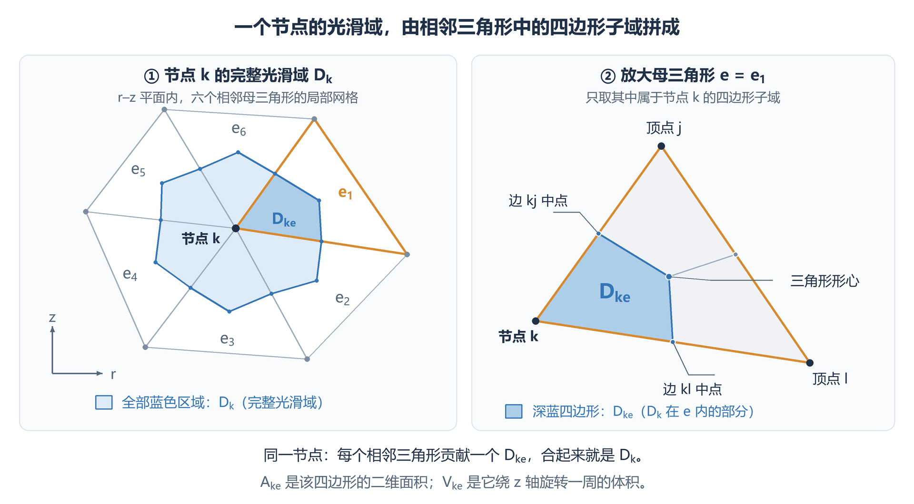
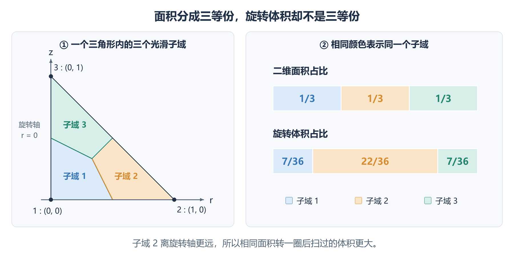
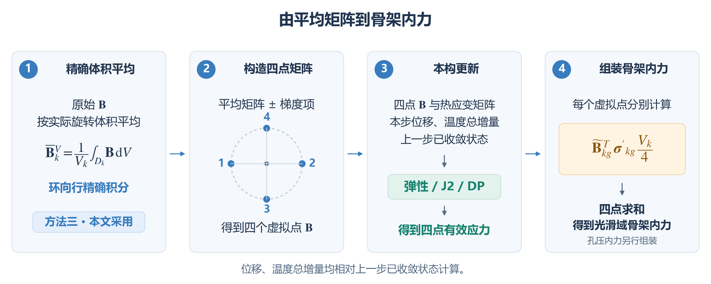
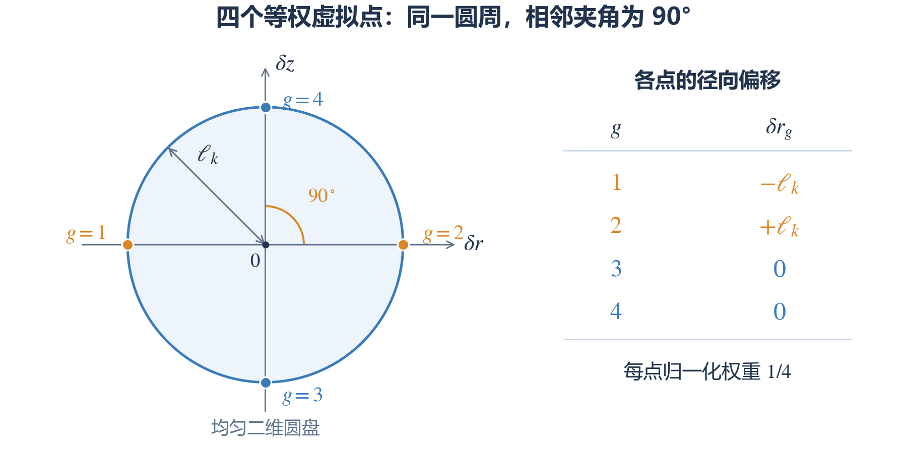
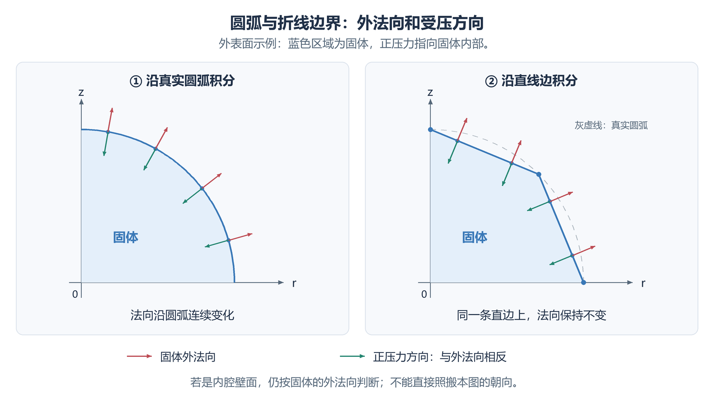

# Axisymmetric SNS-FEM formulation

本文讨论小变形轴对称 THM 的 SNS-FEM 离散，包括光滑域几何、四个虚拟积分点、耦合残差与切线，以及机械体积力和 Darcy 重力项。公式按本文的符号与章节独立说明；验证记录与检查要求集中在[第 14 节](#section-54)。

## 0. 物理范围与符号约定

本文采用以下假设：小应变、准静态、固定参考几何、单一均匀且各向同性的材料、不可压缩固体颗粒 $K_s\to\infty$，以及标量 Biot 系数 $b=1$。孔隙率及水力、热学系数取给定参考值，不随位置或当前未知量更新。机械体力和 Darcy 定律中的重力加速度均取给定常向量，不依赖空间位置或当前未知量。

体力、重力加速度和混合物参考密度分别写为

$$
\boldsymbol f=[f_r,f_z]^T,
\qquad
\boldsymbol g=[g_r,g_z]^T,
\qquad
\rho=(1-n)\rho_s+n\rho_f.
$$

其中 $\boldsymbol f$ 是**单位总体积的机械体力**，量纲为力/体积；$\boldsymbol g$ 是重力加速度，量纲为长度/时间平方。纯重力时 $\boldsymbol f=\rho\boldsymbol g$；$z$ 轴向上时 $\boldsymbol g=[0,-g]^T$。

**注意：** 若还含有其他机械体力，应将它加到 $\boldsymbol f$ 中，但不得因此把 Darcy 定律中的 $\boldsymbol g$ 替换为 $\boldsymbol f/\rho$。后者会改变模型中流体受到的作用，不能仅由力学平衡方程推出。

本文使用以下物理符号：

| 记号 | 含义 |
| --- | --- |
| $n$ | 均匀参考孔隙率；边界单位外法向另写 $\boldsymbol n_{\mathrm{out}}$。 |
| $K_f$ | 孔隙流体的体积模量。 |
| $\rho_s,\rho_f$ | 固体颗粒、孔隙流体的参考质量密度。 |
| $\alpha_s,\alpha_f$ | $\alpha_s$ 为固体线膨胀系数；$\alpha_f$ 为流体体积热膨胀系数的三分之一。 |
| $c_s,c_f$ | 固、液两相的单位质量比热容；不是本构切线 $C_{kg}^{\mathrm{ep}}$。 |
| $S$ | 固定体积应变和温度时的储水系数，单位为 $\mathrm{Pa}^{-1}$；PPP 稳定化矩阵写作 $S_{\mathrm{PPP}}$。 |
| $\beta_T$ | 温度—流体含量耦合系数。 |
| $C_T$ | 混合物单位总体积的热容量，使用大写 $C$。 |
| $\boldsymbol q_f$ | 相对固体、按总截面积计的 Darcy 体积通量，不是孔隙内真实流速。 |
| $n_{\mathrm{node},k}$ | 光滑域 $k$ 涉及的节点数，不是孔隙率。 |

在 $b=1$ 的设定下，孔压耦合直接使用几何列向量 $\boldsymbol m$，不再引入独立的张量型 Biot 参数：

$$
\boldsymbol m=[1,1,1,0]^T,
\qquad S=\frac{n}{K_f},
\qquad \beta_T=3[(1-n)\alpha_s+n\alpha_f],
\qquad C_T=(1-n)\rho_sc_s+n\rho_fc_f.
$$

**材料参数不带光滑域下标 $k$。** 例如 $n,K_f,\alpha_s,\alpha_f,\rho_s,\rho_f,c_s,c_f,k_f,\gamma_f,k_T,S,\beta_T,C_T$ 在整个计算域内相同。几何量 $V_k$、局部矩阵 $K_{ab}^k$、节点向量 $\boldsymbol U_k$ 及积分点状态 $\boldsymbol\sigma'_{kg},C_{kg}^{\mathrm{ep}}$ 仍保留位置索引。均匀材料的各积分点可以经历不同加载路径，因此应力、塑性变量和算法切线未必相同。

本构的四分量应力顺序为 $[rr,zz,\theta\theta,rz]$，应变的第 4 项使用工程剪应变 $\gamma_{rz}=2\varepsilon_{rz}$。矩阵分量排列与张量所选基的排列必须明确对应，不能混用剪切应变因子。

水力传导系数 $k_f$ 与导热系数 $k_T$ 均为常标量。若程序接口需要二维矩阵，则分别传入 $k_f I_2$ 与 $k_T I_2$；$I_2$ 是二维单位矩阵，正文公式直接使用标量。以下 Darcy 重力采用给定竖向常量 $\boldsymbol g=[0,-g]^T$；机械常体力 $\boldsymbol f$ 按[第 12.4 节](#section-52)的标准轴对称 T3 单元组装。

## 1. 已确定的前提与光滑方案

采用小变形轴对称模型，不考虑绕轴扭转。材料采用[第 0 节](#section-1)的均匀、各向同性及 $b=1$ 设定。$r,z$ 分别为径向、轴向坐标，$r\geq0$，$\theta$ 表示环向角度。$\boldsymbol u=[u_r,u_z]^T$ 为位移向量，$p,T$ 分别为孔隙水压力和温度；$B$ 是将节点位移换算为应变的矩阵。位移、孔压和温度整体耦合求解：变形与孔压相互影响，温度变化影响变形和孔压。**热对流可通过 `Keyword.HeatAdvection` 开关选择；[第 8 节](#section-28)统一给出含重力的通量、残差和切线。** 关闭时，温度方程不依赖位移和孔压；开启时，孔压通过 Darcy 速度影响温度，但仍不加入由变形率、孔压变化率直接产生的热量项，具体见[第 8.5 节](#section-35)。实现时逐场检查绝对和相对残差，避免零载荷 patch 中相对残差归一化时出现零分母；必要时将 Newton 更新减半重试，每次本构试算仍使用上一步已收敛状态。

**已确定：所有光滑操作均按四边形子域的实际旋转体积加权。** 计算按“平均矩阵（[第 4 节](#section-12)）→ 梯度矩阵（[第 5 节](#section-16)）→ 虚拟点矩阵（[第 6 节](#section-20)）”的顺序展开。

下表汇总本文采用的构造。

| 事项 | 已确定内容 |
| --- | --- |
| 光滑子域体积 | **已确定。** 使用四边形子域的实际旋转体积，不用母三角形旋转体积的 $1/3$，也不用四个顶点的平均半径代替子域面积形心半径。 |
| 光滑平均 | **已确定。** B、N、E 均按体积平均；平均 B 的计算见[第 4.3 节](#section-15)。 |
| 梯度矩阵 | **已确定。** B、E 的梯度分别按[第 5.3 节](#section-19)、[第 7.3 节](#section-27)构造，包含径向修正。 |
| 四个虚拟点 | **已确定。** 保留点距 $\ell_k=\sqrt{A_k/\pi}$，每点权重为 $V_k/4$，不再乘该点半径，不重新布点或改成不等权。 |
| 热应变与耦合 | **已确定。** 热应变继续使用光滑温度及其梯度；$K_{12}$ 使用[第 4.3 节](#section-15)的平均矩阵 $\overline B_k^V$ 与原始 T3 型函数的子域积分，不要求定义四个虚拟点上的原始 T3 型函数。 |
| 热对流 | **可开关；含重力形式见[第 8 节](#section-28)。** $\rho_f c_f$ 按常数处理，Darcy 速度与温度梯度均用四点 $\widetilde E_{kg}$，温度试函数用 $\widetilde N_{kg}$ 插值，每点权重仍为 $V_k/4$。温度残差及其对孔压、温度的导数一起加入，见[第 8.5 节](#section-35)。 |
| 子域积分、PPP | **已确定。** 四边形子域采用 $3\times3$ Gauss 积分；PPP 使用母三角形的体积平均压力，积分也按实际旋转体积计算，系数沿用固定弹性参考参数。 |
| 机械体力 | 常向量 $\boldsymbol f$ 采用标准轴对称 T3 母单元组装，见[第 12.4 节](#section-52)。 |
| 轴线、圆弧 | **已确定。** 轴线只因轴对称条件约束 $u_r=0$；圆弧用直线段逼近，各段使用自己的外法向，荷载积分保留 $2\pi r$。 |

## 2. 先看清光滑域，再区分面积、体积和组装

### 2.1 一个完整光滑域由哪些部分组成

先选一个网格节点 $k$。在每个与它相连的三角形中，依次连接“节点 $k$—一侧边的中点—三角形的面积形心—另一侧边的中点”，得到一个四边形。

**$D_{ke}$ 是三角形 $e$ 内的这一个四边形；$D_k$ 是围绕节点 $k$ 的所有这些四边形合在一起的区域。** 下文把三角形 $e$ 称为“母三角形”，只是说明 $D_{ke}$ 属于哪个单元。

**图 1。** 左图中，所有蓝色四边形合起来才是 $D_k$。右图只放大其中一个三角形：蓝色四边形是 $D_{ke}$，其余部分属于该三角形另外两个顶点的光滑域。橙色轮廓表示同一个母三角形。一个完整光滑域通常跨越多个三角形，一个子域则只占其中一个三角形的一部分。计算光滑域的矩阵时，要用到这些母三角形的全部节点，包括图中位于蓝色区域外的三角形顶点。

### 2.2 面积、旋转体积与虚拟点距离

$A_{ke}$ 是四边形 $D_{ke}$ 在 r–z 平面内的面积；$V_{ke}$ 是它绕 z 轴旋转一周后的体积。$A_k,V_k$ 则分别表示完整光滑域的面积、旋转体积。因此，

$$
\boxed{A_k=\sum_{e\ni k}A_{ke},\qquad V_k=\sum_{e\ni k}V_{ke}}
$$

这里 $e\ni k$ 表示“遍历所有包含节点 $k$ 的三角形”。面积和体积都是标量，直接相加即可。

$$
\mathrm{d}A=\mathrm{d}r\mathrm{d}z,\qquad \mathrm{d}V=2\pi r\,\mathrm{d}A,\qquad \mathrm{d}S=2\pi r\,\mathrm{d}s.
$$

$$
A_k=\int_{D_k}\,\mathrm{d}A,\qquad V_k=\int_{D_k}2\pi r\,\mathrm{d}A,\qquad \ell_k=\sqrt{A_k/\pi}.
$$

$r$ 是到旋转轴的距离，$A_k$ 是二维面积，$V_k$ 是旋转一周后的体积，$\ell_k$ 是构造四个虚拟点矩阵时使用的偏移距离。式中的 $\mathrm{d}s$ 是平面内的一小段边长，$\mathrm{d}S$ 是这段边旋转后对应的表面积。当前轴对称代码用 `virtualPointDistance = sqrt(domain.area/pi)` 计算 $\ell_k$，与径向坐标 $r$ 区分。

**轴对称内力、刚度等要按体积积分，但不能把代码中每一个面积都换成体积。** 例如，$\ell_k=\sqrt{A_k/\pi}$ 表示与光滑域面积相等的圆的半径；如果改为 $\sqrt{V_k/\pi}$，结果的单位就不再是长度。

本文在体积和表面积分中统一保留 $2\pi$：长度用 m、应力用 kPa 时，等效节点力就是 kN。基本应变公式和半径在积分中的位置可参见 [FEniCSx 轴对称弹性示例](https://bleyerj.github.io/comet-fenicsx/tours/linear_problems/axisymmetric_elasticity/axisymmetric_elasticity.html)；下面有关 SNS 离散的讨论按本笔记中的几何与组装定义展开。

### 2.3 组装：按节点编号对齐，再相加

本文统一用 $\operatorname{Assemble}$ 表示组装。它的意思就是：**把对应节点自由度的行或列，按节点编号和自由度类型对齐，再相加。** 刚度矩阵需要对齐行和列；B、N、E 只需对齐节点列，它们的应变、标量或梯度分量行保持原顺序。位移的径向与轴向分量、孔压、温度分别对应各自的位置。

例如，只看每个节点的一个标量贡献（数值仅用于示意）。三角形 1 的节点依次为 4、8、12，三角形 2 的节点依次为 4、12、19。按节点编号对应后，组装结果是：

| 节点编号 | 4 | 8 | 12 | 19 |
| --- | ---: | ---: | ---: | ---: |
| 三角形 1 的贡献 | 2 | 5 | 7 | 0 |
| 三角形 2 的贡献 | 3 | 0 | 11 | 13 |
| 组装后的贡献 | 5 | 5 | 18 | 13 |

这些数字只用于说明组装。三角形 1 的第 3 个节点和三角形 2 的第 2 个节点都是节点 12，所以对应的 7 和 11 要相加。刚度矩阵组装时，行和列都按这个规则对应。

| 写法 | 相加的范围 |
| --- | --- |
| $\operatorname*{Assemble}_{e\ni k}[\cdots]$ | 只取与节点 $k$ 相连的三角形，将它们的贡献按光滑域 $k$ 的节点顺序对齐后相加。 |
| $\operatorname*{Assemble}_{k}[\cdots]$ | 遍历所有光滑域，将它们的贡献按全局节点顺序对齐后相加。 |
| $\operatorname*{Assemble}_{e}[\cdots]$ | 遍历所有母三角形，将它们的贡献按全局节点顺序对齐后相加。 |

图 1 说明的是“哪些四边形组成一个光滑域”；组装说明的是“这些单元或光滑域的矩阵怎样对应相加”。

### 2.4 后文共用的记号

**先区分横线、波浪线和帽号：**

| 记号与例子 | 本文含义 |
| --- | --- |
| 横线：$\overline B_k^V,\overline N_k^V,\overline E_k^V$ | 光滑域上的**平均矩阵**；上标 $V$ 表示按旋转体积平均。 |
| 波浪线：$\widetilde B_{kg},\widetilde N_{kg},\widetilde E_{kg}$ | **SNS 虚拟点矩阵**，由平均矩阵加减相应方向的梯度项构造；$g$ 标记四个虚拟点。 |
| 帽号：$\widehat B,\widehat E$ | **光滑梯度积分的输入矩阵**。每个母三角形内取 $\widehat B=B_e$（母单元中心的 B）、$\widehat E=E_e$（原始 T3 型函数梯度），节点列按光滑域顺序对齐；见[第 5.2 节](#section-18)、[第 7.3 节](#section-27)。 |

边界条件中的 $\overline{\boldsymbol t}$、$\overline q_{\mathrm{in}}$、$\overline h_{\mathrm{in}}$ 分别表示**给定的面力、流体入流通量、传导热流入流通量**，这里的横线不表示平均。

其余索引与记号如下：

| 记号 | 本文含义 |
| --- | --- |
| $k,e,I$ | 分别是光滑域中心节点编号、母三角形编号、参与插值的节点编号；$i,j,l$ 也用于标记三角形的三个顶点。$D_{ie}$ 就是以顶点 $i$ 为中心、位于三角形 $e$ 内的子域，与 $D_{ke}$ 是同一种记法。 |
| $g=1,2,3,4$ | 同一光滑域内的四个虚拟点编号；后文的 $\sum_g$ 均对这四点求和。 |
| 下标 $kg$ | 依次表示光滑域 $k$、虚拟点 $g$，不是两者相乘。 |
| 上标 $A,V$ | 分别标明按二维面积、旋转体积加权，不是乘方；[第 4 节](#section-12)用这两个上标区分不同平均方式。 |
| $\boldsymbol x=[r,z]^T$、$\boldsymbol x_I=[r_I,z_I]^T$ | 分别为积分位置、节点 $I$ 的坐标。右上角 $T$ 表示转置，与温度 $T$ 区分。 |
| $N_I$、$N_e$ | $N_I$ 是节点 $I$ 的原始 T3 型函数；$N_e$ 是母三角形三个型函数组成的行向量。省略下标的 $N$ 按上下文表示型函数或该行向量。 |
| $\boldsymbol U,\boldsymbol P,\boldsymbol T$ | 分别为节点位移、孔压、温度组成的列向量。加下标 $k$ 时，只取光滑域 $k$ 涉及的节点；局部矩阵也按这组节点排列。 |
| $\Delta$ | 相对于上一个已收敛时间步的增量，例如 $\Delta\boldsymbol T$ 是当前时间步的试算温度总增量；$\Delta t$ 是时间步长。 |

矩阵块 $K_{ab}^{k}$ 的上标 $k$ 表示光滑域 $k$ 的局部贡献；不带这个上标的 $K_{ab}$ 表示组装后的全局矩阵。下标 $a,b$ 标记方程和未知量，具体对应见[第 8 节](#section-28)。正文中的向量用粗体表示；B、N、E 等矩阵则保留与代码接近的字母写法。

**本文的试函数（test function）统一使用字母 v，用下标区分方程、粗体区分向量与标量。** 力学方程的试函数为虚位移向量 $\boldsymbol v_u=[v_r,v_z]^T$，其中 $v_r,v_z$ 分别是径向、轴向分量；孔压方程的试函数为标量 $v_p$；温度方程的试函数为标量 $v_T$。下标 $u,p,T$ 标明所属方程，各方程中的试函数独立选取。每个弱式前都会说明其含义。

**偏导数与标签分开写。** 为避免歧义，本文将空间偏导直接展开，例如 $\frac{\partial N_I}{\partial r}$、$\frac{\partial p}{\partial r}$，不用下标逗号表示求导。下列已命名离散量中保留的逗号只分隔标签或索引，**不表示再求一次导数**：

**$u,p,T$ 是方程标签，$r,z$ 是方向标签；$I$ 是节点编号，$e$ 是母单元编号，$k$ 是光滑域编号。** 因此，“下标带 $k$ 的局部贡献”与“节点 $I$ 的力”是不同对象。

| 记号 | 如何理解 |
| --- | --- |
| $G_{B,r,k}^{V}$、$G_{E,z,k}^{V}$ | B 的径向梯度、E 的轴向梯度，均属于光滑域 $k$；定义见[第 5 节](#section-16)、[第 7 节](#section-24)。 |
| $\overline E_{r,k}^{V}$、$\overline E_{z,k}^{V}$ | 光滑域 $k$ 的平均 E 矩阵中，对应径向、轴向的两行。 |
| $n_{\mathrm{out},r}$、$n_{\mathrm{out},z}$ | 边界单位外法向的径向、轴向分量。 |
| $B_{e,I}$ | 母三角形 $e$ 中，节点 $I$ 的两个位移自由度对应的 B 矩阵列块。 |
| $I_{N,k}^{V}$、$n_{\mathrm{node},k}$ | 前者是光滑域 $k$ 的型函数体积积分，后者是该域涉及的节点数。 |
| $\boldsymbol f_{u,k}^{\mathrm{skel}}$ | 光滑域 $k$ 的骨架内力向量，含该域涉及的所有节点的力学分量，**不是节点 $k$ 的一个力**；见[第 8.2 节](#section-29)。 |
| $\boldsymbol f_{T,k}^{\mathrm{adv}}$ | 光滑域 $k$ 的热对流残差向量，$T$ 标记温度方程，$\mathrm{adv}$ 标记对流；见[第 8.5.1 节](#section-37)。 |
| $\boldsymbol F_{u,I}^{\mathrm{body}}$ | **组装后节点 $I$ 的两个体力等效外力分量**，依次为径向、轴向；$u$ 标记力学方程，见[第 12.4 节](#section-52)。 |
| $\boldsymbol G_{p,k}$ | 光滑域 $k$ 对流体方程的重力贡献，$p$ 是方程标签；见[第 8.4 节](#section-32)。 |
| $\boldsymbol q_{f,kg}$ | 光滑域 $k$、虚拟点 $g$ 处的流体通量；下标 $f$ 标记流体。 |

**组合上标要连同完整符号一起读。** 下表两种记号中的 $V$ 都表示旋转体积加权；逗号后的标签进一步说明构造方式。

| 完整符号 | 上标的含义 |
| --- | --- |
| $\overline B_k^{V,\mathrm c}$ | $V$：旋转体积加权；$\mathrm c$：使用母单元中心的 B 矩阵，见[第 4.2 节](#section-14)。 |
| $G_{B,r,k}^{V,\mathrm{incomplete}}$ | $V$：旋转体积加权；$\mathrm{incomplete}$：漏掉径向修正项的不完整梯度，见[第 5.3 节](#section-19)。 |

$\boldsymbol f_{T,k}^{\mathrm{adv,grav}}$ 和 $K_{33\mathrm{Adv,grav}}$ 中的 $\mathrm{adv,grav}$ 同样是一组标签，表示热对流中的纯重力贡献。上述逗号均只分隔标签；函数自变量、向量分量和并列公式之间的普通逗号仍按通常标点理解。

## 3. 四边形光滑子域的体积如何计算

### 3.1 三角形的体积可以用三角形中心计算

母三角形顶点为 $i,j,l$，面积为 $A_e$；$r_i,r_j,r_l$ 是三个顶点的半径，$r_{ec}$ 是三角形面积形心的半径，$V_e$ 是该三角形旋转一周的体积。因为 $r$ 在直边三角形上是线性函数，所以

$$
r_{ec}=\frac{r_i+r_j+r_l}{3},\qquad V_e=2\pi A_e r_{ec}
$$

是精确几何公式。

### 3.2 子域体积一般不是三角形体积的三分之一

本节用 $\boldsymbol x_{ie}^{A}=[r_{ie}^{A},z_{ie}^{A}]^T$ 表示四边形子域 $D_{ie}$ 的**面积形心坐标向量**，也就是把整个四边形看成均匀薄片时的重心坐标。下标 $i$ 是子域所对应的节点编号，$e$ 是母三角形编号；上标 $A$ 表示按面积求平均。计算子域实际旋转体积时，使用的是面积形心的径向坐标 $r_{ie}^{A}$。**面积形心一般不同于四个顶点坐标的算术平均**；后者在[第 3.3 节](#section-11)记为 $\boldsymbol x_{ie}^{\mathrm{vertices}}$。

节点 $i$ 对应的四边形依次连接“节点 $i$—边 $ij$ 中点—三角形中心—边 $il$ 中点”。它的面积确实是 $A_e/3$，面积形心的坐标为：

$$
\boldsymbol x_{ie}^{A}=\frac{22\boldsymbol x_i+7\boldsymbol x_j+7\boldsymbol x_l}{36}.
$$

这里 $\boldsymbol x_{ie}^{A}$ 是子域 $D_{ie}$ 的面积形心坐标，$A_{ie}=A_e/3$ 是子域面积，$V_{ie}$ 是其真实旋转体积。因此

$$
\boxed{V_{ie}=2\pi\frac{A_e}{3}\frac{22r_i+7r_j+7r_l}{36}.}
$$

将四边形沿“节点—三角形中心”分成两个等面积小三角形后分别积分，即可得到这个结果。它满足

$$
V_{ie}+V_{je}+V_{le}=V_e,
$$

但一般不满足 $V_{ie}=V_e/3$。对子域 $i$，等式 $V_{ie}=V_e/3$ 成立的条件是 $2r_i=r_j+r_l$。

例如，取三角形的三个顶点为 $(r,z)=(0,0),(1,0),(0,1)$，按此顺序将顶点局部编号为 $1,2,3$。三个子域面积相等，但旋转体积分配为

$$
\frac{V_{1e}}{V_e}=\frac{7}{36},\qquad \frac{V_{2e}}{V_e}=\frac{22}{36},\qquad \frac{V_{3e}}{V_e}=\frac{7}{36}.
$$

**图 2。** 左图按实际坐标画出三个子域，右图用相同颜色比较面积占比和体积占比。这里的分数只对应这个三角形，不是所有网格的固定分配比例。

远离旋转轴的子域，转一圈后扫过的体积更大。另外，轴线节点虽然 $r_i=0$，但它的光滑域仍向轴线外侧延伸，旋转后的体积不为零。

**旧手稿中的子域体积计算错误：** 旧手稿采用 $2\pi r_{ec}A_{ke}$，相当于把母三角形的旋转体积平均分成三份，一般不等于各四边形子域的实际体积。本文按子域面积形心的半径计算实际旋转体积，公式见上文。

### 3.3 四个顶点的平均坐标不等于面积形心（注意）

上述四边形的顶点平均坐标记为 $\boldsymbol x_{ie}^{\mathrm{vertices}}$，其中上标 $\mathrm{vertices}$ 只标明“顶点平均”：

$$
\boldsymbol x_{ie}^{\mathrm{vertices}}=\frac{14\boldsymbol x_i+5\boldsymbol x_j+5\boldsymbol x_l}{24},
$$

四个顶点的平均坐标 $\boldsymbol x_{ie}^{\mathrm{vertices}}$ 一般不等于[第 3.2 节定义的面积形心坐标](#section-10) $\boldsymbol x_{ie}^{A}=[r_{ie}^{A},z_{ie}^{A}]^T$。这里 $i$ 是子域所对应的节点编号，$e$ 是母三角形编号，上标 $A$ 表示按面积求平均。$\boldsymbol x_{ie}^{A}$ 是把整个四边形子域 $D_{ie}$ 看成均匀薄片时的重心坐标，其中 $r_{ie}^{A}$ 是计算该子域实际旋转体积所用的半径。

原 markdown 文件（本讨论整理前的技术笔记）记载，参考函数 `Smooth_T3_axisym.m` 使用 `xc_sub=(x1+xm1+xc+xm3)/4` 计算子域中心坐标，并使用 `N_ino/center_SD_ino` 计算 B 的环向应变行。按这条四点算术平均表达式，代码变量 `xc_sub` 对应本文的 $\boldsymbol x_{ie}^{\mathrm{vertices}}$，即四个顶点坐标的平均，一般不等于面积形心 $\boldsymbol x_{ie}^{A}$。下面分析这两条表达式对环向应变的影响。

按照原 markdown 文件对 `N_ino/center_SD_ino` 的描述，若分子取型函数的精确面积平均，分母取四个顶点的平均半径，则分子与分母采用了不同的平均规则。对[第 3.2 节](#section-10)的单三角形、节点 1 和 $u_r=r$，由此得到 $\varepsilon_{\theta\theta}=14/15$，正确值应为 $1$。这一结果说明，混用型函数的面积平均与四顶点平均半径会导致环向应变误差。**旧手稿中的“子域形心”采用的就是四顶点平均坐标；将其当作四边形子域的面积形心是错误的。**

## 4. 平均 B 矩阵的三种构造

**方法一、二都先用母三角形中心矩阵 $B_e$ 近似单元内的 B，再分别按面积、旋转体积平均。方法三直接对原始 B 做精确旋转体积平均，本文采用方法三。**

### 4.1 方法一：中心矩阵的面积平均（不采用）

**对母单元中心矩阵做面积平均，会产生轴对称不平衡内力，因此不采用。** 下面给出构造及反例。

母三角形 $e$ 的中心半径为 $r_{ec}$，中心处的型函数值为 $1/3$。节点 $I$ 的径向、轴向位移对应的两列为

$$
B_{e,I}=\begin{bmatrix}
\dfrac{\partial N_I}{\partial r}&0\\[10pt]
0&\dfrac{\partial N_I}{\partial z}\\[10pt]
\dfrac{1}{3r_{ec}}&0\\[10pt]
\dfrac{\partial N_I}{\partial z}&\dfrac{\partial N_I}{\partial r}
\end{bmatrix}.
$$

$B_e$ 由三个节点的列块组成，应变分量顺序为 $[rr,zz,\theta\theta,rz]$，第 4 项为工程剪应变。对各四边形子域按面积加权，得到

$$
\overline B_k^A=\frac{1}{A_k}\operatorname*{Assemble}_{e\ni k}\left[A_{ke}B_e\right].
$$

**反例：** 四个角点为 $(1,0),(3,0),(3,2),(1,2)$，内部点为 $(1.7,0.8)$；将内部点与四角连接，得到四个三角形。长度单位为 m，孔压、体力均为零，施加均匀应力

$$
\sigma_{rr}=\sigma_{\theta\theta}=1\ \mathrm{kPa},\qquad
\sigma_{zz}=\sigma_{rz}=0.
$$

外边界施加与该应力对应的面力，内部节点没有外荷载，其合内力应为零。孔压为零时，有效应力 $\boldsymbol\sigma'$ 等于总应力；各光滑域的骨架内力为

$$
\boldsymbol f_{u,k}^{\mathrm{skel}}=V_k(\overline B_k^A)^T\boldsymbol\sigma'.
$$

组装后，内部节点的径向内力为 **$3.4867281154\ \mathrm{kN}$，正确值应为零**。这就是该面积平均方法不满足力平衡的反例。

### 4.2 方法二：中心矩阵的旋转体积平均

仍用同一套 $B_e$，改用各子域的实际旋转体积加权：

$$
\overline B_k^{V,\mathrm c}=\frac{1}{V_k}\operatorname*{Assemble}_{e\ni k}\left[V_{ke}B_e\right].
$$

上标 $\mathrm c$ 表示使用母单元中心值。该方法保持组装后的 B 体积积分：

$$
\operatorname*{Assemble}_k\left[V_k\overline B_k^{V,\mathrm c}\right]
=\operatorname*{Assemble}_e\left[V_eB_e\right].
$$

对每个母单元，中心环向值满足

$$
V_e\frac{1}{3r_{ec}}=\frac{2\pi A_e}{3}
=\int_e\frac{N_I}{r}\,\mathrm{d}V.
$$

其余三行的 T3 型函数导数为常数，因此组装后的积分与原始 B 的体积积分相同。**应力处处相同时，该方法与原始轴对称 T3 得到相同的节点内力。** 在上述反例中，内部节点径向内力为 $-1.8\times10^{-15}\ \mathrm{kN}$，即舍入误差范围内的零。

这里保持的是组装后的积分；单个四边形子域内的环向值仍采用母单元中心近似。

### 4.3 方法三：原始 B 的精确旋转体积平均（本文采用）

直接积分原始位置相关矩阵 $B(r,z)$：

$$
\boxed{\overline B_k^V=\frac{1}{V_k}\operatorname*{Assemble}_{e\ni k}
\left[\int_{D_{ke}}B(r,z)\,\mathrm{d}V\right].}
$$

**B 的第 3 行计算环向应变 $\varepsilon_{\theta\theta}=u_r/r$。** 其径向位移列的原始系数为 $N_I/r$，精确平均后记为 $\overline h_{kI}^V$：

$$
\boxed{\overline h_{kI}^V
=\frac{1}{V_k}\sum_{e\ni k}\int_{D_{ke}}\frac{N_I}{r}\,\mathrm{d}V
=\frac{2\pi}{V_k}\sum_{e\ni k}\int_{D_{ke}}N_I\,\mathrm{d}A.}
$$

这里用 $\mathrm{d}V=2\pi r\,\mathrm{d}A$ 抵消了 $1/r$。右端虽写成面积积分，除数仍为真实体积 $V_k$，所以仍是旋转体积平均。节点 $I$ 不属于某个母单元时，该单元对该系数的贡献为零。

对本文的“节点—边中点—单元中心—另一边中点”四边形，节点 $k,j,l$ 按母三角形顺序排列，有

$$
\boxed{\int_{D_{ke}}[N_k,N_j,N_l]\,\mathrm{d}A=\frac{A_e}{108}[22,7,7].}
$$

平均矩阵第 3 行的径向位移列取 $\overline h_{kI}^V$，轴向位移列取零。第 1、2、4 行的型函数导数为常数，其精确体积平均与方法二相同。

**图 3。** 第 1 步采用方法三，第 4 步使用每点 $V_k/4$ 的体积权重。有效应力由本构更新得到，输入的位移、温度增量**均从上一步已收敛状态算起**。四个虚拟点的骨架内力分别计算后组装，孔压内力另行组装。

## 5. 光滑梯度的构造

[第 4 节](#section-12)已给出平均矩阵 $\overline B_k^V$；本节构造径向、轴向两个梯度矩阵。平均矩阵与两个梯度矩阵分别计算，最后在[第 6.1 节](#section-21)组合成虚拟点矩阵。下面依次说明梯度的记号、输入矩阵和计算公式。

### 5.1 梯度的记号与节点列排列

径向、轴向梯度矩阵分别记为 $G_{B,r,k}^V$、$G_{B,z,k}^V$，上标 $V$ 表示体积加权。下标依次标明矩阵种类 B、方向 r 或 z、光滑域编号 $k$；逗号只分隔标签，不表示求导。后面的 $G_{E,r,k}^V,G_{E,z,k}^V$ 也采用这一顺序。

$\widehat B$ 表示梯度积分所使用的母单元矩阵，其取值在[第 5.2 节](#section-18)给出。积分前，各母单元矩阵的列都按光滑域 $k$ 的节点顺序排列；**该单元不含的节点对应列补零**。

$\partial D_k$ 是光滑域边界，$\boldsymbol n_{\mathrm{out}}=[n_{\mathrm{out},r},n_{\mathrm{out},z}]^T$ 是其单位外法向，两个分量分别对应径向、轴向。

### 5.2 梯度计算所用的母单元中心矩阵

**本文在每个母三角形内取 $\widehat B=B_e$，其中 $B_e$ 是[第 4.1 节](#section-13)的母单元中心矩阵，并按[第 5.1 节](#section-17)对齐节点列。** 对属于该三角形的节点 $I$，中心点 $(r_{ec},z_{ec})$ 处有

$$
N_I(r_{ec},z_{ec})=\frac13,\qquad
\left.\frac{N_I}{r}\right|_{(r_{ec},z_{ec})}=\frac{1}{3r_{ec}}.
$$

因此，$\widehat B$ 的第 3 行径向位移列取 $1/(3r_{ec})$，轴向位移列取零；其余行使用该 T3 单元的常数型函数导数。

每个母三角形内部的 $\widehat B$ 是常数，相邻三角形的取值一般不同。[第 5.3 节](#section-19)的公式计入这些跨单元的差别。**不能仅因各母单元内的矩阵为常数，就把光滑梯度设为零。**

### 5.3 体积加权梯度与径向修正

先用一般矩阵场 $B$ 推导，暂不指定其离散取值。在下列积分存在时，**径向光滑梯度定义为 $\partial B/\partial r$ 的体积平均。**

**乘积法则：**

$$
2\pi r\frac{\partial B}{\partial r}
=\frac{\partial(2\pi rB)}{\partial r}-2\pi B.
$$

将上述乘积法则代入体积平均，再对 $B$ 矩阵中的每个标量元素分别应用**二维散度定理**，得到

$$
\begin{aligned}
\frac{1}{V_k}\int_{D_k}\frac{\partial B}{\partial r}\,\mathrm{d}V
&=\frac{1}{V_k}\int_{D_k}\frac{\partial B}{\partial r}\,2\pi r\,\mathrm{d}A\\
&=\frac{1}{V_k}\int_{D_k}
\left[\frac{\partial(2\pi rB)}{\partial r}-2\pi B\right]\mathrm{d}A\\
&=\frac{1}{V_k}\left[
\int_{\partial D_k}2\pi rB\,n_{\mathrm{out},r}\,\mathrm{d}s
-\int_{D_k}2\pi B\,\mathrm{d}A\right].
\end{aligned}
$$

这就是径向修正项的来源。轴向推导相同，但 $r$ 不随 $z$ 变化，因此没有对应的域内修正项。对跨单元分片不连续的 $B$，这里的导数按包含单元间跳跃的弱导数理解。

**注意：** 若直接代入原始环向项，域内积分含有 $\int N_I/r\,\mathrm{d}A$。当子域沿轴线有一段边界，且 $N_I$ 在该段非零时，这个积分对数发散，没有有限值。

离散计算时，将边界项和域内项中的 $B$ **同时替换为[第 5.2 节](#section-18)的母单元中心矩阵 $\widehat B$**。其中的 $1/(3r_{ec})$ 有限，可避免上述奇异性，得到

$$
\boxed{G_{B,r,k}^{V}=\frac{1}{V_k}\left[\int_{\partial D_k}2\pi r\widehat B\,n_{\mathrm{out},r}\,\mathrm{d}s-\int_{D_k}2\pi\widehat B\,\mathrm{d}A\right],}
$$

$$
\boxed{G_{B,z,k}^{V}=\frac{1}{V_k}\int_{\partial D_k}2\pi r\widehat B\,n_{\mathrm{out},z}\,\mathrm{d}s.}
$$

**注意：** 边界积分和域内积分必须使用[第 5.2 节](#section-18)给定的同一套 $\widehat B$。域内积分按 $\operatorname*{Assemble}_{e\ni k}\left[2\pi A_{ke}B_e\right]$ 组装，不能替换成 $2\pi A_k\overline B_k^V$。

**均匀应变再现检查：** 给节点施加位移场 $u_r=\varepsilon_{r0}r$、$u_z=\varepsilon_{z0}z+u_{z0}$，其中 $\varepsilon_{r0},\varepsilon_{z0},u_{z0}$ 均为常数，应得到恒定应变

$$
\boldsymbol\varepsilon_0=[\varepsilon_{r0},\varepsilon_{z0},\varepsilon_{r0},0]^T.
$$

此时 $\widehat B\boldsymbol U_k=\boldsymbol\varepsilon_0$ 在光滑域内处处相同，径向、轴向应变梯度都应为零。以非零的 $\boldsymbol\varepsilon_0$ 为例，若省略径向梯度中的域内修正项 $-\frac{1}{V_k}\int_{D_k}2\pi\widehat B\,\mathrm dA$，则会得到

$$
\begin{aligned}
G_{B,r,k}^{V,\mathrm{incomplete}}\boldsymbol U_k
&=\frac{1}{V_k}\left[\int_{\partial D_k}2\pi r\widehat B\,n_{\mathrm{out},r}\,\mathrm{d}s\right]\boldsymbol U_k\\
&=\frac{1}{V_k}\int_{\partial D_k}2\pi r(\widehat B\boldsymbol U_k)n_{\mathrm{out},r}\,\mathrm{d}s\\
&=\frac{2\pi}{V_k}\left[\int_{\partial D_k}r n_{\mathrm{out},r}\,\mathrm{d}s\right]\boldsymbol\varepsilon_0\\
&=\frac{2\pi}{V_k}\left[\int_{D_k}\frac{\partial r}{\partial r}\,\mathrm{d}A\right]\boldsymbol\varepsilon_0\\
&=\frac{2\pi}{V_k}\left[\int_{D_k}1\,\mathrm{d}A\right]\boldsymbol\varepsilon_0\\
&=\frac{2\pi A_k}{V_k}\boldsymbol\varepsilon_0\ne\boldsymbol 0.
\end{aligned}
$$

这里先代入 $\widehat B\boldsymbol U_k=\boldsymbol\varepsilon_0$，将常量应变提出积分；再用二维散度定理将边界积分转为面积积分，并利用 $\partial r/\partial r=1$。上标 $\mathrm{incomplete}$ 表示漏掉上述域内修正项的计算结果。也就是说，本来没有变化的应变会被算成有径向变化，四个虚拟点的应力和刚度因此受到影响。补回域内修正项后，径向应变梯度才为零。

使用完整公式后，两个应变梯度均为零；[第 4.3 节](#section-15)的平均矩阵也给出 $\boldsymbol\varepsilon_0$。因此，[第 6.1 节](#section-21)由平均矩阵加减梯度项构造的四个虚拟点，都得到同一个正确的均匀应变。

压力、温度所用的 E 矩阵及其体积加权梯度见[第 7 节](#section-24)。

## 6. 四个虚拟点、V/4 与真实体积积分

### 6.1 四个虚拟点及其体积权重

按已确定的体积加权方案，使用[第 4.3 节](#section-15)的平均矩阵和[第 5.3 节](#section-19)的近似梯度，四个虚拟点的 B 矩阵写为：

$$
\begin{aligned}
\widetilde B_{k1}&=\overline B_k^V-\ell_kG_{B,r,k}^V,\qquad \widetilde B_{k2}=\overline B_k^V+\ell_kG_{B,r,k}^V,\\
\widetilde B_{k3}&=\overline B_k^V-\ell_kG_{B,z,k}^V,\qquad \widetilde B_{k4}=\overline B_k^V+\ell_kG_{B,z,k}^V.
\end{aligned}
$$

$$
W_{kg}=V_k/4,\qquad \frac14\sum_{g=1}^4\widetilde B_{kg}=\overline B_k^V.
$$

$W_{kg}$ 是第 $g$ 个虚拟点的体积积分权重，单位是体积。点 1、2、3、4 依次对应径向负、径向正、轴向负、轴向正的偏移。四个点的权重都为正，四个 B 相加除以四，正好得到平均的 NS 矩阵。每个虚拟点分别保存一套塑性状态变量。

**用了 $V_k/4$，就不能再乘 $2\pi$ 和虚拟点半径。** 因为计算体积时已经计入旋转权重，再乘就是重复计算。也不能把 $A_k/4$ 乘以 $2\pi$ 和各虚拟点的示意半径作为权重：若四点围绕节点对称布置，这些权重之和为 $2\pi r_kA_k$，通常不等于实际体积 $V_k$，轴线附近还可能出现零权重或负权重。这里 $r_k$ 是光滑域中心节点到旋转轴的距离。

### 6.2 “四点乘体积”并不自动等于真实域上的精确积分

如果希望四个点精确计算随位置变化的 B 所产生的积分，仅让四个权重之和等于 $V_k$ 还不够。例如，计算刚度时，B 中的元素会两两相乘，会出现位置偏移量的平方，因此还要检查这些平方项的积分是否正确。以面积为 $A_k$、半径为 $\ell_k$ 的均匀二维圆盘为例，$\delta r_g$ 表示第 $g$ 点相对圆盘中心的径向坐标差，$\delta r$ 表示盘内一般位置的同类坐标差。

**注意：** 这里的 $\delta$ 仅标记几何偏移量，不表示变分或求导。

本例沿径向、轴向的正负方向各取一点，四点均在半径为 $\ell_k$ 的圆周上，**沿圆周相邻点的夹角为 $90^\circ$**，如图 4 所示。

**图 4。** 用于二阶矩比较的均匀二维圆盘。编号沿用[第 6.1 节](#section-21)：1 左、2 右、3 下、4 上。$\delta r,\delta z$ 分别为相对圆盘中心的径向、轴向坐标差；每点的归一化权重为 $1/4$。

因此四点的径向偏移依次为 $-\ell_k,\ell_k,0,0$，平方平均值为

$$
\frac14\sum_{g=1}^4\delta r_g^2
=\frac{(-\ell_k)^2+\ell_k^2+0^2+0^2}{4}
=\frac{\ell_k^2}{2}.
$$

真实圆盘区域在积分下标中记为 $\mathrm{disk}$，它满足

$$
\frac{1}{A_k}\int_{\mathrm{disk}}\delta r^2\,\mathrm{d}A=\frac{\ell_k^2}{4}.
$$

四点规则给出的二阶矩是上述圆盘精确值的两倍，因此它不精确积分该圆盘的二阶矩。$\ell_k=\sqrt{A_k/\pi}$ 配合四个等权点，规定了 SNS 梯度项对刚度的贡献大小。保留这一布点与权重，也就保留了原 SNS 的梯度稳定化构造。

**本文保留 $\ell_k=\sqrt{A_k/\pi}$ 的点距和每点 $V_k/4$ 的权重。**

### 6.3 靠轴线的“负半径虚拟点”如何理解

本文采用位于 $r\geq0$ 区域的非退化 T3 网格，因此母单元面积 $A_e>0$、中心半径 $r_{ec}>0$，光滑域实际旋转体积 $V_k>0$。预计算 B 及其梯度时，分母来自这些真实几何量。虚拟点的 B 直接按[第 6.1 节](#section-21)的四个公式组合，无须在虚拟点坐标处重新求型函数。即使示意图上出现 $r_k-\ell_k<0$，这个示意半径也不进入 $N/r$ 求值或积分权重；内力计算使用组合后的矩阵和正权重 $V_k/4$。

**注意：** 虚拟点矩阵按[第 6.1 节](#section-21)直接组合。不要在负半径处重新求型函数，也不能将示意半径取绝对值后用于求值或积分。

## 7. 温度应变，以及压力、温度梯度如何处理

### 7.1 保留 SNS 的四点 E 矩阵

本文用 SNS 虚拟点矩阵计算渗流和热传导。为区分不同的 E，本文记原始 T3 型函数梯度为 $E_e=\nabla N_e$，常数 NS 矩阵为 $\overline E_k^V$，SNS 虚拟点矩阵为 $\widetilde E_{kg}$；其中 $k,g$ 分别标明光滑域和虚拟点。四点矩阵由平均 E 加减相应方向的梯度项得到。

热传导使用四点 $\widetilde E_{kg}$，热容量使用原始 T3 型函数。关闭热对流时，温度方程不依赖 $\boldsymbol u,p$；开启后，仍用四点 $\widetilde E_{kg}$ 计算 Darcy 速度和温度梯度，新增项见[第 8.5 节](#section-35)。温度方程不额外加入 PPP 项，E 中的 SNS 梯度项保留。节点光滑在瞬态导热中也可能出现积分不足造成的数值问题，保留这些梯度项有依据，见 [Cui 等关于稳态与瞬态导热的研究](https://doi.org/10.1016/j.ijthermalsci.2016.06.027)。

### 7.2 体积平均的温度与其梯度

采用前面的体积方案，统一定义

$$
\begin{aligned}
\overline N_k^V&=\frac{1}{V_k}\operatorname*{Assemble}_{e\ni k}\left[\int_{D_{ke}}N_e\,\mathrm{d}V\right],\\
\overline E_k^V&=\frac{1}{V_k}\operatorname*{Assemble}_{e\ni k}\left[\int_{D_{ke}}\nabla N_e\,\mathrm{d}V\right].
\end{aligned}
$$

T3 的 $\nabla N_e$ 在母单元内为常数，后一式可以直接用子域体积加权。**注意：** $\overline E_k^V$ 是“先求导、再平均”，不应当对已经存为常数的 $\overline N_k^V$ 直接求导而得到零。

这里 $\nabla=(\partial_r,\partial_z)^T$，$\partial_r,\partial_z$ 分别表示对 $r,z$ 求偏导。$\overline E_{r,k}^V$、$\overline E_{z,k}^V$ 分别是平均梯度矩阵 $\overline E_k^V$ 的第一行、第二行。继续定义

$$
\begin{aligned}
\widetilde N_{k1}&=\overline N_k^V-\ell_k\overline E_{r,k}^V,\qquad \widetilde N_{k2}=\overline N_k^V+\ell_k\overline E_{r,k}^V,\\
\widetilde N_{k3}&=\overline N_k^V-\ell_k\overline E_{z,k}^V,\qquad \widetilde N_{k4}=\overline N_k^V+\ell_k\overline E_{z,k}^V.
\end{aligned}
$$

$$
\Delta\boldsymbol\varepsilon_{kg}^{\mathrm{th}}=\alpha_s\boldsymbol m\widetilde N_{kg}\Delta\boldsymbol T_k,\qquad \boldsymbol m=[1,1,1,0]^T.
$$

$\alpha_s$ 是固体的线膨胀系数；$\boldsymbol m=[1,1,1,0]^T$ 将标量热膨胀量放入三个正应变分量，并使剪应变为零。$\Delta\boldsymbol\varepsilon_{kg}^{\mathrm{th}}$ 是第 $g$ 个虚拟点的热应变增量，上标 $\mathrm{th}$ 表示热应变。这里的 $\widetilde N_{kg}$ 将节点温度增量换算成该点用于计算热应变的温度增量。它由平均型函数行向量 $\overline N_k^V$ 加减梯度项得到，不需要判断虚拟点落在哪个三角形里，再去求那个三角形的型函数。

均匀温升时必须有 $\overline N_k^V\boldsymbol 1=1$、$\overline E_k^V\boldsymbol 1=\boldsymbol 0$，其中 $\boldsymbol 1$ 是与节点数量对应的全 1 列向量，所以四个虚拟点获得相同热应变。在本文均匀材料假设下，无初始应力、无机械体力、无额外机械约束，且孔压保持 $p=0$ 时，自由膨胀位移为 $u_r=\alpha_s\Delta T r,\ u_z=\alpha_s\Delta T z$（$\Delta T$ 为均匀温升）。此时总应变减去热应变得到的机械应变为零，包括环向分量。**注意：** 不排水升温可能产生孔压，不能直接套用这一自由膨胀检查。

### 7.3 压力、温度的梯度没有 N/r 行

压力和温度的梯度仍然只有径向和轴向两个分量。轴对称给扩散方程带来的半径因子，已经包含在体积积分中。以热传导项为例：$D$ 表示整个 r–z 计算域，$k_T$ 是常标量导热系数，$v_T$ 是温度方程弱式中的标量试函数，在规定温度的边界上为零。它不是温度 $T$，也不是时间步温度增量 $\Delta T$：

$$
\int_D(\nabla v_T)^Tk_T\nabla T\,2\pi r\,\mathrm{d}A.
$$

上式已经考虑圆柱坐标的影响，不能再给热传导或 Darcy 的梯度矩阵添加一个类似机械环向应变的 $N/r$ 行，也不需要在孔压扩散矩阵 $K_{22P}$ 或热传导矩阵 $K_{33G}$ 中重复增加 $1/r$ 项。

**E 的体积加权梯度同样需要径向修正。** 记 $G_{E,r,k}^{V},G_{E,z,k}^{V}$ 为计算四点 E 时使用的径向、轴向变化矩阵。对 E 应用[第 5.3 节](#section-19)的乘积法则与散度定理，得到

$$
\begin{aligned}
G_{E,r,k}^{V}&=\frac{1}{V_k}\left[\int_{\partial D_k}2\pi r\widehat E\,n_{\mathrm{out},r}\,\mathrm{d}s-\int_{D_k}2\pi\widehat E\,\mathrm{d}A\right],\\
G_{E,z,k}^{V}&=\frac{1}{V_k}\int_{\partial D_k}2\pi r\widehat E\,n_{\mathrm{out},z}\,\mathrm{d}s.
\end{aligned}
$$

这里 $\widehat E$ 在每个母三角形内取该单元的 $E_e$；各矩阵的节点列同样先按光滑域 $k$ 的节点顺序排列，**缺少的列补零**。它不含 $N/r$，而且在直边 T3 内是常数，所以径向修正中的面积积分 $\int_{D_k}2\pi\widehat E\,\mathrm dA$ 可以按各子域精确求和。**没有 $N/r$，不代表可以省略径向修正：这个修正来自体积权重中的 r。** 若积分时的 $\widehat E$ 处处相同，径向公式中的两项恰好抵消，结果为零。

例如前两个虚拟点使用

$$
\widetilde E_{k1}=\overline E_k^V-\ell_kG_{E,r,k}^{V},\qquad \widetilde E_{k2}=\overline E_k^V+\ell_kG_{E,r,k}^{V}.
$$

第 3、4 点分别减去、加上轴向项 $\ell_kG_{E,z,k}^{V}$。$G_{E,r,k}^{V},G_{E,z,k}^{V}$ 描述的是相邻单元 E 值的空间变化，不是对已经存成常数的 $\overline E_k^V$ 直接求导。热应变中用于构造四点温度的 $\overline E_k^V$ 仍按[第 7.2 节](#section-26)使用。

## 8. THM 离散方程、残差与一致切线

本节采用前文的光滑矩阵、四点权重和材料假设，先给出三场耦合系统，再列出各局部矩阵的构造。所有局部贡献均按[第 2.3 节](#section-6)的节点组装规则形成全局量。

### 8.1 整体残差与切线矩阵

$\boldsymbol U,\boldsymbol P,\boldsymbol T$ 分别为当前试算的节点位移、孔压和温度总值；$\Delta\boldsymbol U,\Delta\boldsymbol P,\Delta\boldsymbol T$ 是相对于上一个已收敛时间步的增量。时间离散采用 backward Euler，残差定义为方程左端减右端。$\boldsymbol R_u,\boldsymbol R_p,\boldsymbol R_T$ 分别为力学、流体质量和能量方程的残差向量：

$$
\boxed{
\begin{aligned}
\boldsymbol R_u&=\boldsymbol f_u^{\mathrm{skel}}-K_{12}\boldsymbol P-\boldsymbol F_u^{\mathrm{ext}},\\
\boldsymbol R_p&=K_{21}\Delta\boldsymbol U+(K_{22S}+S_{\mathrm{PPP}})\Delta\boldsymbol P-K_{23}\Delta\boldsymbol T
+\Delta t(K_{22P}\boldsymbol P-\boldsymbol G_p)-\boldsymbol Q_p^{\mathrm{step}},\\
\boldsymbol R_T&=K_{33X}\Delta\boldsymbol T
+\Delta t\left[K_{33G}\boldsymbol T+\boldsymbol f_T^{\mathrm{adv}}(\boldsymbol P,\boldsymbol T)\right]
-\boldsymbol Q_T^{\mathrm{step}}.
\end{aligned}
}
$$

对当前节点未知量求导，得到一致切线矩阵

$$
\boxed{
K=
\begin{bmatrix}
K_{11}&-K_{12}&-K_{13}\\
K_{21}&K_{22S}+S_{\mathrm{PPP}}+\Delta tK_{22P}&-K_{23}\\
0&\Delta tK_{32\mathrm{Adv}}&K_{33X}+\Delta t(K_{33G}+K_{33\mathrm{Adv}})
\end{bmatrix}.
}
$$

矩阵的行依次对应 $\boldsymbol R_u,\boldsymbol R_p,\boldsymbol R_T$，列依次对应 $\boldsymbol U,\boldsymbol P,\boldsymbol T$；$0$ 表示相应尺寸的零块。

各项的物理含义及构造位置如下。

| 全局量 | 含义 | 构造位置 |
| --- | --- | --- |
| $\boldsymbol f_u^{\mathrm{skel}},K_{11},K_{13}$ | 骨架内力、力学切线及温度引起的力学耦合 | [8.2](#section-29) |
| $K_{12},K_{21}$ | 位移—孔压耦合 | [8.2](#section-29) |
| $K_{22S},K_{23},K_{33X}$ | 储水、温度—流体含量耦合、热容量 | [8.3](#section-31) |
| $K_{22P},\boldsymbol G_p,K_{33G}$ | 孔压扩散、Darcy 重力项、热传导 | [8.4](#section-32) |
| $\boldsymbol f_T^{\mathrm{adv}},K_{32\mathrm{Adv}},K_{33\mathrm{Adv}}$ | 热对流残差及其对孔压、温度的导数 | [8.5](#section-35) |
| $S_{\mathrm{PPP}}$ | 已乘稳定化系数的 PPP 矩阵 | [第 10 节](#section-42) |
| $\boldsymbol F_u^{\mathrm{ext}}=\boldsymbol F_u^\Gamma+\boldsymbol F_u^{\mathrm{body}}$ | 面力与机械体力的等效节点外荷载 | [第 12 节](#section-48) |
| $\boldsymbol Q_p^{\mathrm{step}},\boldsymbol Q_T^{\mathrm{step}}$ | 本步等效节点流体流入体积与传导热量 | 本节下式 |

$\boldsymbol Q_p^{\mathrm{step}},\boldsymbol Q_T^{\mathrm{step}}$ 采用 backward Euler 离散，分别对应代码中的 `dt*Load.Fp`、`dt*Load.FT`，即已组装的步末节点流体流入速率、传导热流入速率乘 $\Delta t$。本文域内源项为零，因此它们只包含边界贡献。对全局节点 $I$，其分量为

$$
\boxed{
\begin{aligned}
\left(\boldsymbol Q_p^{\mathrm{step}}\right)_I
&=\Delta t\int_{\Gamma_q}N_I\overline q_{\mathrm{in}}\,2\pi r\,\mathrm ds,\\
\left(\boldsymbol Q_T^{\mathrm{step}}\right)_I
&=\Delta t\int_{\Gamma_h}N_I\overline h_{\mathrm{in}}\,2\pi r\,\mathrm ds.
\end{aligned}
}
$$

$\Gamma_q,\Gamma_h$ 分别是 r–z 平面内给定流体通量、传导热通量的边界线。$\overline q_{\mathrm{in}}$ 的单位为 $\mathrm{m/s}$，$\overline h_{\mathrm{in}}$ 的单位为 $\mathrm{W/m^2}$；两者均取本步末时刻的值，以流入为正：

$$
\boldsymbol q_f\cdot\boldsymbol n_{\mathrm{out}}=-\overline q_{\mathrm{in}}
\quad\text{on }\Gamma_q,
\qquad
(-k_T\nabla T)\cdot\boldsymbol n_{\mathrm{out}}=-\overline h_{\mathrm{in}}
\quad\text{on }\Gamma_h.
$$

**边界积分使用原始 T3 型函数 $N_I$，沿实际网格边界计算并按节点相加，不使用光滑型函数或 SNS 虚拟点。** 给定通量不依赖当前未知量，因此不增加切线项。这里的热流仅指传导热流；流体携热已由[第 8.5 节](#section-35)的域内对流项表示。

**关闭热对流时，同时令 $\boldsymbol f_T^{\mathrm{adv}},K_{32\mathrm{Adv}},K_{33\mathrm{Adv}}$ 为零。** 机械体力外载 $\boldsymbol F_u^{\mathrm{body}}$ 和流体残差中的 $-\Delta t\boldsymbol G_p$ 仍保留。温度方程对孔压的切线块在关闭对流时为零，开启时为 $\Delta tK_{32\mathrm{Adv}}$；温度方程对位移的切线块始终为零。

**注意：** Darcy 重力已通过 $-\Delta t\boldsymbol G_p$ 计入流体残差，不再并入 $\boldsymbol Q_p^{\mathrm{step}}$。

### 8.2 骨架内力与力学耦合

先计算各虚拟点的机械应变试算增量，再求光滑域 $k$ 的骨架内力和切线贡献：

$$
\Delta\boldsymbol\varepsilon_{kg}^{\mathrm{mech}}
=\widetilde B_{kg}\Delta\boldsymbol U_k
-\alpha_s\boldsymbol m\widetilde N_{kg}\Delta\boldsymbol T_k,
\qquad \boldsymbol m=[1,1,1,0]^T,
$$

$$
\boldsymbol f_{u,k}^{\mathrm{skel}}
=\sum_gW_{kg}\widetilde B_{kg}^T\boldsymbol\sigma'_{kg},
$$

$$
K_{11}^k=\sum_gW_{kg}\widetilde B_{kg}^TC_{kg}^{\mathrm{ep}}\widetilde B_{kg},
\qquad
K_{13}^k=\sum_gW_{kg}\widetilde B_{kg}^TC_{kg}^{\mathrm{ep}}\alpha_s\boldsymbol m\widetilde N_{kg}.
$$

$C_{kg}^{\mathrm{ep}}$ 是轴对称本构接口采用的 $4\times4$ 算法切线，即有效应力对机械应变试算增量的导数；从三维 UMAT 提取该矩阵的方式见[第 11.2 节](#section-45)。上标 $\mathrm{ep}$ 表示弹塑性；材料均匀时，各点的应力、塑性状态和算法切线仍可不同。热应变从总应变中扣除，因此力学方程对温度的切线块为 $-K_{13}$。**内力与切线使用同一组 $\widetilde B_{kg},\widetilde N_{kg},W_{kg}$。**

孔压耦合使用原始 T3 型函数的体积积分行向量

$$
I_{N,k}^{V}
=\operatorname*{Assemble}_{e\ni k}\left[\int_{D_{ke}}N_e\,\mathrm dV\right],
\qquad
\boxed{K_{12}^k=(\overline B_k^V)^T\boldsymbol m I_{N,k}^{V},
\quad K_{21}^k=(K_{12}^k)^T.}
$$

$I_{N,k}^{V}$ 中的 $I$ 是积分结果的名称，不是单位矩阵或节点编号。$\overline B_k^V$ 采用[第 4.3 节](#section-15)的精确体积平均；[第 7.2 节](#section-26)定义的平均型函数行向量 $\overline N_k^V$ 满足 $\overline N_k^V=I_{N,k}^{V}/V_k$，因此也有 $K_{12}^k=V_k(\overline B_k^V)^T\boldsymbol m\overline N_k^V$。组装后保持 $K_{21}=K_{12}^T$。

**注意：** 面积平均 $\overline N_k^A$ 乘以 $V_k$ 通常不等于型函数体积积分 $I_{N,k}^V$。规定孔压也不会自动施加机械壁面压力；面力仍按[第 12 节](#section-48)处理。

每轮 Newton 和 line search 试算均从上一步已收敛的本构状态出发。UMAT 更新试算应力和算法切线，MEX 使用它们组装矩阵；当前时间步收敛后再保存本构状态。

### 8.3 储水、温度—流体含量耦合与热容量

原始 T3 型函数乘积的体积积分矩阵为

$$
M_k^V=\operatorname*{Assemble}_{e\ni k}
\left[\int_{D_{ke}}N_e^TN_e\,\mathrm dV\right].
$$

使用[第 0 节](#section-1)定义的常系数 $S,\beta_T,C_T$，得到

$$
\boxed{
K_{22S}^k=SM_k^V,\qquad
K_{23}^k=\beta_TM_k^V,\qquad
K_{33X}^k=C_TM_k^V.
}
$$

这三个矩阵在残差中的作用分别为：

| 局部贡献 | 物理含义 |
| --- | --- |
| $K_{22S}^k\Delta\boldsymbol P_k$ | 孔压变化引起的等效节点流体储存体积变化。 |
| $-K_{23}^k\Delta\boldsymbol T_k$ | 温度变化引起的等效节点流体含量变化；负号与[第 8.1 节](#section-34)一致。 |
| $K_{33X}^k\Delta\boldsymbol T_k$ | 温度变化引起的等效节点储热量变化。 |

$M_k^V$ 按实际四边形子域积分，积分规则见[第 9 节](#section-41)。矩阵下标中的 $S,P,X,G$ 沿用代码名称，不是额外的物理变量。

### 8.4 Darcy 流动、重力与热传导

定义全域相同的标量**水力流度（hydraulic mobility）**

$$
H_f=\frac{k_f}{\gamma_f},
\qquad
\boldsymbol q_f=-H_f(\nabla p-\rho_f\boldsymbol g).
$$

$k_f$ 是水力传导系数，$\gamma_f$ 是参考流体重度；$H_f$ 的单位为 $\mathrm{m^2/(Pa\,s)}$。$\boldsymbol q_f$ 为 Darcy 体积通量，按介质总截面积计。虚拟点上的离散通量为

$$
\boldsymbol q_{f,kg}
=-H_f\widetilde E_{kg}\boldsymbol P_k+\rho_fH_f\boldsymbol g.
$$

采用前文的 $\widetilde E_{kg}$ 和 $W_{kg}=V_k/4$，**孔压扩散矩阵** $K_{22P}^k$、**Darcy 重力项** $\boldsymbol G_{p,k}$ 和**热传导矩阵** $K_{33G}^k$ 分别为

$$
\boxed{
\begin{aligned}
K_{22P}^k&=\sum_gW_{kg}\widetilde E_{kg}^TH_f\widetilde E_{kg},\\
\boldsymbol G_{p,k}&=\sum_gW_{kg}\widetilde E_{kg}^TH_f\rho_f\boldsymbol g,\\
K_{33G}^k&=\sum_gW_{kg}\widetilde E_{kg}^Tk_T\widetilde E_{kg}.
\end{aligned}
}
$$

$\boldsymbol G_p=\operatorname*{Assemble}_k[\boldsymbol G_{p,k}]$。$H_f,\rho_f,\boldsymbol g$ 及几何固定时，$\boldsymbol G_p$ 与当前未知量无关，因此不增加切线项。

本步边界流入的等效节点流体体积 $\boldsymbol Q_p^{\mathrm{step}}$ 和传导热量 $\boldsymbol Q_T^{\mathrm{step}}$ 按[第 8.1 节](#section-34)计算。静水平衡及零通量检查见[第 14.4 节](#section-40)。

**注意：** 关闭重力时令 $\boldsymbol g=\boldsymbol0$，分母中的参考流体重度 $\gamma_f$ 保持不变。

### 8.5 热对流残差与一致切线

#### 8.5.1 热对流离散

在本文固定参考几何、常参考系数和无域内热源的设定下，温度方程为

$$
C_T\frac{\partial T}{\partial t}
+\rho_fc_f\boldsymbol q_f\cdot\nabla T
-\nabla\cdot(k_T\nabla T)=0.
$$

该模型不另加机械体力功、塑性耗散或流动耗散项。由于 $\boldsymbol q_f$ 已是按总截面积定义的 Darcy 通量，对流项前面不再乘孔隙率；轴对称下也没有额外的 $q_f^{(r)}T/r$ 项，其中 $q_f^{(r)}$ 是通量的径向分量。

温度试函数为标量 $v_T$，对流项不作分部积分，其弱式贡献为

$$
\int_Dv_T\rho_fc_f\boldsymbol q_f\cdot\nabla T\,\mathrm dV.
$$

试函数使用 $\widetilde N_{kg}$，温度梯度使用 $\widetilde E_{kg}\boldsymbol T_k$；Darcy 通量沿用[第 8.4 节](#section-32)。四点积分得到局部对流残差

$$
\boxed{
\boldsymbol f_{T,k}^{\mathrm{adv}}(\boldsymbol P_k,\boldsymbol T_k)
=\rho_fc_f\sum_gW_{kg}\widetilde N_{kg}^{T}
\left[\boldsymbol q_{f,kg}^{T}\widetilde E_{kg}\boldsymbol T_k\right].
}
$$

$\widetilde N_{kg}$、$\widetilde E_{kg}$ 的尺寸分别为 $1\times n_{\mathrm{node},k}$、$2\times n_{\mathrm{node},k}$，局部残差含 $n_{\mathrm{node},k}$ 个分量。组装后得到 $\boldsymbol f_T^{\mathrm{adv}}=\operatorname*{Assemble}_k[\boldsymbol f_{T,k}^{\mathrm{adv}}]$。**此向量尚未乘 $\Delta t$；每点权重已是 $V_k/4$，不再乘半径。**

#### 8.5.2 热对流切线

对局部对流残差 $\boldsymbol f_{T,k}^{\mathrm{adv}}$ 分别按当前节点温度 $\boldsymbol T_k$ 和孔压 $\boldsymbol P_k$ 求导，得到

$$
\boxed{
K_{33\mathrm{Adv}}^k
=\frac{\partial\boldsymbol f_{T,k}^{\mathrm{adv}}}{\partial\boldsymbol T_k}
=\rho_fc_f\sum_gW_{kg}\widetilde N_{kg}^{T}
\boldsymbol q_{f,kg}^{T}\widetilde E_{kg},
}
$$

$$
\boxed{
K_{32\mathrm{Adv}}^k
=\frac{\partial\boldsymbol f_{T,k}^{\mathrm{adv}}}{\partial\boldsymbol P_k}
=-\rho_fc_f\sum_gW_{kg}\widetilde N_{kg}^{T}
(\widetilde E_{kg}\boldsymbol T_k)^TH_f\widetilde E_{kg}.
}
$$

两者均为 $n_{\mathrm{node},k}\times n_{\mathrm{node},k}$ 矩阵，组装后分别得到 $K_{33\mathrm{Adv}}$、$K_{32\mathrm{Adv}}$，对应代码 `K33Adv`、`K32Adv`。**它们本身不含 $\Delta t$，时间步长已在[第 8.1 节](#section-34)的整体切线中计入。**

$K_{33\mathrm{Adv}}$ 使用含重力的完整通量，随当前孔压更新；$K_{32\mathrm{Adv}}$ 随当前温度梯度更新。参考系数固定时，重力通量对孔压的导数为零，不增加 $K_{32\mathrm{Adv}}$ 的独立项。两者均在每轮 Newton 和 line search 试算时更新。

**$K_{32\mathrm{Adv}}$ 与 $K_{23}^T$ 是不同的耦合项。** 前者来自孔压对流体携热的影响，后者来自温度对流体含量的影响，整体切线一般不对称。对流中的孔压驱动项 $-\rho_fc_fH_f\nabla p\cdot\nabla T$ 含孔压梯度与温度梯度的乘积，因此即使骨架线弹性，耦合方程仍可非线性。

#### 8.5.3 重力对流的计入

纯重力通量及其对流贡献为

$$
\boldsymbol q_f^{\mathrm{grav}}=\rho_fH_f\boldsymbol g,
\qquad
K_{33\mathrm{Adv,grav}}^k
=\rho_fc_f\sum_gW_{kg}\widetilde N_{kg}^{T}
(\boldsymbol q_f^{\mathrm{grav}})^T\widetilde E_{kg},
$$

$$
\boldsymbol f_{T,k}^{\mathrm{adv,grav}}
=K_{33\mathrm{Adv,grav}}^k\boldsymbol T_k.
$$

局部贡献组装为 $K_{33\mathrm{Adv,grav}}$ 和 $\boldsymbol f_T^{\mathrm{adv,grav}}$。完整对流残差满足

$$
\boxed{
\boldsymbol f_T^{\mathrm{adv}}(\boldsymbol P,\boldsymbol T;\boldsymbol g)
=K_{33\mathrm{Adv}}(\boldsymbol P;\boldsymbol g)\boldsymbol T
=K_{32\mathrm{Adv}}(\boldsymbol T)\boldsymbol P
+\boldsymbol f_T^{\mathrm{adv,grav}}(\boldsymbol T).
}
$$

本文使用含完整通量的 `dt*K33Adv*Trial.T` 组装时间离散后的对流残差。**其中已包含重力对流，不得再加 `dt*fAdvGrav`。** `fAdvGrav` 表示尚未乘时间步长的 $\boldsymbol f_T^{\mathrm{adv,grav}}$。只有重力对流贡献为零时，才能单独用 $K_{32\mathrm{Adv}}\boldsymbol P$ 表示完整对流残差。

## 9. 加入半径后，哪些积分需要增加高斯点

在直边 T3 上，$r$ 与 $N_i$ 都是物理坐标的线性函数。因此 $rN_i$ 是二次多项式，$rN_iN_j$ 是三次多项式。

本文用 Q4（四节点双线性四边形）型函数描述子域几何，采用 $3\times3$ Gauss 点。这里 $J$ 是从四边形自然坐标到 $(r,z)$ 的几何映射 Jacobian 矩阵，$\det J$ 是积分换元的面积比例因子。$2\times2$ 表示两个自然坐标方向各用 2 个点，共 4 点；$3\times3$ 同理为 9 点。积分中加入 $r$ 后，$rN_iN_j\det J$ 在四边形自然坐标下一般会出现四次项，因此 $2\times2$ Gauss 点不能保证精确。这里 Q4 只描述积分子域的几何，物理场仍由原始 T3 型函数插值。$2\times2$ Gauss 点计算 $rN_i$ 仍然足够，但计算储水、热容量和 PPP 所需的 $rN_iN_j$ 就不一定够了。

原 markdown 文件还记录了下面的积分核对例子：母三角形为 $(1,0),(3,0),(2,1)$，节点 1 子域为 $(1,0),(2,0),(2,1/3),(1.5,1/2)$，$N_1=(3-r-z)/2$。不含公共因子 $2\pi$ 时，

$$
\int_{D_{1e}}rN_1^2\,\mathrm{d}A=\frac{505}{2592}\approx0.19483024691358025.
$$

| 积分方法 | 结果 |
| --- | ---: |
| Q4，$2\times2$ | 0.19495884773662542 |
| Q4，$3\times3$ | 0.19483024691358030 |
| Q4，$5\times5$ | 0.19483024691358020 |

**上述原始 T3 型函数及其乘积的四边形子域体积积分统一使用 $3\times3$ Gauss 点。** 对本文的直边子域和常材料系数，9 个点足以精确计算上述多项式积分。

若体积积分中的被积函数为常数，直接用该常数乘积分域体积即可。

**注意：** 若被积函数包含随位置变化的 N 或 $N^TN$，一般不能先按面积积分，再乘一个平均半径，因为对一般随位置变化的被积函数 $f(r,z)$，$\int r f\,\mathrm{d}A$ 不等于 $\overline r^A\int f\,\mathrm{d}A$。这里 $\overline r^A=\int r\,\mathrm{d}A/\int\mathrm{d}A$ 是该积分域的面积平均半径。

## 10. PPP 的旋转体积平均

PPP 指 Polynomial Pressure Projection，即多项式压力投影稳定化；它比较压力与其所在母三角形内的平均压力。本文用 $\Pi_e^V$ 表示旋转体积平均，以一个常数近似该三角形内的压力。**这个平均值按母三角形计算，不按整个节点光滑域计算。**

母三角形的旋转体积平均压力定义如下。此处将三角形顶点局部编号为 $1,2,3$，$i\in\{1,2,3\}$；$r_i,N_i$ 分别是同一顶点的半径、型函数。

$$
\Pi_e^V p=\frac{\int_e p\,\mathrm{d}V}{V_e},\qquad \Pi_e^V N_i=\frac{(r_1+r_2+r_3)+r_i}{4(r_1+r_2+r_3)}.
$$

PPP 稳定化矩阵为

$$
S_{\mathrm{PPP}}=\operatorname*{Assemble}_k\left\{\operatorname*{Assemble}_{e\ni k}\left[c_{\mathrm{PPP}}\int_{D_{ke}}(N_e-\Pi_e^VN_e)^T(N_e-\Pi_e^VN_e)\,\mathrm{d}V\right]\right\}.
$$

$c_{\mathrm{PPP}}$ 是由同一组固定弹性参考参数和稳定化倍率确定的常数，在所有光滑域中相同，不随塑性切线更新。$\Pi_e^VN_e$ 表示对 $N_e$ 的三个分量分别求同一种平均。均匀压力与其平均值之差为零，因此 $S_{\mathrm{PPP}}$ 乘均匀压力向量得到零。**流体残差 $\boldsymbol R_p$ 中实际使用的是 $S_{\mathrm{PPP}}\Delta\boldsymbol P$，所以均匀孔压增量使稳定化残差为零。** 当前孔压均匀，但上一个已收敛时间步的孔压可能不均匀，因此两者之差可能不均匀，PPP 稳定化残差就不一定为零。若压力不均匀，压力与这个体积平均值之差，在整个母三角形上的体积积分仍为零（注意：PPP 对应的二次型是压力与平均值之差**的平方**的体积积分乘以稳定化系数）。如果用一个常数近似母三角形内的压力，那么体积平均压力能使“压力与该常数之差的平方”的体积积分最小。

温度方程不添加 PPP 项。

## 11. 轴线条件、本构分量和结果输出

### 11.1 轴线上只约束径向位移，轴向位移可以不为零

$u_r$ 是径向位移，$u_z$ 是轴向位移。在轴线 $r=0$ 上施加 $u_r=0$，表示轴线上的点仍留在轴线上，**但它们可以沿 z 方向移动，所以 $u_z$ 不必为零。** 例如圆柱受压时，轴线上的点可以产生轴向沉降。只在边界条件规定了轴向位移的位置，对 $u_z$ 施加相应约束；不能因为一个点在轴线上，就把它的两个位移都固定。这也是 [FEniCSx 轴对称示例](https://bleyerj.github.io/comet-fenicsx/tours/linear_problems/axisymmetric_elasticity/axisymmetric_elasticity.html) 中分别处理径向、轴向约束的做法。

**按本文的矩阵构造，轴线节点不需要计算 $N_I/0$，所用几何分母均为正，见[第 6.3 节](#section-23)。** 仍须施加轴线的 $u_r=0$，但无需为计算矩阵而预先删除径向位移列。

**下面的关系用于检查光滑解，不是额外的节点位移条件。** 对轴线附近光滑的轴对称解，有

$$
\lim_{r\to0}\frac{u_r}{r}=\left.\frac{\partial u_r}{\partial r}\right|_{r=0},\qquad \sigma_{rr}=\sigma_{\theta\theta},\qquad \sigma_{rz}=0\quad\text{at }r=0.
$$

第一项说明环向应变在轴线处应取有限极限；后两项说明轴线上径向、环向正应力相等，r–z 剪应力为零。它们没有要求 $u_z=0$，也没有要求环向应变为零。普通离散解未必逐点精确满足这些关系，应通过结果和网格加密检查，不要额外给节点规定这些应力值。

同样，光滑的孔压、温度场在轴线上满足 $\frac{\partial p}{\partial r}=\frac{\partial T}{\partial r}=0$，表示径向梯度为零，**不是孔压或温度本身等于零。** 对当前各向同性材料及竖向重力（$g_r=0$），这也意味着轴线上没有径向流量和传导热流量。轴线旋转后没有表面积，通常无需在那里另外施加非零面通量。

刚体运动的检查也要对应轴对称几何：所有节点沿 z 方向平移相同距离，应变为零；给所有节点相同的径向位移，则会改变各节点环的周长，**不能把它当作零应变的刚体平移**。

### 11.2 3D 本构接口与环向应变

**这里说明的是应力、应变数组的分量排列。** 本文调用三维 J2、DP UMAT 时，使用六分量数组。以光滑域 $k$ 的第 $g$ 个虚拟点为例：

| 数组位置 | 物理含义 | 传入的机械应变试算增量 | 返回的有效应力 |
| --- | --- | --- | --- |
| 第 1 项 | 径向正分量 | $\Delta\varepsilon_{rr,kg}^{\mathrm{mech}}$ | $\sigma'_{rr,kg}$ |
| 第 2 项 | 轴向正分量 | $\Delta\varepsilon_{zz,kg}^{\mathrm{mech}}$ | $\sigma'_{zz,kg}$ |
| 第 3 项 | 环向正分量 | $\Delta\varepsilon_{\theta\theta,kg}^{\mathrm{mech}}$ | $\sigma'_{\theta\theta,kg}$ |
| 第 4 项 | 径向—轴向剪切分量 | $\Delta\gamma_{rz,kg}^{\mathrm{mech}}$ | $\sigma'_{rz,kg}$ |
| 第 5、6 项 | 其余两个剪切分量，涉及径向—环向和轴向—环向剪切 | $0$ | $0$ |

机械应变试算增量按[第 8.2 节](#section-29)计算，已扣除热应变，均相对于上一步已收敛状态。**第 4 项使用工程剪应变增量 $\Delta\gamma_{rz,kg}^{\mathrm{mech}}=2\Delta\varepsilon_{rz,kg}^{\mathrm{mech}}$。** 本文不考虑绕轴扭转，因此另外两个剪切分量为零。

`update_axisymmetric_material` 按上表将四分量补为六分量，调用 UMAT 后提取前四个应力、塑性应变分量，并从返回的 $6\times6$ 切线中提取对应的 $4\times4$ 子块。**第 3 项必须传入环向应变增量，不能按平面应变设成零，也不能按平面应力把环向应力设成零。**

四个虚拟点仍属于同一材料，使用相同的材料参数，但它们的塑性发展过程可以不同。PEEQ 表示等效塑性应变。按虚拟点编号保存结果时，第 1–4 个位置保存四点结果，第 5 个位置保存四点的算术平均值。**这里的编号标记结果的存储位置，与上表的应力、应变分量编号不同。** 第 5 个位置只存平均结果，不是另一个需要调用本构的积分点。

### 11.3 材料假设与轴对称几何

本文使用单一均匀、各向同性材料，$b=1$、$K_s\to\infty$。不需要各向异性材料的方向转换。

**[第 8.2 节](#section-29)、[第 8.3 节](#section-31)已经按上述材料假设简化。** 孔压耦合使用 $\boldsymbol m$，储水系数为 $S=n/K_f$，$\beta_T$ 与 $C_T$ 使用统一的常参数表达式。这些简化来自材料假设；B、E 的几何构造、应变分量对应和积分中的 $2\pi r$ 则来自轴对称。

### 11.4 应力、沉降与误差的显示

当前采用应力拉伸为正、孔压受压为正的约定，考虑孔压项后的总应力为

$$
\boldsymbol\sigma=\boldsymbol\sigma'-p\boldsymbol m.
$$

这里 $\boldsymbol\sigma$ 表示四分量 Voigt 列向量。因此 $\sigma_{rr}=\sigma'_{rr}-p$、$\sigma_{zz}=\sigma'_{zz}-p$、$\sigma_{\theta\theta}=\sigma'_{\theta\theta}-p$，而剪应力 $\sigma_{rz}=\sigma'_{rz}$ 不含孔压项。当前轴对称程序在 `cal_Fint` 中计算四点有效应力的平均值，并按上式考虑节点孔压，得到用于绘图的总应力；绘图函数直接读取已保存的 `State.stress`。组装内力和耦合矩阵时仍使用[第 8 节](#section-28)的积分公式。

图仍画在 $rOz$ 平面上，颜色表示的物理量不乘 $2\pi r$。但统计平均沉降、平均 PEEQ 或整体误差时，应根据需要，用旋转后的表面积或体积加权。例如 footing 的表面平均沉降记为 $\overline u_z^{\Gamma}$，$\Gamma$ 是 r–z 平面内代表 footing 接触面的边界线：

$$
\overline u_z^{\Gamma}=\frac{\int_\Gamma u_z\,2\pi r\,\mathrm{d}s}{\int_\Gamma2\pi r\,\mathrm{d}s},
$$

将各节点的取值直接相加再除以节点数，一般不等于这个表面平均值。计算最大值则不需要加权。当前已输出环向应力，可用于检查轴线附近的结果，以及传给本构的各分量是否对应正确。

## 12. 外荷载、斜边与圆弧法向压力

### 12.1 等效节点力需要旋转表面积

**面力（traction）对应的等效节点外力直接按标准轴对称 T3 FEM 计算，不涉及光滑操作。** 使用原始 T3 型函数沿实际网格边界积分，再按节点组装；不使用光滑型函数或 SNS 虚拟点。

这里 $\Gamma$ 泛指需要施加荷载的边界线，$N_I$ 表示节点 $I$ 的原始 T3 型函数在该边界上的取值，$\boldsymbol F_{u,I}^\Gamma$ 是这条边界对节点 $I$ 的径向、轴向等效力：

$$
\boxed{\boldsymbol F_{u,I}^\Gamma=\int_\Gamma N_I\boldsymbol t\,2\pi r\,\mathrm{d}s,\qquad \boldsymbol t=[t_r,t_z]^T.}
$$

$\boldsymbol t$ 是旋转表面单位面积上的面力，也就是 traction，两个分量分别沿径向、轴向。若壁面压力 $p_w$ 以受压为正，则

$$
\boldsymbol t=-p_w\boldsymbol n_{\mathrm{out}}.
$$

$\boldsymbol n_{\mathrm{out}}$ 是**所计算固体域的单位外法向**，上标或下标中的 $\mathrm{out}$ 表示向外。

**注意：** 内腔边界的外法向指向腔内，不能统一认定它都指向圆心外侧。规定孔压与施加机械压力依然是两件事，必须分别设置。

对任意直线斜边，将两个端点局部编号为 $1,2$，对应半径为 $r_1,r_2$，边长为 $L$；这个例子中的 $\Gamma$ 就是该直边。若面力 $\boldsymbol t$ 的径向、轴向分量沿该边都为常数，使用线性边型函数可得精确结果

$$
\boldsymbol F_{u,1}^\Gamma=\frac{2\pi L}{6}(2r_1+r_2)\boldsymbol t,\qquad \boldsymbol F_{u,2}^\Gamma=\frac{2\pi L}{6}(r_1+2r_2)\boldsymbol t.
$$

将各边界段对同一节点的力相加，再按全局自由度顺序排列，得到 $\boldsymbol F_u^\Gamma$。除非两端半径相同，否则上述两个节点分得的力不相等。这个常值面力的例子使用二点 Gauss 就足够；若面力沿边变化，需要根据函数形式增加积分点，或使用自适应数值积分。边界流量、热流量按 $\mathrm{d}S$ 积分；体力、热源按 $\mathrm{d}V$ 积分。

### 12.2 折线边界上的法向压力

本文采用直线段逼近圆弧，与 `cal_Fu` 的直边网格接口一致。各段使用自己的长度、半径和外法向，按[第 12.1 节](#section-49)积分；通过加密边界网格逼近圆弧。

**图 5。** 这是实心物体外表面的示例。左图的法向随圆弧位置变化；右图故意用很粗的折线，每条直边上的两根红箭头相互平行。绿箭头均表示正压力，方向与各自的固体外法向相反。两边都是在 $rOz$ 平面看旋转体的边界。**本文采用右图的逐段直线边处理。**

**注意：** 若积分点仍在直线弦上，却使用真实圆的法向，就是把两种几何处理混在一起，所得荷载不等于沿真实圆弧积分的结果。即使单独把荷载改为沿圆弧积分，只要三角形单元仍使用直边，单元内部计算采用的仍是直边几何。

用圆筒或球壳算例检查边界网格加密后的结果。

### 12.3 轴向节点力可以直接求和，径向节点力要怎样理解

轴向节点力之和可以直接与三维物体的轴向总力比较。径向则不同：平面网格的一个节点旋转后是一整圈，这一圈不同位置的径向方向并不相同。程序中的径向节点力表示使这一圈向内或向外运动的力，通常称为“径向广义力”。把这些数值相加，不能当作沿某个固定水平方向的三维合力。

例如半径为 $R_{\mathrm{cyl}}$、高度为 $L$ 的外圆柱壁受均匀压力，程序中的径向力合计为 $-2\pi R_{\mathrm{cyl}}Lp_w$。但从三维看，圆周两侧的水平力方向相反，完整一圈的水平合力为零。对半径为 $R_{\mathrm{sph}}$ 的半球面，轴向压力合力可以用压力乘圆形投影面积，即 $p_w\pi R_{\mathrm{sph}}^2$，来核对大小，正负号由实际法向决定。

轴对称荷载区域由其旋转后的几何确定：触及 $r=0$ 的顶面区间旋转后是圆形 footing，不触及轴线的区间旋转后是环形 footing。原来的条形 footing 几何不能只把 x 改为 r 就认为物理问题相同。

### 12.4 机械体积力与等效节点力

准静态力学平衡方程为

$$
\nabla\cdot\boldsymbol\sigma+\boldsymbol f=\boldsymbol0,
\qquad \boldsymbol\sigma=\boldsymbol\sigma'-p\boldsymbol1.
$$

此处 $\boldsymbol\sigma$ 为应力张量，$\boldsymbol1$ 为二阶单位张量；其中孔压项 $-p\boldsymbol1$ 的 Voigt 写法为 $-p\boldsymbol m$，见[第 11.4 节](#section-47)。力学方程的试函数取为虚位移向量 $\boldsymbol v_u=[v_r,v_z]^T$，并在规定位移的边界上使相应分量为零。将平衡方程与 $\boldsymbol v_u$ 作点积并在域内积分，再对散度项作分部积分，得到

$$
\int_D\boldsymbol\varepsilon(\boldsymbol v_u):\boldsymbol\sigma\,\mathrm dV
-\int_D\boldsymbol v_u\cdot\boldsymbol f\,\mathrm dV
-\int_{\Gamma_t}\boldsymbol v_u\cdot\overline{\boldsymbol t}\,\mathrm dS=0,
\qquad
\mathrm dV=2\pi r\,\mathrm dA,
\quad \mathrm dS=2\pi r\,\mathrm ds.
$$

**机械常体力直接采用标准轴对称 T3 单元组装。** 对全局节点 $I$，累加所有包含它的母三角形贡献：

$$
\boxed{
\boldsymbol F_{u,I}^{\mathrm{body}}
=\sum_{e\ni I}\int_{A_e}N_I\boldsymbol f\,2\pi r\,\mathrm dA
=\sum_{e\ni I}\frac{\pi A_e}{6}(2r_I+r_J+r_L)\boldsymbol f.
}
$$

这里 $J,L$ 是三角形 $e$ 的另外两个顶点，$A_e$ 为其面积。闭式结果来自

$$
\int_{A_e}rN_I\,\mathrm dA
=\frac{A_e}{12}(2r_I+r_J+r_L).
$$

实现时只需遍历母三角形，将上述贡献加到三个节点的径向、轴向自由度；**不再遍历光滑子域**。节点向量 $\boldsymbol F_{u,I}^{\mathrm{body}}$ 有两个分量，按全局自由度顺序排列后组成 $\boldsymbol F_u^{\mathrm{body}}$。

**每个单元分配给三个节点的力之和为 $V_e\boldsymbol f$，但一般不能三等分。** 权重已包含 $2\pi r$。每个节点只有径向、轴向两个力学分量，没有额外的环向节点体力或 $N_I/r$ 体力项。

机械外荷载及残差为

$$
\boldsymbol F_u^{\mathrm{ext}}
=\boldsymbol F_u^{\mathrm{body}}+\boldsymbol F_u^\Gamma,
\qquad
\boldsymbol R_u
=\boldsymbol f_u^{\mathrm{skel}}-K_{12}\boldsymbol P
-\boldsymbol F_u^{\mathrm{ext}}.
$$

常体力和固定几何不依赖当前未知量，因此体力外载不增加切线项，也不乘 $\Delta t$。Darcy 重力仍按[第 8.4 节](#section-32)与 SNS 扩散算子配套构造。

## 13. 哪些数据可以预计算，哪些 MEX 需要重新编译

在本文的固定网格下，面积、实际体积、型函数的体积积分、B/E 及其梯度、虚拟点矩阵、自由度编号和边界几何都可以只算一次、保存起来供后面使用。材料参数应单独读取；试算应力、塑性变量和算法切线则随本构更新，不能当作固定的几何数据。

**注意：** 开启热对流后，$K_{33\mathrm{Adv}}$ 取决于当前孔压，$K_{32\mathrm{Adv}}$ 取决于当前温度梯度；它们须在每轮 Newton 和每次 line search 候选试算时更新，即使固体是线弹性也不能直接当作常数矩阵重复使用。

轴对称 MEX 需按本文的几何与材料接口重新编译，并支持可变的节点数、单元数。平面 MEX 的几何字段和积分公式不同，不能直接复用。

在固定几何、常体力和常参考系数下，$\boldsymbol F_u^{\mathrm{body}}$ 可按 T3 母单元预计算；$\boldsymbol G_p$ 与纯重力对流矩阵 $K_{33\mathrm{Adv,grav}}$ 也可预计算。完整 $K_{33\mathrm{Adv}}$ 仍随当前孔压更新。

## 14. 检查要求与已有验证记录

**验证范围：** [第 14.2 节](#section-56)汇总原 markdown 文件中无重力实现的测试记录；本次整理沿用这些记录和 `Smooth_T3_axisym.m` 的代码摘录，未重跑 MATLAB 算例或重新核查该函数源码。记录时轴对称 MEX 尚未编译。通用检查要求列于[第 14.1 节](#section-55)，新增体力、重力实现的验证项目列于[第 14.3 节](#section-57)，运行结果留待补充。

### 14.1 通用检查要求

下表列出离散实现的通用检查项目及适用条件。

| 检查项目 | 要求与适用条件 |
| --- | --- |
| 几何体积 | 子域体积总和等于母单元体积；面积不为零的光滑域，其旋转体积也应大于零，包括轴线节点的光滑域。 |
| 刚体平移与均匀应变 | 轴向刚体平移产生零应变；$u_r=\varepsilon_{r0}r,u_z=\varepsilon_{z0}z+u_{z0}$ 在所有虚拟点给出正确的均匀应变，应变梯度为零。 |
| 均匀应力下的平衡 | 在无机械体力的 patch 中，选取满足轴对称平衡方程的均匀应力，施加对应的边界面力，检查内部节点合内力。任意均匀应力未必满足这一前提。规则、不规则和含轴线网格都应检查。含体力时转用[第 14.3 节](#section-57)的完整平衡要求。 |
| 均匀温度与自由膨胀 | 均匀温度使热传导贡献 $\Delta tK_{33G}\boldsymbol T$ 为零；无机械体力、无初始应力和额外机械约束，且所有节点规定 $p=0$ 时，均匀温升应使有效应力为零。零流速 patch 同时设置 $\boldsymbol g=\boldsymbol0$。 |
| 体积积分 | 各子域上的 $\int_{D_{ke}}1\,\mathrm{d}V$、$\int_{D_{ke}}N_e\,\mathrm{d}V$、$\int_{D_{ke}}N_e^TN_e\,\mathrm{d}V$ 与精确积分一致；均匀孔压增量的 PPP 残差为零。 |
| 残差与切线 | 对节点向量 $\boldsymbol U,\boldsymbol P,\boldsymbol T$ 分别施加小扰动，用残差变化检查切线。J2/DP 分别选明确处于弹性、塑性状态的点，避开状态切换位置。 |
| 有解析解或可靠参考解的算例 | 厚壁圆筒检查非均匀环向响应；球壳或半球检查圆弧法向压力；含轴线圆柱检查轴线附近结果；热传导、固结检查轴对称积分。 |
| 稳定性与收敛 | 检查额外零刚度模式、近不排水孔压振荡、网格加密、畸变及 $h/r$ 对误差的影响（$h$ 为网格特征尺寸，$r$ 为离轴距离，取 $r>0$）。DP 非关联流动切线可以不对称，不应强行对称化。开启热对流时，还应检查对流占优算例的误差与振荡。 |
| 无重力热对流回归 | 在原有四种零流速 patch 的条件下，明确设置 $\boldsymbol g=\boldsymbol0$，比较关闭与开启对流的结果；另用非均匀孔压、温度核对 $\boldsymbol f_T^{\mathrm{adv}}$、$K_{32\mathrm{Adv}}$ 和 $K_{33\mathrm{Adv}}$。含重力状态按[第 14.3 节](#section-57)检查。 |
| MATLAB 与 MEX | 对相同网格和状态比较结果，再检查节点数、单元数变化后的兼容性。 |

### 14.2 原 markdown 文件记录的已有检查结果

早期小程序记录包括：子域实际体积、将位移场 $u_r=r$ 算成 $\varepsilon_{\theta\theta}=14/15$ 的问题、母单元中心矩阵按面积平均产生的不平衡内力，以及 $2\times2$ 与 $3\times3$ Gauss 积分的差异。还记录了当时无重力实现的矩阵块、残差符号、机械与温升 patch、零模式等检查，并据此确定精确平均环向行。

该文件记载，当时的模板通过了 40 个机械与温升 patch，以及菱形零模式、非零孔压边界、传热、PPP、矩阵块残差差分和 J2/DP 加载—保持—卸载检查；球壳算例完成了四级网格加密及解析位移比较。

2026-09-14 加入无重力热对流后，该文件还记录了四种 patch 在修改前、关闭对流、开启对流三种情况下的 12 次运行：保存状态、残差及除运行时间外的 Newton 记录逐项一致。非均匀孔压、温度下，对流向量与独立四点计算的相对差异不超过 $1.4\times10^{-15}$；温度残差对孔压、温度的有限差分相对误差不超过 $4.0\times10^{-11}$。

### 14.3 体力与重力的新增检查要求

含体力和重力的实现按下表检查空间离散、边界条件和求解过程。

| 新增项目 | 检查内容 |
| --- | --- |
| 机械体力积分 | 核对 T3 母单元组装、径向/轴向分量排列及[第 12.4 节](#section-52)的节点权重；每个单元的节点力之和应为 $V_e\boldsymbol f$。 |
| 机械自重平衡 | 同时使用体力、相应初始有效应力和边界面力，检查完整机械残差；不能只检查 Darcy 通量就宣称机械自重已平衡。 |
| 静水 Darcy 平衡 | 对 $p=p_{\mathrm{ref}}-\rho_fg(z-z_{\mathrm{ref}})$，核对 $\widetilde E_{kg}\boldsymbol P_k=\rho_f\boldsymbol g$、$\boldsymbol q_{f,kg}=\boldsymbol0$ 与 $K_{22P}\boldsymbol P-\boldsymbol G_p=\boldsymbol0$。以同一静水压力场作为初态，继续计算后续时间步，避免把加载增量与静水平衡混为一谈。 |
| 含重力的热对流切线 | 选取非零 Darcy 通量和温度梯度，分别扰动孔压、温度，检查 $K_{32\mathrm{Adv}}$、$K_{33\mathrm{Adv}}$；核对温度残差中的 $\Delta t\boldsymbol f_T^{\mathrm{adv}}$ 已包含重力对流，且不重复计入。 |
| 热对流开关与零重力情形 | $\boldsymbol g=\boldsymbol0$ 时恢复无重力公式；关闭热对流时仍保留机械体力外载 $\boldsymbol F_u^{\mathrm{body}}$ 和流体残差中的 $-\Delta t\boldsymbol G_p$。均匀温度的对流残差为零，但非零通量下 $K_{33\mathrm{Adv}}$ 一般不为零。 |

### 14.4 静水状态与热对流检查

热对流的残差和切线在以下典型状态下应满足：

| 当前状态 | $\boldsymbol f_T^{\mathrm{adv}}$ | $K_{33\mathrm{Adv}}$ | $K_{32\mathrm{Adv}}$ |
| --- | --- | --- | --- |
| 各虚拟点 $\boldsymbol q_{f,kg}=\boldsymbol0$，但温度有梯度 | 零 | 零 | 一般非零 |
| 温度处处相同，但存在 $\boldsymbol q_{f,kg}\ne\boldsymbol0$ 的虚拟点 | 零 | 一般非零；乘均匀温度向量为零 | 零 |
| 各虚拟点 $\boldsymbol q_{f,kg}=\boldsymbol0$ 且温度处处相同 | 零 | 零 | 零 |

**注意：** 有重力时，$\boldsymbol P=\boldsymbol0$ 只使压力梯度为零，此时 $\boldsymbol q_{f,kg}=\rho_fH_f\boldsymbol g$，通常不为零。原 markdown 文件中四种 patch 的零通量结论对应同时设置 $\boldsymbol g=\boldsymbol0$ 的测试条件。

静水检查取 $z$ 轴向上、$\boldsymbol g=[0,-g]^T$ 和常参考密度 $\rho_f$，设置

$$
p(r,z)=p_{\mathrm{ref}}-\rho_fg(z-z_{\mathrm{ref}}),
\qquad T=T_{\mathrm{ref}}.
$$

能准确计算该线性压力场梯度的离散算子应满足

$$
\widetilde E_{kg}\boldsymbol P_k=\rho_f\boldsymbol g,
\qquad \boldsymbol q_{f,kg}=\boldsymbol0,
\qquad K_{22P}\boldsymbol P-\boldsymbol G_p=\boldsymbol0.
$$

通量和扩散残差应在浮点舍入误差范围内为零。若不满足，应同时检查离散压力梯度、重力项和扩散项的符号及所用算子。

**注意：** 这是 Darcy 通量和流体扩散残差的检查。机械自重平衡还要求初始有效应力、边界面力与体力 $\rho\boldsymbol g$ 满足力学平衡。保持已有静水初态时，$\Delta\boldsymbol P=\boldsymbol0$；从零孔压首次施加静水压力时，储水项 $K_{22S}\Delta\boldsymbol P$ 和 PPP 项 $S_{\mathrm{PPP}}\Delta\boldsymbol P$ 不必为零。

## 15. 已确定的策略与实现顺序

以下列出本文采用的离散策略与实现顺序。

1. **光滑与体积，已确定：** 所有光滑操作均按体积加权。使用四边形子域的实际旋转体积，不用母三角形旋转体积的 $1/3$，也不用四个顶点的平均半径代替子域面积形心半径。
2. **矩阵构造，已确定：** 按[第 4.3 节](#section-15)计算平均 B，按[第 5.3 节](#section-19)、[第 7.3 节](#section-27)计算 B、E 的梯度，再按[第 6.1 节](#section-21)、[第 7.3 节](#section-27)构造虚拟点矩阵。
3. **SNS 四点，已确定：** 保留$\ell_k=\sqrt{A_k/\pi}$的点距，每点权重为 $V_k/4$，不重新布点或改成不等权。
4. **THM 矩阵与残差，已确定：** 按已确定的几何与光滑方案使用[第 8 节](#section-28)的公式。[第 8.2 节](#section-29)、[第 8.3 节](#section-31)使用均匀各向同性、$b=1$ 的简化材料公式，残差与切线使用同一套几何矩阵和积分，并用数值扰动核对。
5. **积分与 PPP，已确定：** 四边形采用 $3\times3$ Gauss 点；PPP 改用母三角形的体积平均压力，其积分按实际旋转体积计算，系数仍根据固定弹性模量计算。
6. **轴线与材料：** 在轴线上施加 $u_r=0$，$u_z$ 只按实际的轴向位移边界条件约束；采用[第 0 节](#section-1)的单一均匀、各向同性且 $b=1$ 的材料设定。
7. **外荷载，已确定：** 常体力按[第 12.4 节](#section-52)直接由 T3 母单元组装；面力沿直边使用各段的外法向，积分保留 $2\pi r$。
8. **热对流：** 用 `Keyword.HeatAdvection` 开关选择。按[第 8.5 节](#section-35)使用四个虚拟积分点，Darcy 速度与温度梯度均用 $\widetilde E_{kg}$，试函数用 $\widetilde N_{kg}$ 插值，每点权重为 $V_k/4$。将 $\Delta t\boldsymbol f_T^{\mathrm{adv}}$ 加入温度残差，并将 $\Delta tK_{33\mathrm{Adv}}$、$\Delta tK_{32\mathrm{Adv}}$ 分别加入温度方程对温度、孔压的切线块，保持非线性本构接口。

按[第 14 节](#section-54)进行检查：基础机械与温升 patch 先设体力、重力为零，所有节点规定 $p=0$；再用有解析解的非均匀轴对称算例检查网格加密效果。
